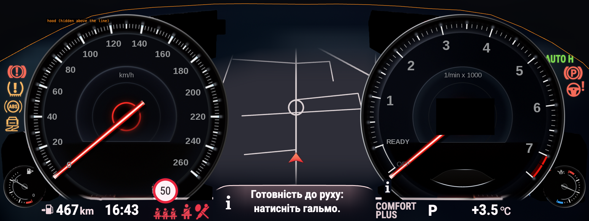
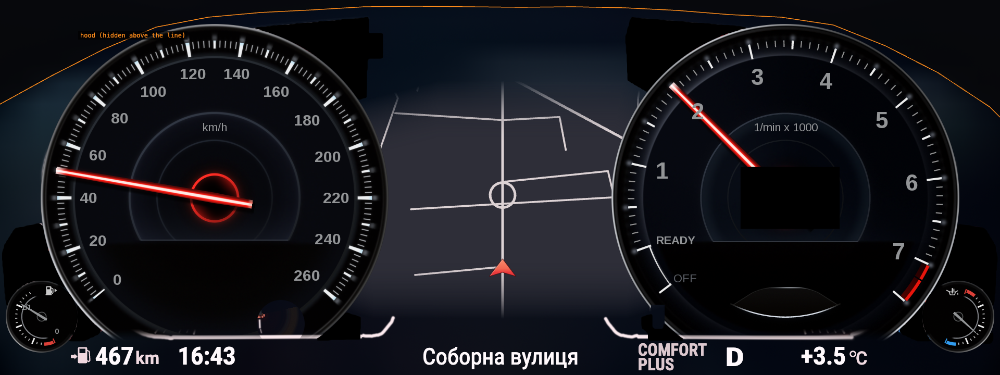

# G20 simulation on the bench: report

Brief: `docs/AGENT-BRIEF-g20-sim.md`. Package reports: `docs/G20SIM-B-structure.md` (static dials), `docs/G20SIM-C-icons-text.md` (icons, text), `docs/G20SIM-D-live.md` (pointers, minis, map). Branch: `g20sim/integrate` (local only).

**Bench only.** Nothing here goes into the app, the layouts or the car. On the car it would cover BMW's real lamps.

## 1. What you get

With "stock cluster backdrop" on, the bench now draws BMW's stock G20 Comfort cluster under the theme. It also draws what BMW draws over a theme: the (P), the driver's belt lamp, the bottom-row gear letter and the black area. Everything is our own drawing, fitted to the rectified car photos 08–14. No photo pixels and no BMW fonts are shipped.





The owner's four screenshots: `wb_dials` over the simulation, car view on (hood line), Comfort.

| | At rest | 50 km/h, 2000 rpm |
|---|---|---|
| `start-up check` lamps | [wb_dials_rest_startup.png](g20sim/wb_dials_rest_startup.png) | [wb_dials_50kmh_2000rpm_startup.png](g20sim/wb_dials_50kmh_2000rpm_startup.png) |
| `driving` lamps | [wb_dials_rest_driving.png](g20sim/wb_dials_rest_driving.png) | [wb_dials_50kmh_2000rpm_driving.png](g20sim/wb_dials_50kmh_2000rpm_driving.png) |

"At rest" in the driving shot is engine at idle (750 rpm), gear D. The start-up shot has the engine off (rpm 0), so the stock tacho shows OFF.

## 2. How to use it

```sh
rm -rf dist bench/.data && node bench/server.js f30_cluster      # http://localhost:8078
curl -X POST localhost:8078/drive -d '{"value":4}'                 # Comfort
curl -X POST localhost:8078/setting -d '{"key":"inComfort","value":"wb_dials"}'
```

Tick "stock cluster backdrop". The "G20" box in the right column then holds these controls:

- **Lamps:** the presets `start-up check` (every panel lamp lit in 08, plus the "ready to drive" message, the 50 sign and gear P), `driving` (no lamps, no message, gear D) and `custom`. There is one checkbox per lamp. The four physical housing LEDs (low beam, side lights, check engine, DSC OFF) are listed greyed out: they sit outside the 1920×720 panel and are never drawn.
- **Other controls:** the speed-limit sign (none, 30…130), the check-control message (none / "ready to drive"), the gear letter (P R N D S), and day/night (night is the default).

The theme counts as connected while the app runs and has a layer on the panel. The layout `off` draws none, so the simulation then shows BMW's stock layout (08/09). With any layout on, it shows BMW's alternate layout (14). The drive mode is read from the server's `/drive` log line.

**URL flags** (for headless screenshots):

| Flag | Sets |
|---|---|
| `?g20=startup\|driving` | the lamp preset |
| `&day=1` | the day look |
| `&g20limit=50\|none` | the speed-limit sign |
| `&g20cc=ready\|none` | the check-control message |
| `&g20gear=P` | the gear letter |
| `&g20lamps=id,id` | a custom lamp set |
| `&g20time=16:43` | a fixed clock |
| `&g20street=…` | the street name |
| `&g20conn=0\|1` | forces the state (QC) |
| `&g20dbg=outline\|gauges` | debug views |
| `&g20glow=<gain>` | the glow gain (calibration) |
| `&g20fill=b\|d\|both` | which package's mini fill is drawn |

**Regenerate:**

| What | Command |
|---|---|
| Manifest | `python3 tools/g20sim/build_manifest.py` |
| B's layers | `bake/src/G20/structure/build.py`, see its report |
| D's parameters | `bake/src/G20/live/build_params.py` |
| QC shots and owner shots | `tools/g20sim/qc_shots.sh all`, with the bench running |
| QC numbers | `tools/g20sim/qc.py` |
| Glow calibration | `tools/g20sim/calib_glow.py` |
| Pointer sweep | `tools/g20sim/pointer_sweep.sh` then `pointer_sweep.py` |

Python runs as `UV_CACHE_DIR=… uv run -q --no-project --with opencv-python-headless --with numpy --with pillow --with scipy python …`.

## 3. Assembly (packages A–E)

| Pkg | Delivered | Files |
|---|---|---|
| A | the hook in `bench/page.html`, `GET /g20/*` in `bench/server.js` (static, inside `bench/g20/` only, no `..` and no dot files), the G20 controls, a stub that drew the catalogue polygons | marked `G20SIM` |
| B | the static stock dials, minis and background: 42 PNGs, 21 layers per look (night and day), 2.05 MB | `bench/g20/structure/`, `bake/src/G20/structure/` |
| C | `G20C`: telltales, belts, airbag, bottom row, digital speed, labels, sign, check-control panel, centre and bottom-row mode label and gear; vector, Roboto (OFL) | `bench/g20/c.js`, `bench/g20/fonts/` |
| D | `G20Live`: the stock pointers, their glow, the tacho rev band, the minis' needles and fill, the synthetic map; every parameter in one table `PARAMS` | `bench/g20/live/live.js` |
| E | `bench/g20/g20sim.js` behind the §5 interface, the manifest builder, QC, the glow calibration, the sweep, this report | `tools/g20sim/` |

Draw order, bottom to top:

1. B's background;
2. D's map;
3. B's dials (z 20–49);
4. D's gauges (z 50–59);
5. B's "0 km/h" scale label (z 58: it lies over the stock pointer in 08/09);
6. C's under-elements.

Then the app's layers, then C's over-elements, then the black area (theme connected only).

`bench/g20/` is 2.6 MB of the 12 MB budget.

**Lead decisions where packages overlapped:**

1. **The tacho "0".** B baked it and C draws it live (it swaps with OFF). C's is used; B's entry is marked `skip` in the manifest.
2. **The minis' fill.** B (a grey level fill clipped live at D's needle line) and D (a lit fill) model the same pixels. B's alone matches 08 within about 5 levels across the fuel mini; together they double. Default: B's. D's fill is switched off through `PARAMS.fuel.fill.v.enabled`.
3. **The pointer glow gain.** It was calibrated on the assembled simulation (`tools/g20sim/calib_glow.py`, least squares in the pointer zones over B's faces): 08 speedo 0.47, tacho 0.58; 09 speedo 0.63, tacho 0.73. D's `PARAMS.glow.gain` is now **0.6** (was 1.0, fitted on a stand-in face), also in `build_params.py`. With it the pointer zones go from 0.771 / 8.6 to 0.788 / 8.1 on 08.
4. **Drawing over a theme.** `drawCarView()` keeps the hood but no longer draws its red stand-in boxes for the black area, belt and (P) while the simulation is on: the simulation draws the real ones.

## 4. Evidence per element group

| Group | What is drawn | Evidence |
|---|---|---|
| Stock dials (B) | frames, ticks, numerals, red-orange band glow, wing faces, rev band, info lines (the tacho one stock only), bottom lines with curved ends (hidden under the check-control panel), fuel and oil minis | **strong** for geometry and night/day colour (08, 09). **Weak:** the faces under the pointer glow (continued from above), the map veil, the oil fill above its needle, the speedo's 0 tick and wing end (mirrored from the tacho) |
| Pointers (D) | a 6 px bar on a ray from a virtual centre to the scale point, value → scale point by the 130 measured ticks; glow, dark rim and shadow; tacho rev band from 0 to the pointer | tick tables **strong** (tips within 0.85 px of every numeral); orientation in motion, speedo centre, glow above idle, band above idle **weak**: only 0 and idle were ever photographed |
| Short tacho bar | with a theme connected, BMW draws the tacho bar 109 px long instead of 187 px (14 and 10 agree) | medium |
| Minis' needles (D) | fuel from `fuelL` / 65 L, oil from `oil` on 70–150 °C | needle geometry medium (1.9 px); **the oil range is a guess (weak)** |
| Map (D) | our own seeded street layout in `map.region`, edge fade, red arrow, drift at 1 px per metre | colours and widths medium; layout **none** (synthetic by design); scale weak |
| Telltales (C) | lit looks of brake, TPMS, ABS, DSC, AUTO H, (P) red and green, steering, rear belts, driver belt, airbag; unlit = nothing drawn (measured in 09/14) | lit looks strong (08; AUTO H and green (P) in 09/14); airbag drawing medium; halo weak |
| Bottom row (C) | range + pump, clock, street, temperature; the mode label and the gear when connected | positions strong; one-digit hours, minus temperatures, SPORT / ECO PRO **none** (never photographed) |
| Assist (C) | digital speed, "1/min x1000", OFF (rpm < 200), COLD (oil < 40 °C, engine running), sign (30…130), check-control panel with "i" and the 08 message, `info_tacho` "i" | OFF and COLD rules **weak**; three-digit sign **none** |
| Over (C + E) | (P), driver's belt, bottom-row gear, black area | strong (11–14) |
| Not drawn | low beam, side lights, check engine, DSC OFF | physical LEDs outside the panel (`g20_comfort.json` `excluded`): no canvas can show them |

**Free font:** Roboto, variable (SIL OFL), at width 87.5 and weight 700 for the bold labels.
- Its digit widths match the photos within 1–3 % (467: 72 px against the photo's 70; 16:43: 106 against 105).
- Inter and Arimo are 11–17 % too wide, and Barlow has no Cyrillic (the car is in Ukrainian).

## 5. QC (brief §6)

**How it was measured:**
- **The image compared:** the bench's own screenshot (headless Chrome, `car=0`) against the rectified photo.
- **The state of each render:**
  - 08: stock, night, start-up lamps, rpm 0, 16:43.
  - 09: stock, day, AUTO H and green (P), 50 sign, gear D, rpm 700.
  - 14: theme connected (forced with `g20conn=1`, layout off), AUTO H, green (P), driver's belt, 30 sign, gear P, rpm 720, oil 30 °C. It is shown in both looks.
- **ROIs and masks:** B's, plus glare, plus our 0.7.2 texts in 14. Our texts were masked in 14 instead of drawn, which compares the same pixels.
- **Not masked:** unlike B's own QC, the pointer zones stay in: D's glow is drawn.
- **Metrics:** SSIM on luminance and mean ΔE2000 from `bake/src/qc.py`.
- **Output:** review sheets in `bake/work/g20sim/E/qc/` (local).

| Group (SSIM / ΔE) | 08 night | 09 day | 14, day look | 14, night look |
|---|---|---|---|---|
| B speedo frame+band | 0.860 / 6.8 | 0.848 / 7.0 | 0.734 / 11.5 | 0.703 / 13.1 |
| B speedo face | 0.898 / 3.8 | 0.901 / 4.4 | 0.889 / 9.2 | 0.871 / 11.4 |
| B tacho frame+band | 0.839 / 6.9 | 0.809 / 7.6 | 0.709 / 10.8 | 0.708 / 11.0 |
| B tacho face | 0.921 / 3.0 | 0.924 / 3.4 | 0.899 / 6.1 | 0.837 / 7.7 |
| B rev band | 0.798 / 6.6 | 0.671 / 8.7 | 0.587 / 12.9 | 0.788 / 10.0 |
| B info lines | 0.876 / 5.9 | 0.860 / 6.4 | 0.575 / 7.4 | 0.491 / 6.7 |
| B fuel mini | 0.760 / 6.3 | 0.687 / 8.6 | 0.741 / 8.5 | 0.767 / 8.2 |
| B oil mini | 0.695 / 6.3 | 0.640 / 8.0 | 0.576 / 8.5 | 0.484 / 7.7 |
| B bottom lines | 0.750 / 12.1 | 0.765 / 11.8 | 0.374 / 18.4 | 0.393 / 18.3 |
| B background | 0.967 / 0.9 | 0.964 / 1.2 | 0.812 / 7.3 | 0.578 / 8.1 |
| D pointer zones (bar + glow) | 0.788 / 8.1 | 0.793 / 8.9 | 0.744 / 9.6 | 0.729 / 9.5 |
| D map region (synthetic) | 0.804 / 4.7 | 0.772 / 7.1 | 0.683 / 9.0 | 0.631 / 11.4 |
| C telltales | 0.692 / 14.6 | 0.672 / 13.7 | 0.333 / 21.4 | 0.310 / 22.6 |
| C bottom row | 0.589 / 12.2 | 0.679 / 11.8 | 0.578 / 10.6 | 0.531 / 11.0 |
| C assist/message | 0.700 / 9.2 | 0.674 / 10.9 | 0.552 / 13.1 | 0.516 / 13.0 |
| Black box (over) | – | – | 0.082 / 6.0 | 0.079 / 6.0 |
| **Whole panel** | **0.861 / 4.2** | **0.854 / 5.0** | **0.750 / 8.5** | 0.637 / 9.7 |

**14 is a day photo.** Its clock reads 10:15, and every group scores better with the day look (B measured the speedo face's luma bias at +1.5 with the day look against −27 with the night look). The brief's "08 and 14 (night)" does not hold. The 14 column to read is "day look".

**Why some groups are below 0.85:**
- **Crisp shapes against a blurred photo.**
  - This drags down the telltales, texts, rev band, info lines and minis.
  - C measured that blurring our render with the camera's fitted blur alone adds 0.1–0.35 SSIM; the bottom-row P reaches 0.90.
  - The text is in another font (Roboto vs BMW Type Next), so the glyph edges are 1–2 px out of phase even where the boxes match.
- **Photo 14:**
  - its rect is 2–3 px off against 08/09 on 6 px lines (the bottom line's y at x 320: 08 646.5, 09 647.0, 14 648.8);
  - it has haze over the map and the speedo's inner area;
  - it has a teal reflection on the left edge;
  - AUTO H and (P) score about 0 there from a 3–4 px offset, while the same drawings score 0.63–0.74 on 08/09.
- **Bottom lines:**
  - their box holds the lower end of the pointer glow;
  - in the photos the glow fades out a few px above the bottom frame line, while D's glow is clipped at the face polygon without that fade: at x 320, y 638 ours reads about 65 red where 08/09 read about 25 (open point 4);
  - B's own score without the glow is 0.817 / 7.7 on 08.
- **Rev band:** a fine dotted texture inside the segments is not modelled.
- **Map:** it is synthetic, with different roads by design. Only the background, road colour and width are fitted.
- **Black box:** SSIM is meaningless on a flat black area against sensor noise. ΔE 6 is the noise floor.
- **Airbag (0.31):** an approximate redraw of a pictogram seen once.

**Geometry (2 px):**

| Package | Result |
|---|---|
| C | within 2 px of `g20_comfort.json` on 08/09. Except: the airbag's right edge +3; the rpm label −3 on 08 (+1 on 09: the photos disagree by 4 px); the sign ±4 in x and the check-control panel's right edge, where B's bottom line runs through the catalogue box; and the centre mode label, where a map road crosses it. On 14: 3–4 px, inside that rect's accuracy |
| B | within 2 px except these re-measured edges: the speedo's "260" reaches x 727 (catalogue hull 704); the rev band's bottom is 5 px lower; each info line is two segments; the minis' frames follow the photo's white line (the catalogue hulls include the needles) |
| D | the pointer tips hit every numeral (0/20/40/60/100/140/200/260 km/h, 0…7 ×1000 rpm) within 0.85 px; at rest the bars match 08/09/14 within 1–2 px |

## 6. The owner's question: the stock pointers under wb_dials

Measured on the real bench (`tools/g20sim/pointer_sweep.sh` / `.py`). For each value pair:
- **The two renders:** `wb_dials` over the simulation's gauges alone (`?g20dbg=gauges`: stock pointers, glow, rev band, minis' needles over black), and `wb_dials` over black.
- **What counts as visible:** a pixel where the two differ by more than 12 levels. That is a stock pointer or glow pixel the driver would see through our layout.
- **Car view:** off.

| Speed km/h | rpm | Visible stock px (speedo side / tacho side) | Max y | Px at y ≥ 656 |
|---|---|---|---|---|
| 0 | 0 | 4630 (2215 / 2415) | 650 | 0 |
| 0 | 750 (idle) | 4078 (2215 / 1863) | 650 | 0 |
| 5 | 900 | 3737 (2155 / 1582) | 650 | 0 |
| 10 | 1000 | 3339 (1964 / 1375) | 650 | 0 |
| 20 | 1200 | 2251 (1279 / 972) | 650 | 0 |
| 50 | 2000 | 18 (8 / 10) | 580 | 0 |
| 100 | 3000 | 18 (8 / 10) | 580 | 0 |
| 140 | 4000 | 18 (8 / 10) | 580 | 0 |
| 200 | 5500 | 142 (89 / 53) | 580 | 0 |
| 260 | 7000 | 174 (87 / 87) | 580 | 0 |

Images: `bake/work/g20sim/E/sweep/vis_<speed>_<rpm>.png` (local). Visible pixels are green, and the cut is the red line.

**Where the stock pointers pass, relative to y 656 and our collar:**

1. **Nothing reaches y 656.**
   - At rest the outer ends are the lowest points: the speedo bar at y 644, the tacho bar at 646, their glow at 649–650, and the minis' needles at 643.
   - On the G20 the pointers climb away from the cut as the value rises.
2. **At rest and at low speed, the stock pointers' outer ends and their glow show under our dials.**
   - The reason: `wb_dials` fades its big dials out at the bottom. Its pixels in a strip of about y 634–656 are partly see-through; this is not a hard cut at 656.
   - The strips: x 283–496 under the speedo and x 1425–1636 under the tacho.
   - The brightness: up to 86 levels on the speedo side (the glow, and the bar's end at x 372, y 640). On the tacho side up to 154 (the bar's end at x 1546, y 645), with the glow fading out from there.
   - When it stops: it shrinks as the pointers lift and is gone by 50 km/h / 2000 rpm.
   - In plain words: at standstill and when pulling away, a thin red-orange sliver of BMW's pointer glow, plus the bar's tip on the tacho side, can show just under our dials' fade. It does not show above y 634, and it does not reach the bottom row.
3. **At high values, the stock bars' inner (top) ends show outside the collar.**
   - From about 200 km/h and 5500 rpm, the stock bars run along the top of the scales: x 500–530, y 57–67 above the speedo and x 1395–1410, y 60–65 above the tacho, plus a 1 px column at (1209, 35–38) by the stock "7".
   - Count: up to 87 px per side at 260 km/h / 7000 rpm.
   - Most of it is above the hood line (y ≈ 20–35 there), so the driver may not see it at all. Check it with the owner's eye.
4. **The minis' needle tips.** About 8–10 px of each stock mini needle's tip show beside our minis: (92, 476) and (1777, 577). They are constant, because the needles do not depend on speed.
5. **The model's sweep disagrees with the bench.** D's offline sweep found nothing visible below the collar and at y ≥ 656, because it assumed our dials opaque down to y 656. The bench shows the layout's real fade (point 2) and a coarser collar than the plan's mask (point 3). The bench numbers are the ones to trust; both rest on the pointer model, whose motion is weak evidence.

**The owner's photo at about 50 km/h and 2000 rpm settles it.** Compare it with `wb_dials_50kmh_2000rpm_driving.png` and with `bake/work/g20sim/E/stock_50kmh_2000rpm_driving.png` (the simulation alone). Correct `G20Live.PARAMS`:
- `speed.centre` / `rpm.centre`: the virtual centres;
- `orient`: `ray` or `tick`;
- `len`, `glow.*`.

## 7. Open points

1. **Stock pointers in motion (weak).** Only 0 and idle were photographed. The ray model fits the three tacho poses (angle error 0.00–0.29°) but is extrapolated above about 1500 rpm, and the speedo's centre is mirrored from the tacho. One photo at about 50 km/h and 2000 rpm settles it (§6).
2. **LCD brightness, night vs day.**
   - 08 (night) and 09 (day) were taken 7 minutes apart and the camera's auto exposure evens them out. The day look is fitted to 09 as photographed: the dark surfaces follow 09 ≈ 0.71 × 08 + 22, and the whites clip in both.
   - Neither photo measures the panel's real luminance.
   - A night photo with a fixed exposure next to a day one would settle the dimming.
3. **14 is a day photo** (clock 10:15, see §5). There is no theme-connected night photo.
4. **The pointer glow near the bottom line.** In the photos the glow fades out a few px above the bottom frame line. Ours is clipped at the face without that fade, so it is about 40 levels too red there. A fade in D's `glow.q0/q1` (the depth window) or in the face mask would fix it. This is exactly the strip that shows through the bottom fade of `wb_dials` at rest (§6, point 2). So until a car photo shows how bright BMW's glow really is just above that line, the bench overstates that sliver.
5. **The minis' fill.** B's fill has a hard inner edge (fuel about x 105–125, y 500–535; oil about x 1755–1780) where the photo fades. The oil range 70–150 °C is a guess.
6. **Elements never photographed** (evidence none): SPORT / ECO PRO labels, a three-digit sign, minus temperatures, a one-digit hour, other check-control messages, what triggers the `info_tacho` "i", gear letters R/N/S, a cold engine running in the stock layout.
7. **The sign window.** In `wb_dials` with no sign set, the window shows the stock frame's end tick and the tail of the stock "km/h" label (about x 497–505, y 600–640). This is what the car would show if the model is right.
8. **Photo-derived tables.** B's soft layers (background, band glow, wing faces) come from binned and smoothed tables fitted along each dial's curves, with the crisp content masked out (`bake/src/G20/structure/params/*.npz`). That is the same method as the 6WB bake's gradient fits: no photo pixels are shipped. The tables are low-frequency averages of the photos, though, and live in the repo (2.2 MB). If that is too close to the photos for the owner's taste, they can be replaced by a fitted polynomial per curve at some cost in SSIM.

**Update 2026-11-12 (polish C, `docs/POLISH-C-REPORT.md`):** the background is now pure black, the tables are cleaned of what the camera and the cabin added (`bake/src/G20/structure/clean_soft.py`), and the QC above predates it: against the photos the background and frame groups now score lower by design (the photos' lit-up black is gone).
9. **Machine paths.** The scripts find the git-ignored evidence (`reference/`, `bake/work/overlay/rect/`) from the repo root, or from `F30_MAIN` when run in a worktree.
10. **The controls.** Every control path was exercised through the URL flags (presets, lamps, limit, message, gear, day, time), which set the same state as the UI. The UI handlers themselves were not clicked headlessly. Open the page and try them.
