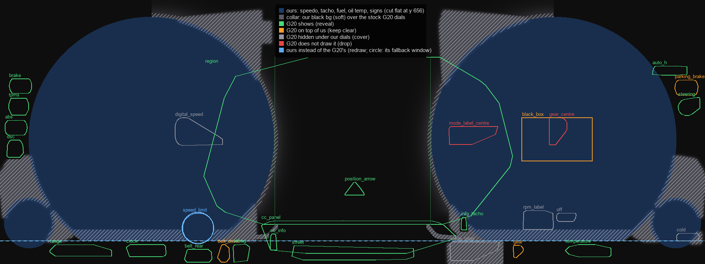
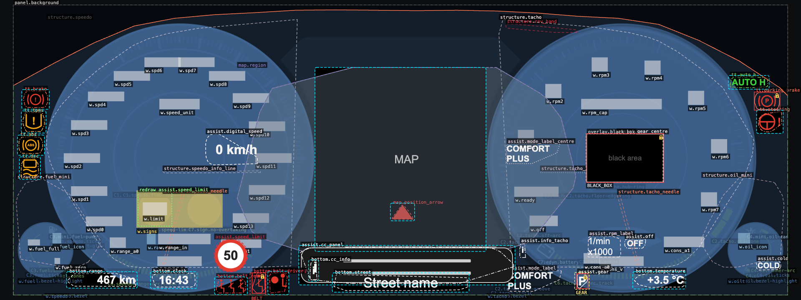

# Plan: our dials, everything else from the G20

The aim is to keep our four 6WB dials (speedo, tacho, fuel and oil temperature) and let the stock G20 cluster draw everything else.

- Scope: Comfort, the `panel` target. This builds on the overlay map (`docs/OVERLAY-REPORT.md`, `design/overlay/`).
- Status: built as the layout "6WB Dials + G20" (`wb_dials`). The sections below are the original proposal.
- **Update (polish B, 2026-11-12, `docs/POLISH-B-REPORT.md`):**
  - The collar is pure black and soft. `plan_dials.py` now writes `collar.dials.png` as the final soft coverage: the collar over the stock dials (grown 6 px, blurred σ 4), a band under our dials' faded bottoms (y 626–656), a shade at our dials' inner edges toward the map, and a black patch over the bottom-row COMFORT PLUS. Every G20 item we show, and 3 px round it, stays clear.
  - The speed-limit sign is ours (`redraw`): the `wbsign` under the speed hub, as in 6WB Comfort. BMW's sign shows through the round window only while we have no limit. Today `app.json` `config.limit` is null, so on the car the window stays open.
  - The windows (sign, check-control "i") have soft edges.
  - The stock bottom line stays visible from BMW's frame corners (the hooks) to our dials' edges and runs on under them.
- **Update (polish F, 2026-11-13, `docs/POLISH-F-REPORT.md`):**
  - The stock bottom lines, their curved end hooks and the grey dash are under black: `plan_dials.py` writes `cover.dials.png` (full size, from photos 09 and 08), packed as the scene texture `cover`. It keeps 3 px clear of the check-control frame, its text and its left "i". Where the left hook crosses the "i"'s dot, a 92 px stub of it stays.
  - The shade at our dials' inner edges is drawn by WBBACK at the strength the `dialShade` setting picks. It is no longer in the collar.
  - The range, the clock and the outside temperature are BMW's or ours by setting (`ownRange`, `ownClock`, `ownTemp`). Ours are drawn at BMW's places over black patches. Our drive-mode label (`modeLabel`) and the gear in our tray (`gearTray`) are on the tacho.



Key to the scheme:
- **Blue:** our dials after the change.
- **Hatched:** the collar, where our background stays opaque.
- **Outlines:** G20 elements, coloured by decision:
  - green: shows through (reveal);
  - orange: BMW draws it on top of us;
  - grey: hidden under our dials;
  - red: BMW does not draw it with a custom theme.
- **Dashed line:** the cut at y = 656.

## 1. The idea

Two facts from the G20 catalogue (`design/overlay/g20_comfort.json`) make this simple:

- **Every stock G20 dial graphic ends at y ≤ 652.** This covers the scales, needles at rest, the rev band and both stock minis.
- **The G20 bottom row starts at y ≥ 659.** It holds the range, clock, belts, airbag, street, COMFORT PLUS, the gear letter and the outside temperature.

Five changes follow from that:

1. **Cut both big dials flat at y = 656** ("horseshoe" dials). Below the line the G20 bottom row shows through. Our scales end at y ≈ 580 and our needles never go lower:
   - the speedo sweeps 230° → 130°, with an empty sector of 100° at the bottom;
   - the tacho sweeps 250.5° → 131.25°.

   So the cut removes only the bottom of the bezel ring and the empty floor of the dial.
2. **Add two small windows above the line:**
   - a round one for the G20 speed-limit sign, `[494, 577, 584, 667]`, r 45. It sits in the empty sector of our speedo.
   - one for the check-control "i" left of the tacho, `[1252, 587, 1274, 631]`.
3. **Make our background transparent** except a **collar** (`design/overlay/collar.dials.png`). The collar covers the parts of the stock G20 dials that stick out past ours:
   - the "200…260" arc above the speedo;
   - the "7" and redline band above the tacho;
   - the stock fuel and oil minis at both sides.
4. **Move the fuel and oil minis up 20 px** (centre y 628 → 608). Then the G20 range ("467 km") clears our fuel mini. The minis still clear the left lamps: our fuel mini starts at y 538, and the DSC lamp ends at y 429.
5. **Drop everything of ours that is not a dial:**
   - the middle window, info bar and horizon;
   - our speed-limit signs;
   - the range and consumption arcs and texts;
   - eDynamics;
   - the bottom-row texts.

   The G20 shows its own versions. Our READY/OFF stays, because it belongs to our tacho.

## 2. What the car would show

The visible share is computed on the 1 px rasters: G20 element pixels not under our remaining shapes or the collar. Our masks use alpha ≥ 64.

| G20 element | Relation | Safety | Decision | Visible |
|---|---|---|---|---|
| Left lamps `tt.brake`, `tt.tpms`, `tt.abs`, `tt.dsc` | unknown | critical | reveal | 100 % (no hole needed) |
| `tt.steering`, `bottom.airbag`, `assist.cc_panel` | unknown | critical | reveal | 100 % |
| `bottom.belt_rear` | unknown | critical | reveal | 100 % (below the cut) |
| `tt.parking_brake` (P), `bottom.belt_driver`, `assist.gear`, `overlay.black_box` | over | — | keep-clear | BMW draws them on top |
| `bottom.range`, `bottom.clock`, `bottom.temperature`, `assist.mode_label`, `bottom.street` | under | info | reveal | 100 % |
| `assist.speed_limit` | under | info | reveal | 100 % (round window) |
| `assist.info_tacho`, `bottom.cc_info`, `map.position_arrow` | unknown / under | info | reveal | 100 % |
| `tt.auto_h` | unknown | info | reveal | 94 % (the left edge of the A stays under our tacho bezel) |
| `map.region` | under | info | reveal | 65 % (the gap between the dials, `[748, 155, 1172, 612]`) |
| `assist.digital_speed` (big "0 km/h") | under | info | cover | 0 % (our needle shows the speed) |
| `assist.rpm_label`, `assist.off`, `assist.cold` | under / unknown | info / cosmetic | cover | 0 % (our tacho and oil gauge show the same) |
| `structure.*` (stock scales, needles, rev band, minis) | under | — | cover | about 1–2 % of the convex hulls (see §5) |
| `assist.mode_label_centre`, `assist.gear_centre`, `structure.tacho_info_line` | gone | info / cosmetic | drop | BMW does not draw them; the bottom-row label and gear show instead |

**Safety:**
- All 8 critical unknown lamps show, with no holes to maintain, because our background is transparent there.
- No critical element is covered, so this plan is safer than `plan.safe.json`.
- Settling the unknowns (`docs/OVERLAY-PHOTO-PROTOCOL.md`) no longer blocks the theme.

**What we give up:**
- our range arc, consumption arc, eDynamics battery and info-bar texts (the G20 shows its own range; consumption is not shown);
- the 6WB look of a closed round dial at the bottom.

## 3. The plan file and the constructor

- **Plan:** `design/overlay/plan.dials.json` follows the constructor's plan schema and validates. To open it, run `python3 -m http.server 8000` from the repo root and go to `http://localhost:8000/tools/overlay/constructor/?plan=design/overlay/plan.dials.json`.
  - It hides the 30 elements of ours that are not dials (20 of them drawn on the car today, `w.bg` included).
  - It moves the `mini.fuel` and `mini.oil` anchors by dy −20.
  - It sets the decisions above, with one hole per reveal. The map and sign holes are edited by hand.
- **Conflicts:** 47.
  - **7 errors `content-under-over`:** the black box over our tacho hub, and the bottom-row gear "P" over our tacho. Both exist today, and BMW draws them on top. The "P" one goes away with the cut at y 656, but the constructor does not model the cut.
  - **24 warnings `hole-cuts-content`:** these are the intended windows. They are the cut (range, clock, rear belts, temperature, COMFORT PLUS), the sign window and the "i" window. The one exception is `tt.auto_h`, which is not cut; we accept its 6 %.
  - **16 info:** the four G20 items we cover on purpose.
- **Outside the schema:** the plan schema has no field for the collar or for a cut of a dial. They live in `collar.dials.png` and in this document.



## 4. What to change in the theme (needs the owner's go)

| # | Where | Change | Budget |
|---|---|---|---|
| 1 | `design/gen_6wb.py` → `apps/f30_cluster/hud/layouts/wb_comfort.json` | Remove these widgets: `signs`, `limit`, `range_*`, `cons_*`, `row_*`. Remove the `window`, `horizon` and `line` textures from `bg`. Remove C6's range and eDynamics arcs and C7's battery from the bake. Set the `fuel` and `oilt` widgets to y 538 (was 558). | frees textures and layers |
| 2 | WBBACK (`shared/`) | Draw `bg` only where the collar mask is set: a new `tex.collar`, an R8 texture at ¼ scale (480 × 180), sampled bilinear with threshold 0.5, so the edges are 4 px steps. The rest of the background is alpha 0. The texture must always stay bound (RAMSES skips a layer with an unbound sampler). | 480·180·8 ≈ 0.7 MB of 16 MiB; 1 sampler; 0 extra uniforms |
| 3 | WBDIAL (`shared/`) and the baked C1/C2 layers (`bake/src`) | Discard pixels at panel y ≥ 656, plus the two windows: one `vec4 u_cut` (cut y, sign window centre and radius) and one `vec4 u_win` (the "i" rect). For the baked layers, either the same discard in their effect, or alpha cut in the bake. | +2 uniform slots per dial effect: check WBDIAL's count against 32 first (see cd6ac29) |
| 4 | `shared/visible.js` | Add BMW's (P) `[1838, 217, 1900, 260]` and the gear letter (side findings in `docs/OVERLAY-REPORT.md`). Once our background is transparent, `BELT`, `BLACK_BOX` and the (P) only matter for our dials. | — |
| 5 | Bench | The bench car view draws the cut, the windows and the collar. The P10 renders give the "before" image. | — |
| 6 | Car | One photo at rest and one at about 2000 rpm and 50 km/h (passenger seat). Check the points in §5. | — |

**Order:** do 1 and 2 first. They alone give a usable result: the G20 shows around the dials, and the 8 critical lamps are visible. The bottom row stays hidden until 3 is done.

## 5. Open points and risks

1. **Stock needles while moving.** The catalogue has the G20 needles only at rest, pointing down to y 645 and 647. The scale shapes suggest they move up and away from the cut. If a stock needle reaches below y 656 anywhere in its travel, it will show under the cut. Needs a photo while driving.
2. **The collar comes from convex hulls of the stock dials.** These are larger than the real lines. About 8,800 hull pixels fall inside the map gap and around the "i", where the collar must stay open. Thin stock outline lines may show at the edges of the map gap. To check: photo, or a finer catalogue of the stock dial outlines.
3. **The "260" label reaches x 727,** past its hull (x 704). It was measured on rect 08 and 09 and added to the collar by hand (`EXTRA_COLLAR` in the script).
4. **The map is only partly visible:** our dials cover about 35 % of it. With a route active, the G20 map may want the full area; this plan does not give it.
5. **`assist.off` and `assist.info_tacho`** are still `unknown`. The "i" window is cheap, so it is kept. A window for "OFF" would show the stock tacho needle at rest, so it is covered.
6. **Style:** open-bottom dials are a departure from the closed 6WB rings. A softer option is to end the bezel ring with a short fade at the cut, instead of a hard edge. This is a design decision for the owner.

## 6. Reproduce

```sh
export UV_CACHE_DIR=bake/work/.uvcache
uv run -q --no-project --with numpy --with pillow python tools/overlay/plan_dials.py   # plan, collar, scheme
python3 tools/overlay/headless.py --plan design/overlay/plan.dials.json               # conflicts + screenshots
uv run -q --no-project --with jsonschema --with pillow python tools/overlay/validate.py
```

The constants at the top of `tools/overlay/plan_dials.py` set the cut line, the windows, the mini move and the extra collar. Change them there and re-run.
