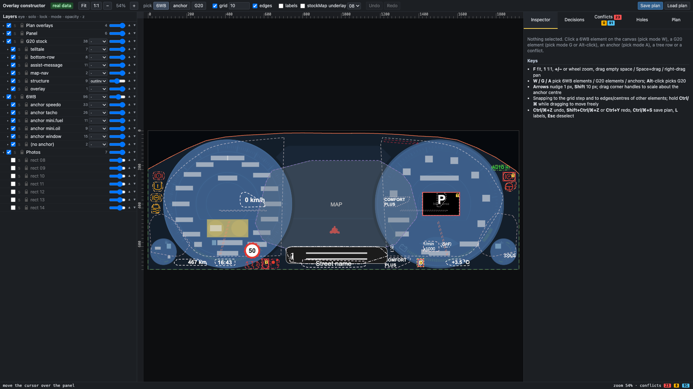
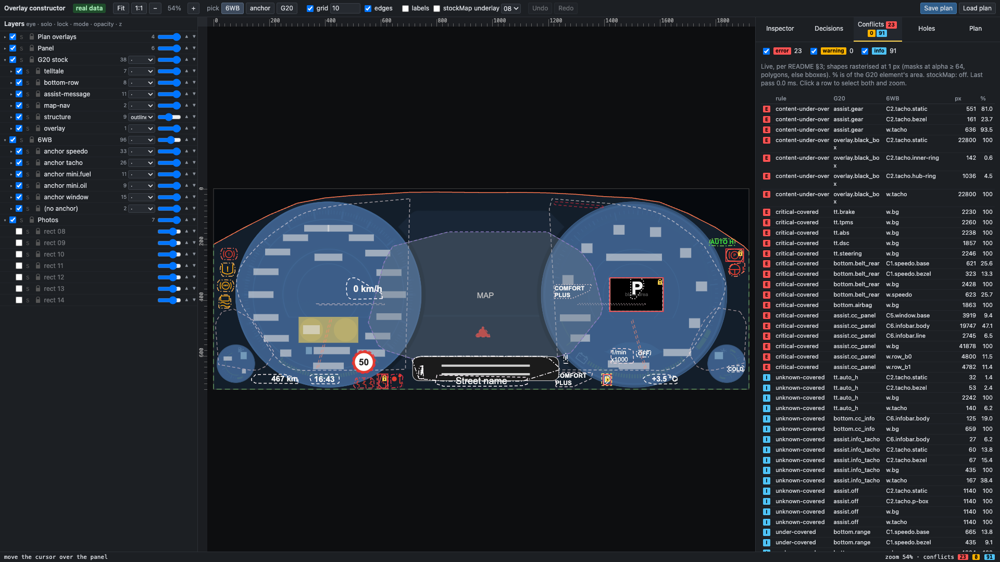
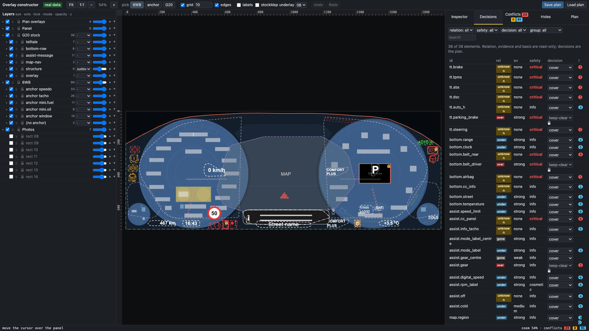
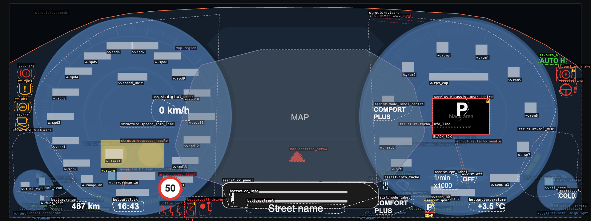

# Overlay report: stock G20 cluster vs our 6WB Comfort (panel)

Scope: Comfort only, the `panel` target, the current `wb_comfort` layout. Brief: `docs/AGENT-BRIEF-overlay-constructor.md`. Data: `design/overlay/` (start with its `README.md`). Constructor: `python3 -m http.server` from the repo root, then open `http://localhost:8000/tools/overlay/constructor/`.

## 1. The answer in one table

| Can I… | G20 elements | Why |
|---|---|---|
| **Not hide; must stay clear** (BMW draws them on top of us) | `tt.parking_brake` (red (P), right column), `bottom.belt_driver`, `assist.gear` (bottom-row P), `overlay.black_box` | Seen on top of our opaque theme in 11, 12, 13 (strong). The (P) is **new**: `shared/visible.js` does not know about it yet. |
| **Keep, or hide, as I choose** (BMW still draws them under us: `reveal` to keep, `cover` to hide) | `bottom.range`, `bottom.clock`, `bottom.street`, `bottom.temperature`, `assist.speed_limit`, `assist.mode_label` (bottom-row COMFORT PLUS), `assist.digital_speed` ("0 km/h"), `assist.rpm_label` ("1/min x1000"), `assist.cold` (medium), `map.region`, `map.position_arrow`, and the stock dials themselves (`structure.*`: scales, needles, rev band, fuel and oil minis) | Seen in 10 (our grid drawn over them) and 14 (our text only), hidden in 11–13 where we are opaque. 19 elements: 17 strong, 2 medium (`assist.cold`, `structure.speedo_info_line`). |
| **Must draw myself** (BMW does not draw them while a custom theme is up) | `assist.mode_label_centre` (big COMFORT PLUS left of the tacho hub), `assist.gear_centre` (big gear letter in the tacho hub; weak), `structure.tacho_info_line` | BMW switches to a different layout with a custom theme: the label and the gear move to the bottom row, and the black box covers the old gear spot. None of them is safety-relevant. |
| **Not settled yet** (needs the photo session in `docs/OVERLAY-PHOTO-PROTOCOL.md`) | `tt.brake`, `tt.tpms`, `tt.abs`, `tt.dsc`, `tt.steering`, `bottom.belt_rear`, `bottom.airbag`, `assist.cc_panel` (all **critical**), `tt.auto_h`, `bottom.cc_info`, `assist.info_tacho`, `assist.off` | Lit only in 08 (stock). In 10 and 14 they were off, and in 11–13 a lamp hidden under us looks the same as one that is off. |

What this means for the theme today:

- **Errors in the current layout (default plan, 23).**
  - 7 are our tacho drawn under BMW's own items. The black box covers our tacho hub (`C2.tacho.static`, `w.tacho`, hub and inner ring). The bottom-row "P" sits on our tacho's lower disc and bezel (81 % of the P's area over `C2.tacho.static`). Both are known and harmless to the driver, but anything we put there is invisible.
  - 16 are the 8 critical unknowns, covered by our background (and, for the rear belts, by the speedo's lower disc; for the check-control panel, by the info bar and the `row_b0`/`row_b1` texts).
- **The safe interim plan** (`design/overlay/plan.safe.json`) reveals the 8 critical unknowns: 8 holes, and no critical errors are left. Its cost is 5 warnings:
  - the rear-belt hole `[499, 675, 580, 719]` cuts 44 % into the speedo's lower disc;
  - the check-control hole `[708, 597, 1244, 695]` cuts the `row_b0`/`row_b1` texts.
  - The four left lamps, the steering lamp and the airbag hole sit in our plain background and cost nothing.
- **To keep BMW's own range, clock, street, temperature, speed-limit sign or map:** set `reveal` in the constructor. Their conflicts (info `under-covered`) show which of our layers would have to move. The map needs our speedo and tacho discs cleared off its 840 × 457 px bbox, or the stockMap hole that already exists. Range, clock and the 30 sign sit under the speedo's lower disc; the temperature under the tacho's.

## 2. Per-element table

Relation, evidence and safety come from `design/overlay/g20_comfort.json`. The default decisions follow the brief: over → keep-clear, critical + under → reveal, critical + gone → redraw, the rest → cover. Conflicts are from `design/overlay/plan.default.json`: E error, W warning, i info, with the first three of our elements involved (`w.bg` first).

| id | group | relation | evidence | safety | default decision | conflicts with current 6WB Comfort (default plan) | keep / hide / draw |
|---|---|---|---|---|---|---|---|
| `tt.brake` | telltale | **unknown** | none | critical | cover | E critical-covered (w.bg) | unsettled (photo 16) |
| `tt.tpms` | telltale | **unknown** | none | critical | cover | E critical-covered (w.bg) | unsettled (photo 16) |
| `tt.abs` | telltale | **unknown** | none | critical | cover | E critical-covered (w.bg) | unsettled (photo 16) |
| `tt.dsc` | telltale | **unknown** | none | critical | cover | E critical-covered (w.bg) | unsettled (photo 16) |
| `tt.auto_h` | telltale | **unknown** | none | info | cover | i unknown-covered (w.bg, C2.tacho.bezel, C2.tacho.static +1) | unsettled (photo 19) |
| `tt.parking_brake` | telltale | **over** | strong | critical | keep-clear | — | BMW keeps it; stay clear |
| `tt.steering` | telltale | **unknown** | none | critical | cover | E critical-covered (w.bg) | unsettled (photo 16) |
| `bottom.range` | bottom-row | **under** | strong | info | cover | i under-covered (w.bg, C1.speedo.base, C1.speedo.bezel +1) | keep (reveal) or hide (cover) |
| `bottom.clock` | bottom-row | **under** | strong | info | cover | i under-covered (w.bg, C1.speedo.base, C1.speedo.bezel +2) | keep (reveal) or hide (cover) |
| `bottom.belt_rear` | bottom-row | **unknown** | none | critical | cover | E critical-covered (w.bg, C1.speedo.base, C1.speedo.bezel +1) | unsettled (photo 16/18) |
| `bottom.belt_driver` | bottom-row | **over** | strong | critical | keep-clear | — | BMW keeps it; stay clear |
| `bottom.airbag` | bottom-row | **unknown** | none | critical | cover | E critical-covered (w.bg) | unsettled (photo 16) |
| `bottom.cc_info` | bottom-row | **unknown** | none | info | cover | i unknown-covered (w.bg, C6.infobar.body) | unsettled (photo 16/17/21) |
| `bottom.street` | bottom-row | **under** | strong | info | cover | i under-covered (w.bg, w.row_b0, w.row_b1) | keep (reveal) or hide (cover) |
| `bottom.temperature` | bottom-row | **under** | strong | info | cover | i under-covered (w.bg, C2.tacho.bezel, C2.tacho.static +2) | keep (reveal) or hide (cover) |
| `assist.speed_limit` | assist-message | **under** | strong | info | cover | i under-covered (w.bg, C1.speedo.base, C1.speedo.tick-groove-rim +3) | keep (reveal) or hide (cover) |
| `assist.cc_panel` | assist-message | **unknown** | none | critical | cover | E critical-covered (w.bg, C5.window.base, C6.infobar.body +3) | unsettled (photo 16/17/21) |
| `assist.info_tacho` | assist-message | **unknown** | none | info | cover | i unknown-covered (w.bg, C2.tacho.bezel, C2.tacho.static +2) | unsettled (photo 16/17/21) |
| `assist.mode_label_centre` | assist-message | **gone** | strong | info | cover | — | draw it ourselves or drop |
| `assist.mode_label` | assist-message | **under** | strong | info | cover | i under-covered (w.bg, C2.tacho.bezel, C2.tacho.static +1) | keep (reveal) or hide (cover) |
| `assist.gear_centre` | assist-message | **gone** | weak | info | cover | — | draw it ourselves or drop |
| `assist.gear` | assist-message | **over** | strong | info | keep-clear | E content-under-over (C2.tacho.bezel, C2.tacho.static, w.tacho) | BMW keeps it; stay clear |
| `assist.digital_speed` | assist-message | **under** | strong | info | cover | i under-covered (w.bg, C1.speedo.base, C1.speedo.inner-disc +3) | keep (reveal) or hide (cover) |
| `assist.rpm_label` | assist-message | **under** | strong | cosmetic | cover | i under-covered (w.bg, C2.tacho.p-box, C2.tacho.static +3) | keep (reveal) or hide (cover) |
| `assist.off` | assist-message | **unknown** | none | info | cover | i unknown-covered (w.bg, C2.tacho.p-box, C2.tacho.static +1) | unsettled (photo 16/17) |
| `assist.cold` | assist-message | **under** | medium | info | cover | i under-covered (w.bg, C4.oil.face, C4.oil.inner-arc +2) | keep (reveal) or hide (cover) |
| `map.region` | map-nav | **under** | strong | info | cover | i under-covered (w.bg, C1.speedo.base, C1.speedo.bezel +27) | keep (reveal) or hide (cover) |
| `map.position_arrow` | map-nav | **under** | strong | info | cover | i under-covered (w.bg, C5.window.base) | keep (reveal) or hide (cover) |
| `overlay.black_box` | overlay | **over** | strong | cosmetic | keep-clear | E content-under-over (C2.tacho.hub-ring, C2.tacho.inner-ring, C2.tacho.static +1) | BMW keeps it; stay clear |
| `structure.speedo` | structure | **under** | strong | cosmetic | cover | — | keep (reveal) or hide (cover) |
| `structure.speedo_needle` | structure | **under** | strong | cosmetic | cover | — | keep (reveal) or hide (cover) |
| `structure.speedo_info_line` | structure | **under** | medium | cosmetic | cover | — | keep (reveal) or hide (cover) |
| `structure.tacho` | structure | **under** | strong | cosmetic | cover | — | keep (reveal) or hide (cover) |
| `structure.tacho_needle` | structure | **under** | strong | cosmetic | cover | — | keep (reveal) or hide (cover) |
| `structure.tacho_info_line` | structure | **gone** | medium | cosmetic | cover | — | draw it ourselves or drop |
| `structure.rev_band` | structure | **under** | strong | cosmetic | cover | — | keep (reveal) or hide (cover) |
| `structure.fuel_mini` | structure | **under** | strong | info | cover | — | keep (reveal) or hide (cover) |
| `structure.oil_mini` | structure | **under** | strong | info | cover | — | keep (reveal) or hide (cover) |

`structure.*` elements are context (a ghost of the stock dials) and raise no conflicts by rule.

## 3. Open unknowns and the photo protocol

The full protocol, with the reasoning per element and the diagnostic layout, is in `docs/OVERLAY-PHOTO-PROTOCOL.md`. It is one evening with the car parked, about 30 minutes. Photos are numbered from 15 and saved as `reference/g20/NN_<what>_<yyyy-mm-dd>.jpg`.

| Photo | Setting | Action | Settles |
|---|---|---|---|
| 15 | stock theme (app stopped) | START-STOP without the brake (ignition on, engine off); burst over the first 4 s | the reference: which lamps the start-up check lights |
| 16 | `diag_overlay` layout | engine off, then START-STOP without the brake; burst | `tt.brake`, `tt.tpms`, `tt.abs`, `tt.dsc`, `tt.steering`, `bottom.airbag`, `bottom.belt_rear`, `assist.off`, `assist.cc_panel`, `bottom.cc_info`, `assist.info_tacho`, both info lines |
| 17 | `diag_overlay` | 10–20 s later ("press the brake" message) | check-control panel, its "i", `assist.off` |
| 18 / 18b | `diag_overlay`, then stock | rear door open and close; rear belt buckle, then unbuckle | `bottom.belt_rear` |
| 19 | `diag_overlay` | AUTO H on; then a hold in D | `tt.auto_h` (and re-checks the (P)) |
| 20 / 20b | `diag_overlay`, then stock | DSC short (DTC), then long (DSC OFF) | `tt.dsc` |
| 21 | `diag_overlay` | open a door or the bonnet (check-control message) | fallback for the check-control items |
| 22 | `diag_overlay` | cold start (optional) | `assist.cold` |
| 23 | stock | repeat any action whose cell stayed empty | tells `gone` from not lit |

**The test pattern `diag_overlay`** (design only; nothing is built). The layout is transparent except for 18 split cells. Each cell is opaque over the left half of one element's bbox (plus 6 px), with the right half clear. Read a cell like this:

- the whole glyph visible means `over`;
- only the right half, cut at the cell edge, means `under`;
- nothing, while the stock repeat shows it lit, means `gone`.

Four control cells have known answers: the (P), the driver belt, range and temperature. The budget is 1 effect layer (21 of 32 uniforms, no textures) plus up to 4 text sheets.

**Risk:** if the cluster drops our connection when the ignition changes, photo 16 misses the start-up lamp check. Then the brake, TPMS, ABS, steering and airbag lamps stay unknown, because no safe action lights them outside that check. Until then, `plan.safe.json` (reveal them all) is the conservative choice.

`assist.gear_centre` cannot be settled by any photo: BMW's black box is always on top of that spot. It makes no difference to a design.

## 4. How this was made, and how sure it is

| Package | Output | Check |
|---|---|---|
| A: schema | `design/overlay/schema.json`, `constraints.json`, `README.md`, `sample/`, `tools/overlay/validate.py` | every file validates |
| B: photo rectification | `tools/overlay/rectify.py` gives `bake/work/overlay/rect/08…14.png` and `H.json` (local) | rms in panel px: 08 1.11, 09 1.02, 10 1.21, 11 0.16, 12 0.82, 14 0.81. Photo 13 (480×360) is not usable for geometry. Lens distortion is fitted with a homography plus k1. |
| C: 6WB export | `tools/overlay/export_wb.py` gives `wb_comfort.json` (96 elements: 44 baked, 52 live) and 48 masks (≈ 250 KB) | IoU against the P10 bench render: speedo 0.999, tacho 0.999, fuel 0.992, oil 0.991 |
| D: constructor | `tools/overlay/constructor/` (static, offline, no build) | sample conflicts equal the hand-made `sample/expected_conflicts.json` (15 of 15); 38-check self-test (`?selftest=1`) |
| E: G20 catalogue | `tools/overlay/catalogue_g20.py` gives `g20_comfort.json` (38 elements) and 38 schematic SVGs | every lit or drawn item in 08 is catalogued or excluded with a reason; positions within 1–3 px of C9 once C9's old-rect offset is accounted for (B showed C9's 08 rect was off by up to 5 px in the right column) |
| F: relations | `tools/overlay/relations_g20.py` and `.json`, `docs/OVERLAY-PHOTO-PROTOCOL.md` | every element has a relation, evidence and basis; every unknown has a protocol step |
| G: integration | `tools/overlay/headless.py` gives `plan.default.json`, `plan.safe.json` and the screenshots | both plans validate |

To re-run everything:

```sh
export UV_CACHE_DIR=bake/work/.uvcache
PY="uv run -q --no-project --with opencv-python-headless --with numpy --with pillow python"
$PY tools/overlay/rectify.py            # needs reference/g20 (local)
$PY tools/overlay/export_wb.py
$PY tools/overlay/catalogue_g20.py      # also applies relations_g20.json
uv run -q --no-project --with jsonschema --with pillow python tools/overlay/validate.py
python3 tools/overlay/headless.py       # plans + screenshots (Chrome)
```

**Choices made along the way.** The owner may want to revisit these.

- **`content-under-over` ignores our plain backgrounds:** a background under BMW's lamp hides nothing. Our dials and texts still count.
- **`drawn_on_car: false`** marks elements the car does not draw with the default settings, and they raise no conflicts:
  - `C10.panel.background` and `C7.bar.range` are not packed into any scene texture;
  - the `!baked`-toggled widgets are off by default.
- **The stockMap hole is cut from every background,** and the plan stores the setting in `settings.stockMap`. The default plan has it off.
- **Safety:**
  - `tt.steering` is critical, though it is not on the brief's list (steering-fault warning).
  - `assist.cc_panel` is raised to critical: it carries the oil-pressure and coolant warnings, and no lamp of ours covers those.
- **Lamp colours are as measured.** The (P) and the steering lamp read red in 08; C9 had called them amber.

**Side findings for the main thread** (not acted on, since §2 forbids those paths):

1. **`shared/visible.js` lacks BMW's red (P)** at about `[1838, 217, 1900, 260]`. It is `over`, with strong evidence. It also lacks the gear letter, which was dropped in cb28ce7 but is still `over` at `[1398, 668, 1424, 703]`.
2. **Our clock seems to show UTC:**
   - 14: ours 08:16 next to BMW's 10:15;
   - 12: ours 20:29, with EXIF 22:29 +02:00.
3. **The baked `C1.speedo.bezel` reaches 2,764 px outside the speedo disc,** and `C6.infobar.body` 23,040 px below the window texture (y > 648). The car clips both.

## 5. Package H (proposal only; nothing is built, it needs the owner's approval)

The goal: let the theme read `plan.json`, so the owner's decisions take effect without hand-editing layouts.

1. **Holes.**
   - WBBACK today takes one `hole` rect plus `holeWhen` and `holeRadius`. Generalise it to `holes: [{x, y, w, h, r, when?}]`, at most 8, passed as one `vec4 u_holes[8]` plus one `vec4 u_holeR[2]` (radii). That is 10 uniform slots, which fits the 32-uniform budget only if WBBACK's current count allows it: check `docs/BAKE-P10-levels.md` and cd6ac29, which got WBBACK under 32.
   - If it does not fit, pack the holes into a tiny R8 mask asset (for example 240×90, 1 px = 8 panel px). It must stay bound at all times: every sampler needs an asset, or RAMSES skips the layer.
   - The dials and other widgets keep drawing over holes, so a hole that cuts dial content needs that widget moved. That is the constructor's `hole-cuts-content` warning.
2. **Keep-clear boxes.**
   - `shared/visible.js` gets `BMW_OVER = [{id, rect}]`, loaded from `design/overlay/constraints.json` + `plan.keep_clear` at build time. It is not read at run time on the car.
   - `check()` warns per widget, exactly as for `BLACK_BOX` and `BELT` today, and the bench's car view draws them.
   - The (P) should be added first.
3. **Where the plan lives.**
   - A generator step (like `design/gen_6wb.py`) reads `plan.json` and writes the layout's `bg.holes`, plus a `planVersion` with the plan's `based_on` hashes.
   - The app never parses `plan.json` on the car.
4. **Test.**
   - The bench's car view shows the holes.
   - A car photo after the protocol session (`diag_overlay` vs the real layout) confirms each revealed lamp shows through.

## 6. Screenshots

These are the constructor on the real data, default plan, without photo underlays. The same views with photo 08 under them are in `bake/work/overlay/shots/` (local only).








