# Two clusters for one 3 Series: a BMW G20's instrument cluster, redrawn by a team of AI agents

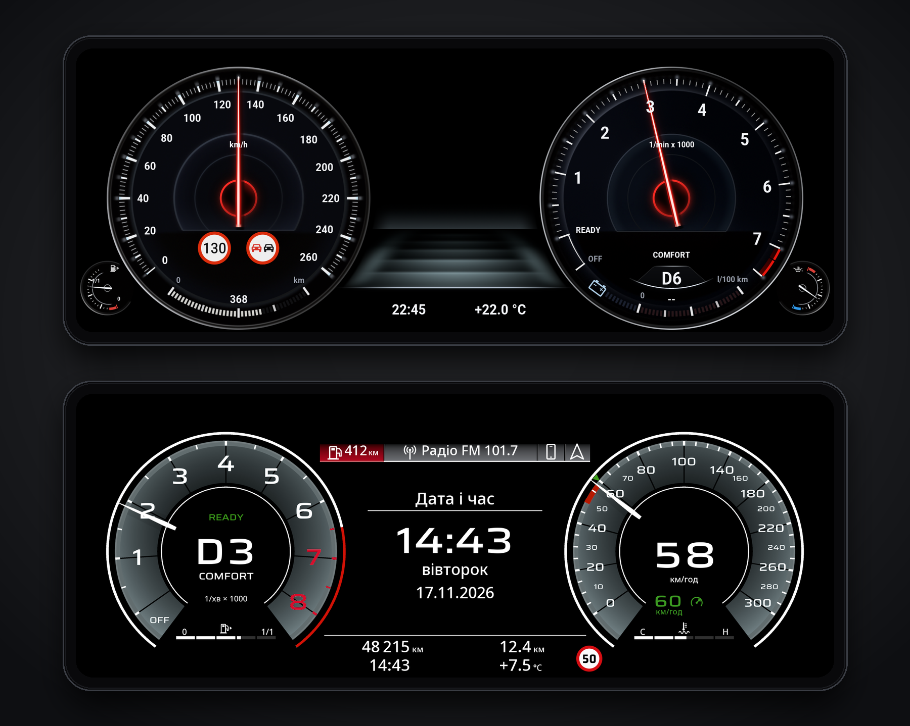
*Both clusters as the project's bench draws them: f30_cluster (the look of the F30's analogue-style cluster, Comfort mode) and Twin Dial (two round dials in the spirit of Audi's virtual cockpit). The surround is drawn.*

**In short.** A G20-generation BMW 3 Series has a 1920 × 720 digital instrument cluster. The project's goal was to bring the F30's two "analogue" dials back onto it, and then to build a second cluster from scratch. The car's iDrive 7 head unit (MGU) is rooted, and the community already has tools for drawing on the cluster.

The work was done by a team of Claude-based AI agents (one lead agent and parallel package agents) under human direction. A person set the goals and the rules, took the decisions, photographed the panel and pressed the buttons in the car; the agents measured, drew, and wrote the code, the tests and the reports. The rest of the text is about what was done and how.

Nine days of git history (11–19 November) produced two cluster apps and one app for listening to the car:

- **f30_cluster**: the F30 cluster look, with Comfort, Sport and Eco Pro modes;
- **Twin Dial**: a separate cluster built from scratch in the style of Audi's virtual cockpit;
- **signal_probe**: an app that draws nothing and only listens to the car's signals.

In numbers: more than 650 commits, about 150 merges, almost 190 branches and some twenty briefs. Up to 15 agents ran in parallel at the peak, and more than 60 over the project (an estimate; 62 agent worktrees are still on disk). The car's signal catalogue has 689 interfaces, and the working data (renders, rectified frames, logs) came to about 3.7 GB in 12 thousand files. Both clusters have already run on the car, not only on the bench.

> **Important.** This is a hobby project on a rooted head unit. The car is not flashed or coded, and nothing is written to it: the apps only read signals. BMW's warnings are never hidden, and the article explains how that is enforced. There are no rooting instructions here. Copying anything that writes to a car is not advisable.

## 1. The task and the platform

An F30 with option 6WB (the multifunction instrument display) also had a screen, but it drew two large "analogue" dials with chrome rings and red needles. The G20 has a flat digital cluster instead.

Technically it works like this. The MGU head unit runs third-party OAP apps (on Node 8). The community built the MGU App Kit for them, and **cluster-render** carries layers to the cluster: an app opens a Unix socket and describes its layers (effects with GLSL shaders, images, text sheets), and cluster-render builds a RAMSES scene from them. The scene itself is rendered by the **KOMBI**, the instrument cluster's own ECU.

That gives the first important conclusion: **BMW's cluster is not replaced; the app's own layers are laid on top of its scene.** BMW keeps drawing its own content, and some of it (the seat-belt lamp, the parking brake, the gear letter) it draws *over* the app's layers. So one rule runs through the whole project: **a BMW warning may never be hidden unless the app's own text for that exact message is on screen in the same frame.**

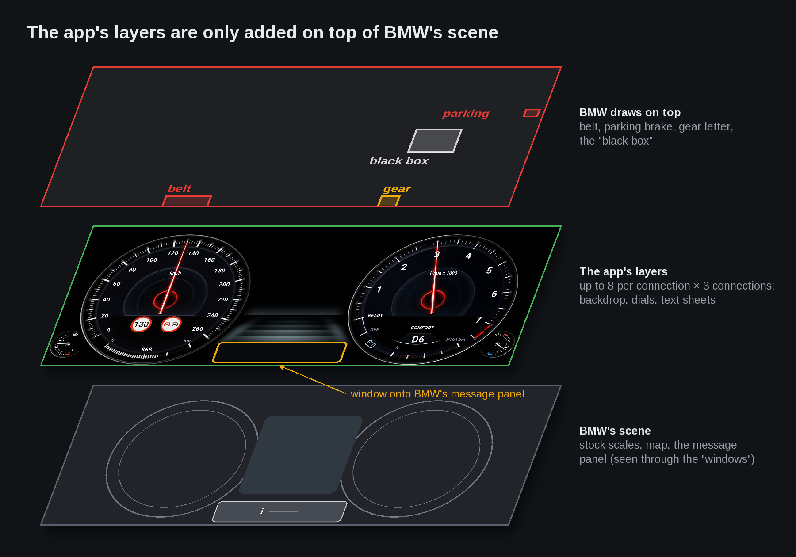
*How the picture is put together: BMW's scene, the app's layers above it (with a "window" onto BMW's message panel), and above those what BMW draws on top. The project's diagram; BMW's scene is shown as grey placeholders.*

## 2. Platform limits, learned on the car

At first everything lived on the **bench**, a browser rig that stands in for cluster-render and the car. On the bench everything worked. On the car some things did not, and behind each such difference were several rounds of "installed, photographed, figured out".

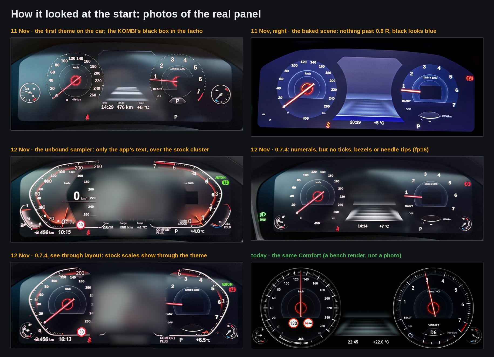
*How it looked at the start. Five photos of the real panel from 11–12 November, cropped to the cluster; the map and the street name in BMW's row are blurred. The last frame is today's bench render for comparison.*

**Pixel memory is counted twice.** cluster-render has 16 MiB for images and textures and counts every image twice: w·h·8 bytes for RGBA, w·h·2 for a one-byte R8. One 670 × 670 dial texture takes 3.4 MiB. Switching layouts failed with "the service's pixel memory is full": the old textures were still alive while the new ones uploaded. The fix: free what is unused first, then create. There is also a layer limit of eight per connection to cluster-render.

**A sampler without a texture, and the layer vanishes silently.** In the third photo only the app's text was drawn, with the stock cluster and its own numerals underneath. The RAMSES renderer simply skips an effect whose shader declares a `sampler2D` with no texture bound, and returns no error. Suspicion first fell on the 32-uniform limit, then on asset size. Now every unused sampler gets a transparent 1 × 1 texture, and the bench skips such a layer just as the car does.

**`mediump` on the car is fp16.** The second and fourth photos have numerals but no ticks, bezels or needle tips: the big dials (R 335 px) drew nothing beyond about 0.8 R. The cause is that `length(p)` on a pixel offset squares the coordinates, and in fp16 (max 65,504) that overflows somewhere past 256 px. A browser runs `mediump` as fp32, so the bench never showed it. The 0.7.5 fix is two lines:

```glsl
#ifdef GL_FRAGMENT_PRECISION_HIGH
precision highp float;     // mediump is fp16 on the car's GPU (x*x+y*y overflows past ~256 px)
#else
precision mediump float;
#endif
...
float d = length(p / R) * R;   // not length(p)
```

**The KOMBI resets on a shader that's too big.** Version 0.7.11 added night looks, and the cluster started going dark. According to the car's logs, the KOMBI went away about 2.3 s after each time the scene was shown: 13 times in just under six minutes, its network tunnel torn down and renegotiated every time. Layer structure and memory were identical to 0.7.10; only the shaders had changed. A dial shader of 25.4k characters worked; at 26.7k it reset the cluster. In 0.7.13 each layer gets only its own look's code, and the Comfort shader is 12.4k characters. The app also got its own guard: after two KOMBI resets it turns the theme off by itself. This was checked on the car the same evening, and the resets were gone.

**A getter with id 0 means "no getter".** The 0.7.16 update failed four times with a terse `UPDATE_FAILED`. In the signal catalogue six fields had `"getter": {"id": 0}`, and the MGU's config generator tests the id for truthiness, so zero means there is no getter. A "read" flag (`r`) on such a field kills the whole install. The `r` was dropped, the subscription (`s`) kept, and 0.7.17 installed. Since then the signal check requires non-zero ids.

### How it works: a shader for a weak GPU

The reason is simple: the KOMBI compiles every shader it receives in full, every branch included, and it has little headroom. So the shader that goes to the car is prepared in JS first.

The source of the WBDIAL dial shader, comments included, is about 30k characters and holds five looks: Comfort, Sport, Eco Pro, the small side gauge and the efficiency dial. Before sending it, `compact()` in `shared/shaders.js` does three things: it resolves every `#if STYLE` and `#if NIGHT` block for the look in use (only digits and operators, evaluated in JS), strips comments and blank lines and, when a look has no night colours, unwraps every `nightLook(x)` call into a plain `x`. The core:

```js
const cond = (e) => {
    const x = e.replace(/\bSTYLE\b/g, '(' + n + ')').replace(/\bNIGHT\b/g, '(' + nk + ')');
    if (!/^[\d\s()<>=!|&-]+$/.test(x)) throw new Error('shaders.compact: cannot evaluate #if ' + e);
    return !!Function('return (' + x + ');')();       // only digits and operators reach here
};
...
const c = line.replace(/\/\/.*$/, '').replace(/\s+$/, '');
if (c.trim()) out.push(c);
```

The result in numbers (measured on the current code): all five looks compacted take 18.2k characters, Comfort with its night look 13.3k, Sport and Eco Pro (no night colours) 6.4–6.6k. Twin Dial's dial shader `tdial` is 5.8k characters against a budget of 8k, and a test checks that budget.

A few more rules grew out of the same lessons:

- **Uniforms are packed into `vec4`s.** cluster-render holds up to 32 uniforms a layer, and some GPUs have fewer vectors. So WBDIAL gets, for example, `u_geo` (layer width and height, bezel width, mirroring) and `u_scale` (start, sweep, major and minor tick counts), and `#define`s give them readable names back.
- **Every sampler has a texture.** Empty samplers get a transparent 1 × 1 texture (`_bindBlanks` in `hud.js`).
- **R8 reads differently on the car and on the bench.** The car returns a one-byte texture as (r, 0, 0, 1); the bench page, through a 2D canvas, as (r', r', r', r) with r' rounded. One function reads it exactly on both, bilinear filtering included: `float r8a(vec4 s) { return s.a < 0.999 ? s.a : s.r; }`.
- **No length in pixels.** Every distance is taken on a scaled vector (`length(p / R) * R`, `length(q / 64.0) * 64.0`) or a clamped one (`length(clamp(q, 0.0, 64.0))`), and Twin Dial's static test checks that no shader takes `length()` of an unnormalised offset.

## 3. Geometry and area: what of the 1920 × 720 is really available

The panel is 1920 × 720 pixels, but the driver doesn't see all of them. The hood hides the top corners. It was measured like this: a grid was put on the panel, photographed from the driver's seat, and a homography was fitted to 108 grid crossings (residual 3.5 px). The hood edge is now stored as a polyline, "the first visible y" every 100 px along x. The first numbers came from another car, an X3 M40i, whose hood is much deeper at the corners, so for the G20 everything was measured again.

Next comes the list of what belongs to BMW. The agents built a catalogue of the stock G20 Comfort elements (38 of them) and, from photos, worked out for each whether BMW draws it **over** the app's layers, **under** them, whether it **disappears** with a custom theme, or whether it is still **unknown**. Always on top: the belt lamp, the red (P) of the parking brake, the gear letter in the bottom row, and the black box discussed below. For the critical lamps that the photos couldn't place either over or under, a "safe plan" put holes in the backdrop right above them.

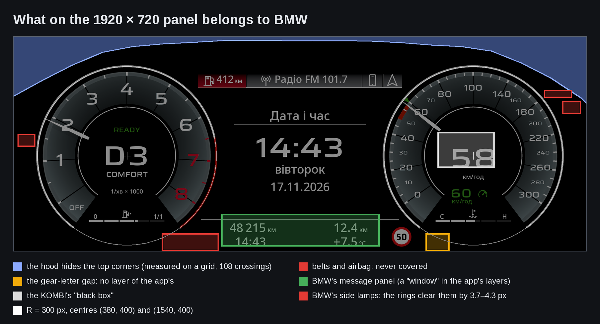
*What on the panel belongs to BMW: the hood, belts and airbag, the gear-letter gap, BMW's message panel, the "black box" and the side lamps. Underneath: a Twin Dial 0.1.1 render from the bench.*

### How it works: rectifying a photo

Every measurement on the car starts with one step: mapping a photo of the panel to the panel's own pixels. A homography (a perspective map of the plane) is used for that, but a homography alone turned out not to be enough.

On the grid photo the residual after the best homography has a clean cubic profile in x of about ±3.5 px: the phone lens' radial distortion. So the model in `tools/overlay/rectify.py` is a homography plus one radial term about the photo centre:

```
u = c + (q − c) · (1 + k₁ · |q − c|² / s²),    u = H · (panel point)
```

where q is a photo pixel, c the photo centre and s half its diagonal. For each k₁ on a grid of values the homography is found by least squares, and the k₁ with the smallest rms error in panel pixels wins. Grid crossings are found by normalised cross-correlation (NCC) on the "green minus red" channel, so the grid's yellow labels drop out. First RANSAC with a generous threshold rejects outliers, then three refinement rounds at a 3 px threshold.

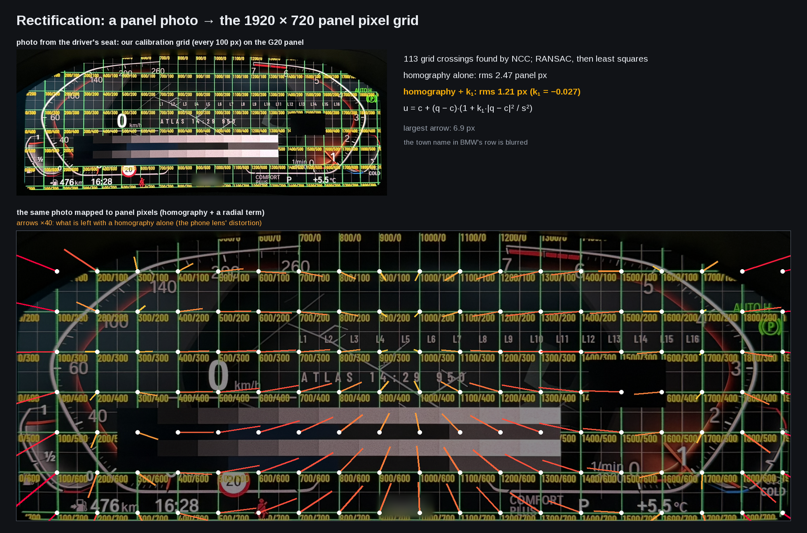
*Top: the calibration grid on the G20 panel, photographed from the driver's seat. Bottom: the same in panel pixels; the arrows (×40) show what a homography alone, without the radial term, would leave. The town name in BMW's row is blurred.*

In numbers: 113 crossings were found on the grid photo. A homography alone leaves an rms error of 2.47 px; the homography with k₁ = −0.027 only 1.21 px. On the photo of the first theme on the car, where the control points were 30 static captions of the theme itself (found by NCC against a bench render of the same build), the error falls from 1.61 to 0.16 px.

Photos without a grid are tied in a chain. The day photo of the stock theme is matched to the already rectified grid photo with SIFT: both images are first evened out with CLAHE (3.0, 8 × 8 tiles), then 12,000 SIFT features, Lowe's ratio test at 0.8, and matches only within 40 px of the previous estimate. The night photo is tied to the day one the same way. The first, simplest version of the tool (6,000 features, Lowe ratio 0.78, RANSAC at 6 px) matched a bench render to the photo of the first theme on the car in the same way. Photos where one photo pixel is larger than 4 panel pixels are not used for geometry, only for visual checks.

### How it works: searching the fit and checking overlaps

For Twin Dial a dedicated agent searched the dial radius and position with a script. The conditions: both dials symmetric about x 960, the whole bezel arc at least 4 px under the hood line, the dial's disc at least 3 px from every BMW item. The largest radius wins, and among equal radii the centre distance closest to the reference. The result was **R = 300 px**, with centres at (380, 400) and (1540, 400). Two lamps fixed the position: auto-hold on the right (3.7 px clearance) and ABS on the left (4.3 px). To keep proportions comparable across references, everything was measured in **dial units**: lengths as a fraction of R, angles in degrees clockwise from 12 o'clock. One thing from the references couldn't be kept: the dials are 9 % smaller and sit 30 px lower, because otherwise BMW's lamps would land inside the rings.

The numerals on the scale have a clearance rule: the "ink" of every numeral stays at least 4 px from the next numeral, from the ticks and from the needle at rest. This is checked at bake time: the glyph outlines come from the drawing at three times the size, and the smallest distance between outlines is computed for every pair. On the speedometer the smallest gap between numerals is 7.6 px, and a "120", had it been added, would have a gap of 0.65 px, which is why it isn't in the set. For the mockups an "ink recorder" was written: it runs the picture generator unchanged and records the box of every text and every icon. On 210 frames it checked the keep-outs (not one non-black pixel in the belt group, the gear gap or the holes for the seven side lamps), the tab cells, the gaps in the bottom row and the open message window. The checker itself has a test of 25 deliberately doctored pictures, each of which it must fail. It also found one real fault: the unit "бар" (bar) on the technical page stuck out 2.7 px past the edge of the centre window.

### The black box

With a custom theme the KOMBI sometimes draws a solid black rectangle in the middle of the right-hand dial (on the G20 roughly [1420, 320, 1611, 440]; it shows in the early photos and even in the grid photo above) and never removes it. Three research rounds went into it:

- A layout switch doesn't re-map the panel's slot. In the bench model of cluster-render the gap with no layer at all lasted 3–19 ms, while the slot is released only after 3000 ms.
- Among the catalogue's 689 interfaces no signal says "box shown". But the box covers **exactly the spot** where the stock G20 draws its big gear letter. It looks (a hypothesis) like the letter's backing plate falling back to its stock position.
- Comparing the two apps through a recording of every message sent to cluster-render showed that f30_cluster puts layer rectangles over the bottom-row gear letter in every theme and state, while Twin Dial never puts any layer in the zone x 1380–1460, y 660–720. Every cluster-render layer is a RAMSES quad in the scene the KOMBI renders itself, so the KOMBI receives those rectangles as geometry, not only as pixels.

For a test on the car, f30_cluster got a "Діагностика" (diagnostics) menu with three experiments, all off by default: cut every layer rectangle round the gear gap (an effect layer that touches it is split into four, and three widgets move to a fourth connection so that each keeps at most eight layers), put one extra layer over the gap (clear, black or grey), and rebuild the layout on every drive-mode change. On the bench the first one changes the picture outside the gap by no more than 0.03 of a code value.

On 19 November a diagnostic experiment on the car hid the black box. [MECHANISM: to confirm]

## 4. How an analogue cluster was split into layers

The first themes were pure GLSL: dials, ticks, glow, all procedural. It looked decent, but not like an F30: on the same photos the procedural dial scored an SSIM of only 0.23–0.32. So the next step was **baking**: split the 6WB into separate elements, measure each and draw it with the project's own code, and store what is static as textures.

### From photos to the dial's frame

The approach: map each 6WB photo not to "panel pixels" (someone else's cluster has none) but to the **dial's own frame**. To do that, each dial in each photo is fitted from its own bezel:

1. Rays go out from a hand-placed seed, and on each ray the bezel's bright ridge is found to sub-pixel precision.
2. RANSAC fits a circle to the ridge points, then an ellipse (perspective) with inliers by distance to the ellipse.
3. **The bezel's outer half-maximum edge** maps to the theme's R; the ridge itself lands at ~0.99 R.
4. Camera roll comes from the line through both dial centres. For single dials it comes from the edge of the disc's lower "floor"; on the tick macro shot the radius comes from the minor tick pitch (3.2°) and the roll from the 6000 rpm tick.

The fit residual on the best photo is 0.64 and 0.59 px for the big dials and 0.14–0.21 px for the small ones. Each photo is also normalised for exposure: black is the 5th luminance percentile just outside the bezels (1.0–1.08 R), white is the mean of the brightest 0.5 % inside 0.95 R, mapped to 235; the channels are balanced to a neutral white with gains clamped to 0.8–1.25. A mask is stored per frame as bits: outside the photo, glare, watermark, needle corridor, live text.

This step brought the first non-obvious finding. On the photos the bezels are brightest not where an "upper-left key light" would put them but at the bottom, toward the centre window, and the two dials in one photo mirror each other. That pointed to reflections rather than drawn gloss, so the light direction had to be measured separately (section 5).

### Inventory: ten clusters and a layer stack

The cluster was split into ten **clusters** of elements: C1 speedometer, C2 rev counter, C3 and C4 the fuel and oil minis, C5 the centre window, C6 the bottom row and arcs, C7 signs and pictograms, C8 the Sport and Eco Pro parts, C9 housing and glass (documentation only), C10 background. Eight agent packages shared them, and a ninth put everything together. Inside a cluster come **layers**, bottom to top, with fractional z so new layers slot in without renumbering. For the speedometer the stack is:

| z | Layer | Kind | Class |
|---|---|---|---|
| 1 | face: a dark blue gradient, the fill of the disc and the "floor" | albedo | baked @0.5x |
| 2 | the bezel's shade on the face (ambient occlusion) | shadow | baked @0.5x |
| 2.5 | shade below the "horizon" line | shadow | baked @0.5x |
| 3 | the groove under the ticks | albedo | baked @0.5x |
| 3.1 | the groove's lit inner rim | highlight | procedural |
| 5 | wedge ticks with a cool fringe at the ends | albedo | procedural |
| 6, 7 | the inner disc's edge, the inner ring (arcs open at the bottom) | albedo | procedural |
| 8 | the "floor" lip | albedo | procedural |
| 8.5 | glow: spots past the ticks, halos of ticks and rings | glow | baked @0.5x |
| 9 | darkening round the hub | shadow | baked @0.5x |
| 11 | the bezel with its gloss | highlight | procedural |
| — | needle, its shadow, hub, over-speed band | — | dynamic |

The rev counter adds the red zone, the arc to OFF, the gear "tray", the light spots past the ticks and the hub's red ring.

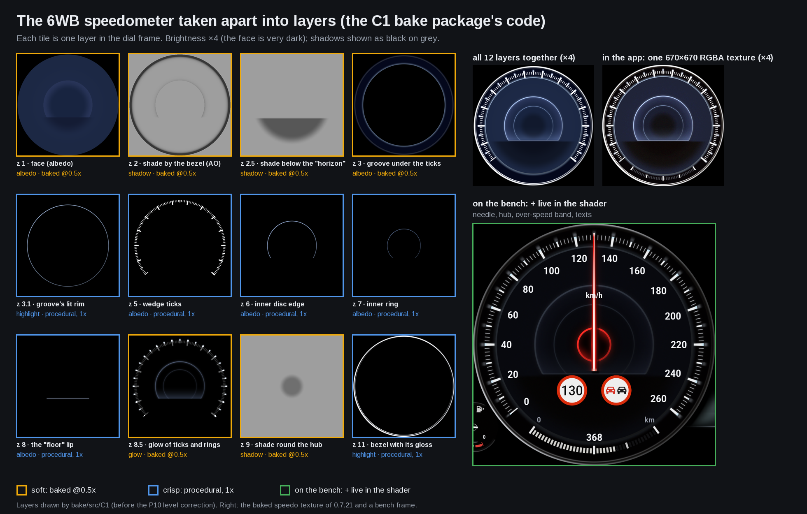
*Each tile is one layer of the speedometer as `bake/src/C1/draw.py` draws it (brightness ×4; shadows shown as black on grey). Right: all layers together, the baked texture of the released 0.7.21, and a bench frame with the live parts.*

Not one photo pixel is copied. Each layer is a formula in R units: a tick, for example, is a trapezoid from r_in to r_out whose half-width grows linearly from w_in to w_out, and its coverage is computed analytically on a 4 × 4 sub-pixel grid and averaged. The parameters were fitted by measurement: major ticks 0.820–0.902 R with a half-width of 0.0085 → 0.0112 R, the bezel at 0.9915 R with σ 0.0058 R, the disc edge at 0.487 R (the theme had 0.51), the inner ring at 0.330 R (theme 0.36), the "floor" line 0.245 R below the centre. The disc and the ring are arcs open at the bottom: they end on the "floor" line instead of closing, as they did in the first theme.

### What to bake and what to keep live

The line is drawn not where it is convenient but where the platform's limits put it:

- **Soft, low-frequency** content (gradients, shadows, glow) is baked at half size (@0.5x): bilinear upscaling loses nothing, and it takes a quarter of the memory.
- **Crisp** content (ticks, rings, bezel) was procedural in the packages, with exact parameters in R, so it could be redrawn at another R.
- **Dynamic** content is never baked: the needle and its shadow, the hub's state, the over-speed band, the signs' visibility, texts (fonts are live and localised) and, of course, everything BMW draws.
- The only blending is plain "over" (alpha over), no multiply or add, so shadow, highlight and glow are kept as separate alpha layers above the albedo. That allows relighting without re-baking the base.

The budgets it had to fit: no more than 8 MiB baked per mode (memory counted as w·h·8), up to eight layers per connection and 32 in total. Hence the integration package's proposal: don't make every layer its own cluster-render layer, make the baked files **assets** (textures) sampled by the effect layers that already exist. Assets count as pixel memory, not as layers, and the z order is kept inside one shader. Comfort's baked content fitted in 4.31 MiB.

### How the baked content reaches the app

The final integration went one step further. `tools/bake_scene.py` composes the **whole static stack** of each big dial (face, shadows, groove, ticks, red zone, OFF arc, discs, rings, floor, glow, tray, hub ring, bezel and the bottom arc with its pictogram) in z order into one 670 × 670 RGBA texture with straight (not premultiplied) alpha. The procedural layers are rendered at 1x for this by the package's own code. Half-size layers are upscaled bilinearly in premultiplied alpha before compositing, as the GPU would do.

In the WBDIAL shader the "everything static is baked" mode (`u_hasBase > 2.5`) does one texture fetch, and only what moves or depends on data stays live: the over-speed band, the bottom arcs' fill, the hub, the needle's shadow and the needle itself. That split explains why the line between "baked" and "live" lies exactly here:

- **Shader size.** Every static element in a shader is code the KOMBI compiles in full. After the resets in 0.7.11 every line counted, and a texture costs zero characters.
- **Memory.** The two dial textures at 3.42 MiB each are the biggest item. With the fonts, the window and the masks, Comfort's settled state takes 11.41 MiB of 16.
- **Layers.** All of Comfort is 21 layers on three connections; one layer per 6WB element would not fit into eight per connection.
- **Animation.** Anything that changes more often than a theme switch stays in the shader: re-baking a texture would cost a new upload of several megabytes.

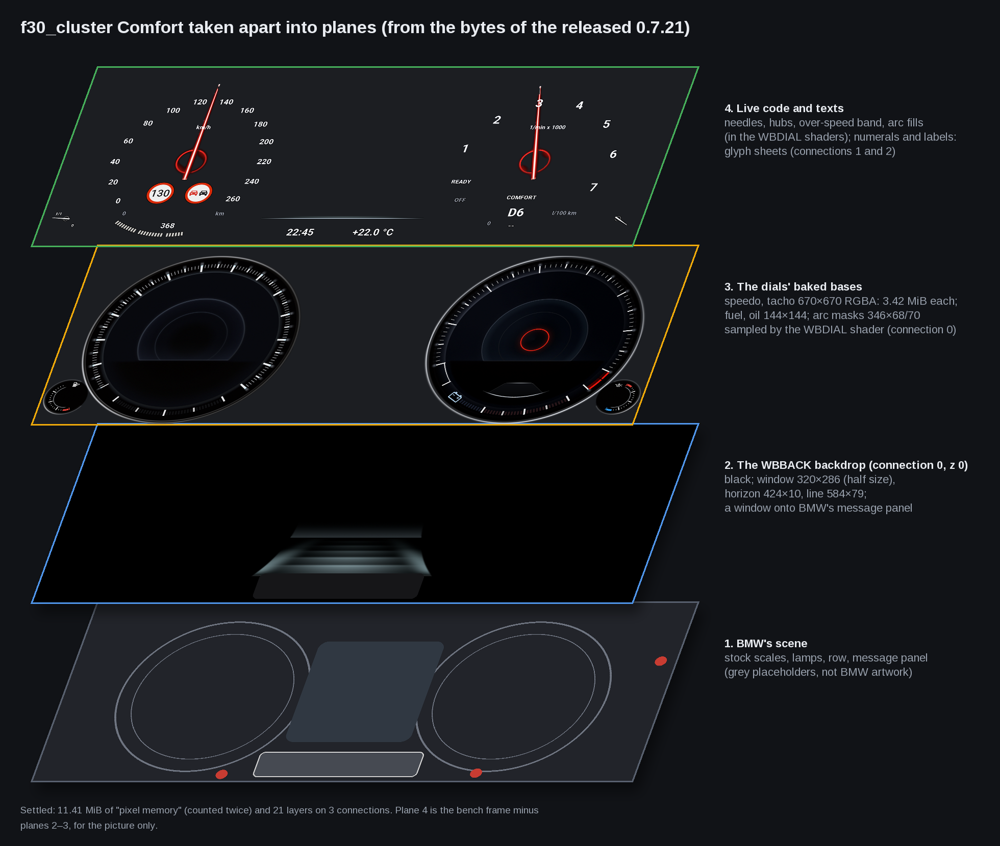
*f30_cluster Comfort from the bytes of the released 0.7.21: BMW's scene (grey placeholders), the WBBACK backdrop with the baked window, horizon and line, the dials' baked bases, and what the live code and text sheets add (extracted as the difference between a bench frame and the baked planes).*

### Quality control

Every layer and every stack was compared with the rectified photo by the same tool, `bake/src/qc.py`: SSIM on luminance with a Gaussian window, the mean colour difference ΔE2000, the edge position error (the symmetric distance between Canny edges in panel pixels) and a banding check. The brief's targets were strict: SSIM ≥ 0.85 and ΔE ≤ 6 for soft layers, edges ≤ 1 px for crisp ones. The honest result: some soft layers met them (the "floor" fill 0.92, the hub well 0.92), while the composed stack on the best photos scored SSIM 0.61–0.66 and ΔE 4.8–5.3. Against the earlier procedural dial (0.23–0.32) that is a big step, but not "pixel for pixel". The stack's edge error (3.8–4.9 px) is limited by blur, numerals and the needle in the photos themselves, not by drawing errors.

Some findings along the way were fun:

- **The window came out four times too bright.** Its levels came from a photo where veiling glare had lifted everything. A gain of 0.24 was proposed, but the photos spanned 0.08–0.39, so the final call was left to judgement by eye (and the P10 package later fixed the levels, below).
- **Photo 02 isn't a photo.** The font analysis showed that the "cleanest" reference is a synthetic picture: "Fasten seatbelt" is doubled, "EfficientDynamics" is illegible, "OPO" stands where OFF belongs. Its proportions differ too (the disc at 0.568 R instead of 0.487), so it wasn't used for measurement.

### Levels: black isn't black

A separate package, P10, sorted out the levels, and two things came out of it.

First: the earlier normalisation subtracted black in sRGB code values, not in linear light, and on two photos it took the plastic housing, not the LCD, as "black". The correction works in linear light: a code is returned to the photo's own code, and then

```
L  = (lin(raw) − lin(F)) / (lin(W) − lin(F))
c' = srgb(L · lin(235))
```

where F is the LCD black plus the local veiling glare of that area and W is white. The correction applies to albedo, glow, highlight and merged layers; shadows and masks stay as they are.

Second: **the G20's black isn't black.** A night photo of the theme on the car, mapped to panel pixels, was fitted to the bench render with a per-channel model in linear light:

```
photo_lin = F + g · panel_lin^γ
```

The panel's black came out at 0.12 % of white in red, 0.09 % in green and 0.56 % in blue: clearly blue (about 1000 : 1 against 180 : 1). In the second early photo, overexposed by about 2.8 EV by the phone's night mode, it shows to the naked eye. The model is good to about ±12 codes: one photo cannot separate the panel's gamma from the camera's. The same three numbers later became a constant in Twin Dial: flat colours are sent there with the panel's black taken out, `L' = (L − F) / (1 − F)`.

## 5. Shadows, light, glow and night

A shadow on a cluster isn't physics but a few formulas fitted to photos. This section collects every place in the project where light and shade are computed or baked, and how.

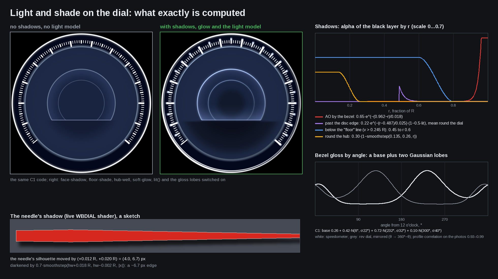
*Left: the same code without shadows and without the light model; right: everything on. Top right: the alpha of the shadow layers by radius; below: the bezel gloss by angle; at the bottom: a sketch of the needle's shadow in the live shader.*

### Where the light comes from: the bezel gloss

The first question was where the light on a 6WB comes from. For every angle of the bezel two things were measured: the ridge brightness and how far the brightest point sits across the bezel's tube. The first harmonic of each series was taken: its phase gives the direction, its amplitude the strength.

Then the speedometer's ridge profile was correlated with the rev counter's twice: as it is ("same light") and mirrored, θ → 360° − θ. On photo 04 the correlation came out 0.22 against **0.93**, on 06 0.20 against **0.99**, on 03 0.80 against 0.91. Conclusion: the gloss mirrors between the dials, so it's part of the drawn design, not a reflection in the glass. Hence one mirror-symmetric model for both dials: a base plus two Gaussian "lobes" by angle. The speedometer package measured them as: base 0.26, a narrow lobe at 8° (σ 22°, gain 0.42), a broad one at 232° (σ 32°, 0.72) and a weak third at 300°. The rev counter gets the same, mirrored. Reconciling the two packages also proposed moving the lobes to 22° and 219° and putting the "key" for the groove rims straight up (90°): a vertical direction is mirror-symmetric by construction and equals the mean of the photos. The speedometer package's code kept the measured 8° and 232°.

For lit edges (the groove, the disc edge, the ring) a simple factor toward the "key" is used:

```python
def lit(g):
    a = math.radians(P.LIGHT["key_dir_deg"])
    lx, ly = math.cos(a), -math.sin(a)            # y down
    rr = np.maximum(g.r, 1e-6)
    return 0.5 + 0.5 * (g.u / rr * lx + g.v / rr * ly)
```

Here `key_dir_deg` = 115° (maths convention), and the edge colour is multiplied by `(1 − 0.35) + 2 · 0.35 · lit`, so it varies by ±35 %.

### Shadows that are drawn, not computed

No shadow on the baked dials is computed by ray-tracing or by blurring a silhouette. Each is a **drawn gradient with alpha**, fitted to a profile from the photos, and that too is the answer to "how were the shadows computed":

- **The bezel's shade on the face** (ambient occlusion): `a = 0.65 · exp(−max(0.962 − r, 0) / 0.018)`, darkest at 0.944–0.960 R, as in the macro shot.
- **The shade past the disc edge**: `0.22 · exp(−(r − 0.487) / 0.025)`, stronger on the unlit side (factor `1 − 0.5 · lit`), only above the "floor" line.
- **The shade below the "horizon"**: on the photos the face below the "floor" line is darker out to ~0.7 R, although a crisp edge exists only inside ~0.45 R. So a separate layer at z 2.5 appeared: alpha 0.45, rising over 0.035 R from the line and fading out between 0.6 and 0.8 R. The evidence is weak (visible on one photo of three), and the manifest says so.
- **The hub well**: `0.30 · (1 − smoothstep(0.135, 0.26, r))`, also on weak evidence.
- **The groove under the ticks**: not a shadow but a fill that goes from the light spilling off the lit rim to an almost black floor, with the bezel's dark wall at 0.964–0.984 R.

At bake time all shadows and albedo are merged into one "@0.5x" base, the shadows multiplied into it.

### Glow

Glow has several sources too, all measured on the tick macro shot:

- **a light spot past the end of a major tick**: a Gaussian at 0.918 R, σ 0.012 R along and 0.016 R across, alpha 0.42 for majors and 0.30 for mids (in the photo: a peak of 108 at 0.916 R, 66 at 0.932 R, 26 at 0.944 R);
- **a halo round every tick**: `0.10 · exp(−d / 0.006)`, half as strong for minors;
- **halos of the disc edge and the ring**, stronger on the lit side;
- **a glow from the "floor" lip**, rising toward it as a power of 1.8;
- **a cool fringe** on the outer 30 % of the major ticks (colour (120, 215, 255), mix 0.40). The report marks it as probable lens chromatic aberration in the photos, and whether to keep it is an open question.

All parts are combined into one glow layer with straight alpha: `alpha = 1 − Π(1 − aᵢ)`, the colour an alpha-weighted mean.

Live glow exists only in the shader: the needle's red halo that follows its taper (`0.22 · exp(−max(|x| − hw, 0) / (0.016 R))`) and the hub ring's halo (`0.30 · exp(−|d − r_hub| / (0.020 R))`).

One more glow problem came up in the bench simulation of the stock G20 cluster (it is needed to see what of BMW's shows through the see-through variants of the theme). The gain of the stock pointer glow was fitted by least squares: `photo − base = g · (glow₁ − base)` over the pointer zone with the other elements masked, which gives `g = Σ G·Y / Σ G²`. Two photos gave 0.47–0.73 for the different dials, and the simulation uses 0.6.

### The needle's shadow: the one live shadow

The needle moves, so its shadow can't be baked; the WBDIAL shader computes it per pixel. The approach: the same needle silhouette, moved right and down, with a soft edge, multiplies the colour under it:

```glsl
vec2 ps = p - vec2(0.012 * R, -0.020 * R);
vec2 qs = vec2(dot(ps, vec2(nd.y, -nd.x)), dot(ps, nd));
if (qs.y > T && qs.y < L) {
    float hws = qs.y < 0.0 ? mix(W0, WT, qs.y / T) : mix(W0, W1, qs.y / L);
    col *= 1.0 - 0.7 * smoothstep(hws + 0.018 * R, hws - 0.002 * R, abs(qs.x));
}
```

The y axis points up here, so the silhouette moves right and down. At R = 335 that is an offset of (4.0, 6.7) px and a shadow edge about 6.7 px wide. The needle itself is a "tube" too: red edges, a dark seam on the lit side, a light core about 0.4 of its width (as in the macro shot), a warm cap on the tail and a white tip.

The red over-speed band lies in the empty ring between the hub and the numerals, measured on a reference: a hard inner edge at 0.521 R, brightest there, fading outward to nothing at 0.663 R. Its alpha has two parts: a linear fade of 0.72 and a narrow strip of 0.30 near 0.530 R.

### The window between the dials

Comfort's centre window has no hard frame. The backdrop shader makes soft edges along the curve of the stock G20 map's "veil" (`veil(t) = 1 − (1 − t)²`), with fades of 150 px at the top, 40 px at the sides, 56 px at the foot and a shade from the dials' rims over 60 px (`smoothstep(0, 60, distance from the rim)`). The corners are rounded because the fade bands meet on a circle (the length of a vector whose components are at most 1 never exceeds 1.42 and is safe in fp16), not as a product, which would leave square corners. The rule: the shade only darkens, and empty space stays (0, 0, 0).

fp16 mattered here as well: the old round hole for BMW's sign computed `length(lp − centre)` in pixels, which is unsafe in fp16. Now every window distance is taken on a vector divided by 64, then multiplied back.

### Night

In f30_cluster night is **one colour transform at the end of the shader**, so the baked textures are recoloured live on the GPU, with no second set of textures (which wouldn't fit in 16 MiB). A colour is split into its grey part w = min(r, g, b) and the rest, and each part has its own "image":

```glsl
vec3 nightLook(vec3 c) {
    float w = min(c.r, min(c.g, c.b));
    vec4 v = vec4(c - vec3(w), w);
    return vec3(dot(u_nk0, v), dot(u_nk1, v), dot(u_nk2, v));
}
```

By day the matrix is the identity. The "amber" look, for example, maps white to (0.66, 0.59, 0.50) and the needle's red to (1.0, 0.50, 0.06). The same rows are applied in JS to the text colours, so a numeral and its tick agree. Road signs are only dimmed (a limit sign stays red and white). The looks have been judged on the bench only, not yet on the car at night. Sport and Eco Pro have no night colours at all, and their shaders are built without this code.

### Twin Dial: linear light

Twin Dial computes light in **linear** space. Night there is a multiplier per material in linear light (white 0.80, bezel 0.70, ticks 0.75, the scale band 0.60 inside, 0.55 outside and 0.50 at its lit ends, the tick strip 0.55, red 0.85). There is no night reference, so all of these are hypotheses.

Twin Dial's needle shadow is simpler than f30's: the scale band under the needle darkens to 0.85 for 0.05 R either side, only on the band itself (not on the tick strip) and never on "ink". Shadows for the numerals (an outline of 0.008 R darkening to 0.75, and a drop shadow offset by (+0.010, +0.012) R, blurred by σ 0.008 R, 0.35, both in linear light) were measured, programmed and shown on the mockups. The decision taken on the mockups: numerals without a shadow. Both models stay in the code, and either can be restored by changing one word.

The red arc on the rev counter's bezel has an antialiased edge along the angle. The angle difference is turned into pixels by multiplying by the number of pixels per degree at that radius:

```glsl
float pxd = rd * 0.0174533;                          // px per degree at this radius
float arc = step(0.975, rho) * clamp((th - u_red.x) * pxd + 0.5, 0.0, 1.0) * step(th, u_red.w);
```

And a red tick or numeral switches to its colour earlier, with `smoothstep(0.50, 0.70, g)` instead of `smoothstep(0.70, 0.85, g)`, so no grey halo is left round the red.

## 6. Fonts

The fonts were chosen by measurement, not by eye.

**f30_cluster.** It started with Arimo. Then an agent measured the real 6WB's digits and noticed that Arimo's "1" has a foot serif and the 6WB's doesn't: the "1" is 0.655 of the digit height wide against 0.410, 60 % too wide. But a plain "match the heights, then compare widths" doesn't work on photos: a bright LCD "blooms" in a photo, and every glyph thickens by a roughly constant amount d. So the fit models the bloom:

```
measured_width(i) = s · W(i) + d,     measured_height(i) = s · H(i) + d
```

with s and d by least squares and d ≥ 0. Two more observables pin d: the stroke width (which blooms like a glyph) and the **counter** of a "0", "4" or "6", which *shrinks* with bloom and so enters with a coefficient of −1. It was the counter that broke the "light weight plus heavy bloom" degeneracy: the 6WB's measured "0" counter (5.60 px) ruled out a candidate that until then was level with the winner. The method's own check: a "6" on two different photos at a 4× scale difference gives a width-to-height ratio of 0.6394 and 0.6390, agreeing to 0.1 %.

Among 22 free faces at various weights and widths, Roboto at width 87.5 came 1st, 1st and 3rd in three runs (on the rev numerals, 1.85 % of the figure height against 6.87 % for Arimo, which came 17th). The 6WB's figures are also tabular: the step between adjacent digits is 10.26 ± 0.39 px whatever the digits are.

**Twin Dial.** An agent took a "fingerprint" of the references' numerals: the zero fills 0.904 of its box where an ellipse fills 0.785, so the digits are "squared". Of 38 families (75 font files), ranked by the deviation of the glyph boxes, Saira won for the numerals (4.23 % against 7.13 % for the runner-up) and Noto Sans for the text (3.14 %). Even at its widest, Saira's zero is about 7 % narrower than the references', so the numerals are baked with a horizontal stretch of 1.06.

**How a font reaches the car.** The car never rasterises a font. `tools/bake_fonts.py`, on the developer's computer, draws every glyph needed and writes an atlas: one coverage byte per pixel, base64 in JSON, plus metrics (every cell the same height, an offset for overhangs, one shared advance for the digits so a number doesn't jump). JSON because the app package holds JSON only, and the car then needs no PNG decoder. On the car `hud_text.js` only copies these bytes into sheets, and the text shader reads `.r` of a one-byte texture.

**Cyrillic.** The car's cluster runs in Ukrainian, and if a font lacks a letter the element goes back to BMW (a box-shaped replacement glyph does not count as "the app's own text on the screen"). So the fonts that may carry the car's text have the whole Ukrainian alphabet in both cases, the apostrophes, guillemets, quotation marks, dashes and №, and, after the "full text, always" decision, the Russian and Belarusian letters and the Latin diacritics of European street names as well. The U+02BC apostrophe, which Roboto lacks, is drawn with U+2019's glyph of the same shape. Twin Dial's Saira atlas, by contrast, refuses Cyrillic at bake time, because it only draws digits and Latin labels. The sixteen atlases of Twin Dial's round 2 take 3.03 MiB. The pictograms are drawn from scratch after the ISO 2575 shapes. The car can hand over its own message icons (7 PNGs), but that's BMW's artwork: it isn't stored, logged or committed.

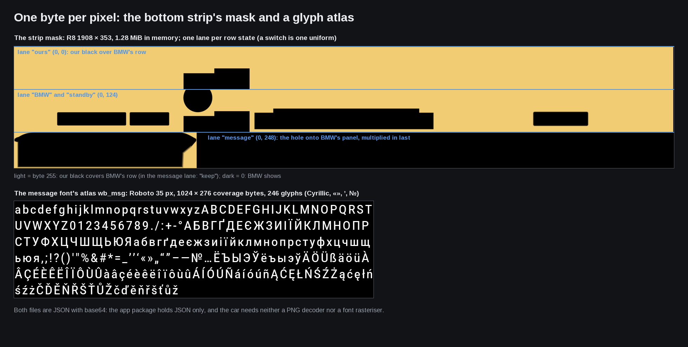
*Two one-byte assets of f30_cluster as they sit in the app: the bottom strip's mask with a lane per state of the row, and the message font's atlas (Roboto 35 px, 246 glyphs including Cyrillic).*

## 7. The bottom strip's mask

The panel's bottom row belongs now to BMW, now to the app: it holds the belt lamps, the gear letter, the message panel, and depending on the row's state the app either covers the stock content with black or reveals it. At first this was dozens of rectangles and circles in the shader. Package M replaced them with **one R8 mask** of 1908 × 353.

The key question was how to store a shape. Three ways were tested on eight synthetic shapes (8 × 8 supersampling as ground truth, sampled the way `texture2D` samples):

| Shape | Full-size R8: max error | Half-size distance field: max error |
|---|---|---|
| a rectangle with a fractional edge | 0.002 | 0.41 |
| a round hole, r 41.5 | 0.002 | 0.067 |
| a panel with an arc and slanted ends | 0.002 | 0.56 |
| a 2 px corridor between two holes | 0.001 | 0.48 (and an edge shift of −0.20 px) |

A distance field is good on long straight edges but breaks exactly at corners and narrow corridors, which is where the black has to hug the stock items. A full-size mask reproduces every shape to the 8-bit step, and R8 costs a quarter of RGBA, so full size turned out affordable. A round hole of radius 42.5 px with a 2 px soft edge comes back from the baked bytes as 42.499 (a circle-fit residual of 0.004 px).

Each state of the row ("ours", "BMW's", "standby", "message") has its own lane in the atlas, and a switch costs one uniform and no upload. The lookup is snapped to the texel centre, `floor(p − box) + 0.5`. Without it, under fp16, 60 of 1920 columns would land on the wrong texel (up to 0.94 of a texel off). A mask baked from the existing rectangles reproduces the earlier picture within 0.60/255 in all seven bench states. Twin Dial bakes its "window" onto BMW's message panel the same way: the stock panel's outline, dilated by 3 px, in a 536 × 112 texture.

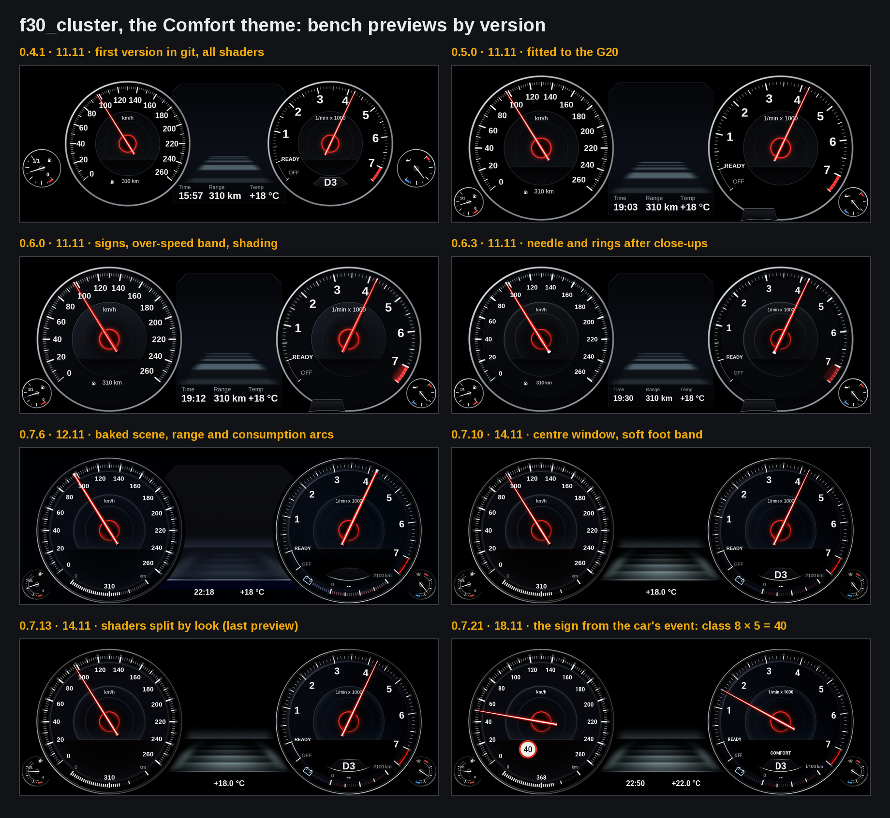
*f30_cluster's evolution in the app's own previews (bench shots) since the first version in git. The previews were last re-shot in 0.7.13; the last frame is from the state gallery of the released 0.7.21.*

## 8. Listening to the car

This is the largest part of the project, and the least visible from outside.

### The catalogue: 689 interfaces

The head unit has a signal catalogue, a file called `someip-interfaces.json`. It holds **689 SOME/IP interfaces and 5100 members: 2319 fields, 2116 methods and 665 events**, described by 7411 data types. 640 of the fields have a setter, and the clusters and the probe touch none of them.

At first it seems enough to find the right name. But a field being in the catalogue doesn't mean the car sends it. The catalogue gives structure and ids; it doesn't say whether the provider is alive, what a field's factors are, or what 65535 means.

The check-control messages are the telling example. The first candidate was `KombiInterface_2.newCCMessage`, because the name fit perfectly. In 0.7.18's log it didn't arrive once in 25 minutes, even though the door was opened. Later, in another log, it did show up a few times, but it can't be relied on. The live one turned out to be `ccList`: at rest it holds an entry with id 0, and an open door adds entry id 15 in white. But `ccList` also holds stored messages, not only the one on screen now. The field whose name promised to answer "what's shown now", `statusActiveCCMessage`, read 65535 on the car all the time. The real one was a third, `Vehicle2.statusDisplayedCCMessage`: open the door, 15 appears in the list, and 30–60 ms later this field says 15 too. It also showed BMW messages that `ccList` never carries at all (numbers 285, 926, 927, 184).

After a few stories like that it was clear that guessing had to stop. A dedicated tool was needed.

### signal_probe: the app that draws nothing

`signal_probe` is a separate OAP app. It has no layer on the cluster and renders nothing; it only subscribes to signals and writes a log. This is how it's built:

- **Sets with checkboxes.** Version 0.1.0 has 160 fields on 62 interfaces in 11 sets: messages, trip computer and mileage, body and voltage, media, phone, view and buttons, navigation, driver assistance, technical, the "black box", and not-yet-wired. Each set is switched on by its own checkbox in a menu on the centre screen. At the first start all are off, and while a set is off the app subscribes to nothing. That's deliberate: the car had never been listened to on this many signals at once, so one or two sets are switched on at a time.
- **The "Позначка N" (Mark N) button.** A press writes a "this step starts here" line into the log. The lead agent later uses these marks to find the right seconds among thousands of lines.
- **Privacy.** The log gets only numbers, enum names and text lengths. A track title is logged as "17 chars", and of a caller only whether they're in the contacts. Tests with "canaries" check this: a marker is planted in every text member, and none may reach a log line.
- **Volume limits.** Each field has a minimum gap between lines and a cap on their number, and an overall guard holds the log to 40 lines a second. For the steering-wheel buttons the gap is zero: a test feeds 60 changes in 60 ms and expects 60 lines.
- **Summaries.** 30 seconds, 2 minutes and 10 minutes after a set is switched on, the app writes which fields have spoken, which stay silent and whose providers never came up. It asks a silent field once through its getter, which is also only a read.

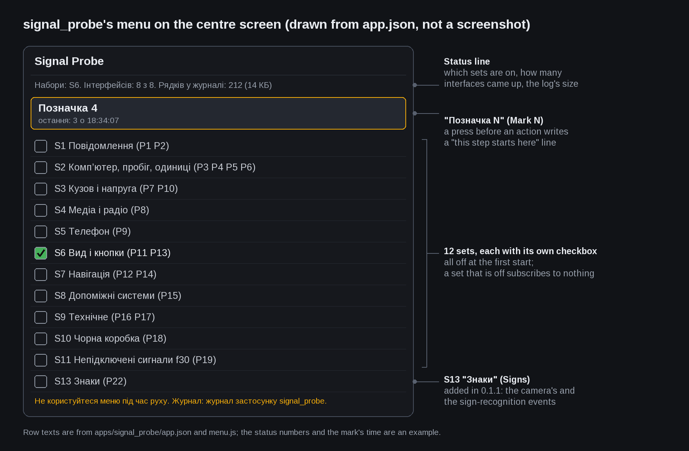
*signal_probe's menu on the centre screen. This is a drawing from the app's menu definition, not a screenshot; the numbers in the status line are an example.*

A whole infrastructure grew round the probe. A **register** of 91 items lists everything the car has to answer: what can be read from the logs of the apps already installed, what needs the probe, what needs a photo or an experiment. The **log collector** is read-only: it runs only commands on a whitelist (`cat`, `ls`, `stat`, `tail`, `date`, `journalctl` for one service), refuses any other command and any shell metacharacter, and a test checks that against a fake `ssh`. A **parser** turns the logs into the decision tables of every research report and writes answers per register item. After a collection, a privacy check keeps VINs, phone numbers, coordinates and addresses out of the derived files. A separate script proposes exact `app.json` changes as diffs with the evidence beside them, but never applies them itself.

### The session at the car

For the session a ten-block document in Ukrainian was prepared: "standing with the ignition on", "engine", "media", "phone", two short drives with a passenger. It has safety rules ("never touch the probe's menu while driving", "on the road only the passenger works the menu") and a table of marks.

The first session lasted about an hour (an estimate, not checked against the files): a laptop in the car connected over SSH, buttons pressed and doors opened in the cabin, and the lead agent reading the fresh log lines between presses. In the probe's first collected log, eight minutes long, 44 of 53 fields in four sets had spoken. The probe named the silent ones, along with the providers that never came up. After that first collection the register had 28 items answered, 14 partial and 13 unanswered; the other 36 need a photo or a manual check.

The best moment of the day was this. Neither cluster was showing a speed limit, though the stock panel showed a 30 sign. While the car stood with that sign on the panel, the agent built probe version 0.1.1 in under an hour, with a twelfth set, "Знаки" (Signs): ten new sources, eight of them events rather than fields. That made 170 sources on 66 interfaces. A short drive with that set showed where the cluster gets its sign from.

### What was found

- **The TRIP button on the stalk** (the on-board computer) is bit **0x40** of `operationColumnStalks` in `de.bmw.body.Light`. Seventeen presses gave seventeen clean "0 → 0x40 → 0" pairs. The button now switches Twin Dial's tabs. The app only *observes* it: under the app's layers BMW still pages through its own screens.

  ```json
  "tabKey": {
    "iface": "de.bmw.body.Light", "field": "IndicatorSteeringColumn",
    "path": ["operationColumnStalks"], "mask": 64, "invalid": [255]
  }
  ```

  The automatic parser carefully declined to name the bit because it also moved in a neighbouring step. The lead agent confirmed it by hand against the notes taken during the session.
- **"Shown now"** is read from `statusDisplayedCCMessage`, not from the dead `statusActiveCCMessage` with its eternal 65535.
- **The speed limit.** Both clusters were built on the `TrafficSignDisplayControl` field, but its provider never comes up on this car. The sign arrives as an **event**, `TrafficSignRecognition`, about twice a second: `presentClassLimitSpeed` × 5 = km/h. Class 8 matched a 40 sign and class 6 a 30 sign, and a separate event from the front camera, which gives the value it read directly in km/h, confirmed it. The catalogue describes class 29 as a chime request, so without a separate check the cluster would have shown a "145" sign.
- **Cruise control** turned up in the HUD feed: the set speed in km/h and the function's symbol (cruise or limiter), even with the HUD itself switched off.
- **The trip computer.** The factors for average speed, consumption and distance were checked against the car's own trip page. Distance turned out to have a factor of 1, not the 0.1 that had been assumed.
- **A CarPlay route.** When navigation runs through CarPlay, the car gives the distance to the destination, the travel time and the arrival time, but no manoeuvre arrows and no lanes. The distance comes in metres whatever unit is written next to it: 5700 with "KM" means 5.7 km, because 57 km in an 11-minute drive doesn't happen.

The rules for the code are simple and strict: `r` only with a non-zero getter, `s` only for subscriptions, only named events, **never a setter and never a method with side effects**.

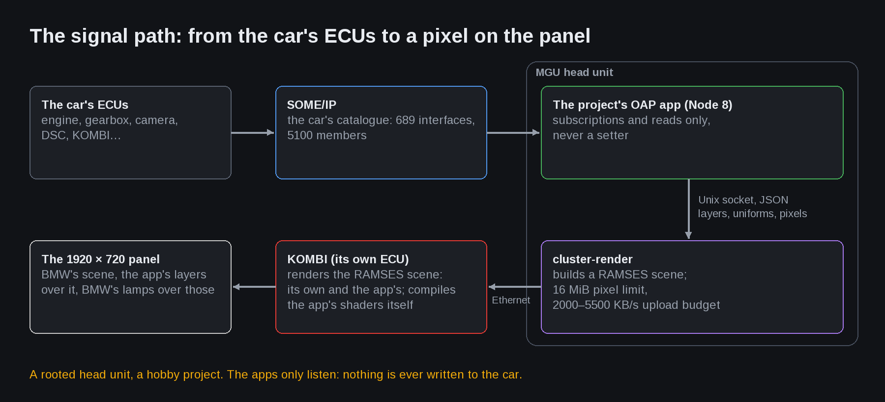
*The signal path: the car's ECUs → SOME/IP → the app on the MGU → cluster-render → KOMBI → the panel. Nothing goes back to the car.*

## 9. Twin Dial: a second cluster from scratch

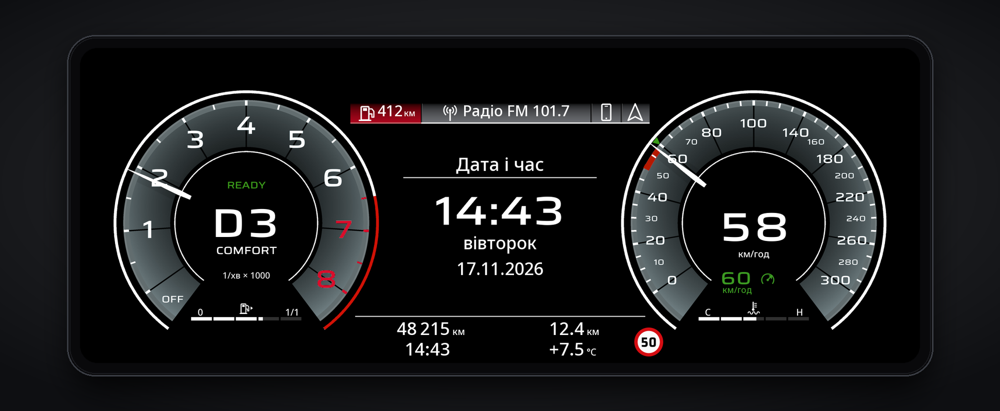
*Twin Dial 0.1.1 on the bench: a 50 limit, the needle at 58, the scale strip red from 50 to the needle, the sign at the bottom, cruise set to 60 in green inside the speedometer.*

After f30_cluster the next task was a different look: two round dials in the spirit of the later-generation Audi virtual cockpit, with a flat grey scale band, a thin white bezel and a red zone. It is a separate app rather than an f30_cluster theme, and it is entirely its own, with no see-through variant showing the stock cluster.

**Round 1 was measurement only.** Seven agents worked in parallel, each in its own git worktree: references, dials, frame, type and pictograms, colour, signals, and the fit to the G20 panel. The reference agent rectified five images to a frontal view at R = 400 px; the best one fitted to 0.35 px. A web search found no more usable frontal shots, and some public sources simply answered HTTP 429. The decision: no further reference hunting for now. The lead agent merged the seven reports into a specification.

Next came a **mockup renderer** that draws the specification itself. Decisions were taken on the mockups: a ±125° sweep, a white needle, the red zone, messages drawn by the app, the on-board computer in the centre. The verdict on the mockups was clearly positive, and from then on they were the visual reference. One lesson came from there too: the first mockup had grey "feet" under the scale that no reference has. The agent had invented them, and they were removed in a commit of their own.

**Round 2 (0.1.0)** built the app: fonts, 25 pictograms, baked dial faces, the engine, a bench simulation and a state gallery. **Round 3 (0.1.1)** added live tabs, each with its own colour: on-board computer, messages, media from CarPlay, phone and navigation. The limit sign arrived with a marker on the scale and a red strip from the limit onward, and cruise moved into the speedometer's lower opening. That took eight research packages, two rounds of mockups and seven build packages, later merged into one integration branch.

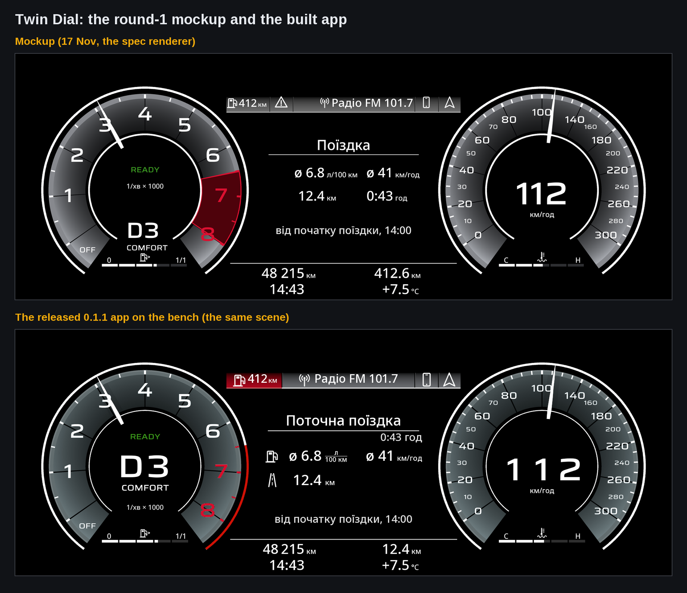
*Top: the round-1 mockup (the specification renderer). Bottom: the released 0.1.1 on the bench in the same scene. In round 3 the red wedge became an arc on the bezel, the gear moved into the rev counter's centre and the tabs got their own colours.*

### How it works: the material in a byte

In f30_cluster each dial is an RGBA texture of 3.42 MiB. In Twin Dial each dial's face is **one R8 texture** of 616 × 560, one byte per pixel: 0.66 MiB in memory, a quarter of the bytes per texel. The byte is the pixel's neutral sRGB code (the picture's green channel), and **the material and the colour are decided by the shader** from two things: the pixel's radius ρ = r/R and the byte value itself.

The approach. At bake time (`tools/twin-dial/bake_face.py`) the face is drawn at three times the size and reduced with a LANCZOS filter. The scale band gets a brightness from a law fitted to a reference,

```
Y = 0.0188 · e^(4.60 · (ρ − 0.60)) · e^(0.59 · (1 − cos θ))      (linear light)
```

the tick strip a constant code 109, its bright line 124, the major lines across the band 6, the fuel bar's segment frames 47, a grey label 227, and all "ink" (ticks, numerals, bezel, inner rim, OFF) 255. The shader decodes:

1. g = byte/255, L its linear light.
2. The material by radius: scale band ρ 0.5795–0.9375, tick strip 0.893–0.9375, its line 0.924–0.934, bezel ρ ≥ 0.975 (always "ink"). The boundaries are `smoothstep`s a few thousandths of R wide.
3. "Ink" by byte: `ink = max(smoothstep(0.70, 0.85, g), bezel, red · smoothstep(0.50, 0.70, g))`.
4. The colour: `rgb = L · mix(background tint, ink colour, ink)`. The band's tint is 0.76 : 1 : 1.064 in linear light (cool); the tick strip has its own, from its colour (98, 109, 111).
5. The red from the red zone, the limit and cruise markers, the fuel bar fills and the needle with its shadow come from uniforms, without any change to the texture.

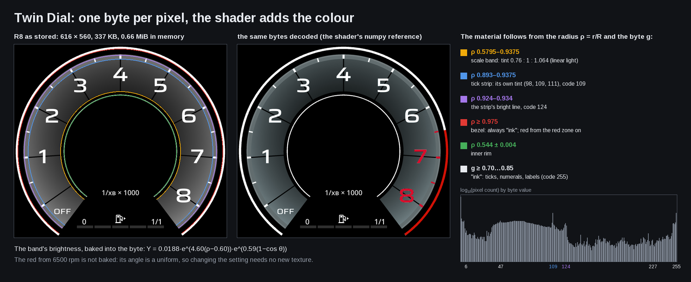
*Left: the rev counter's R8 face as stored (the coloured arcs are the material boundaries). Middle: the same bytes decoded by the shader's numpy reference, with the red zone from 6500 rpm. Right: the material rules and a histogram of the byte values.*

Two properties follow. First, the red zone, the night multipliers, the band level (the `bandGain` setting) and the limit change in place as uniforms, with no layout rebuild and no upload. Second, the decode can be checked away from the car. `face_shade.py` is the same algorithm in numpy, and `test_shader.py` runs the real GLSL shader on the computer's GPU (through moderngl, no browser) and compares: outside the needle area the difference is 0.000 of a code. The bake is reproducible to the byte: every committed file regenerates exactly, and a manifest keeps the sha256 of every texture and every font. Compared with the mockup at the same font stretch, the mean difference is 0.3–0.4 of a code value per channel.

### Messages and the safety machine

The hardest part of Twin Dial is check-control messages in the centre. BMW's stock message panel is covered by the app's own card, so it has to be guaranteed that a warning never leaves the screen, not even for a frame. Under the stock panel there is a "window" of exactly its shape, and it stays open whenever the app can't draw the text: the field isn't read yet, there's no entry for the number, a glyph is missing, drawing threw an exception. The sequence:

1. A message appears, and the window **opens** right in the signal handler, without waiting for the next tick.
2. The window closes only once the card with the text of **that exact** message has been on screen for at least **150 ms**.
3. If the driver leaves the Messages tab, the window opens in the same turn, and the text stays for at least another 150 ms. The window and the card live on different connections, and nothing guarantees an order between them.

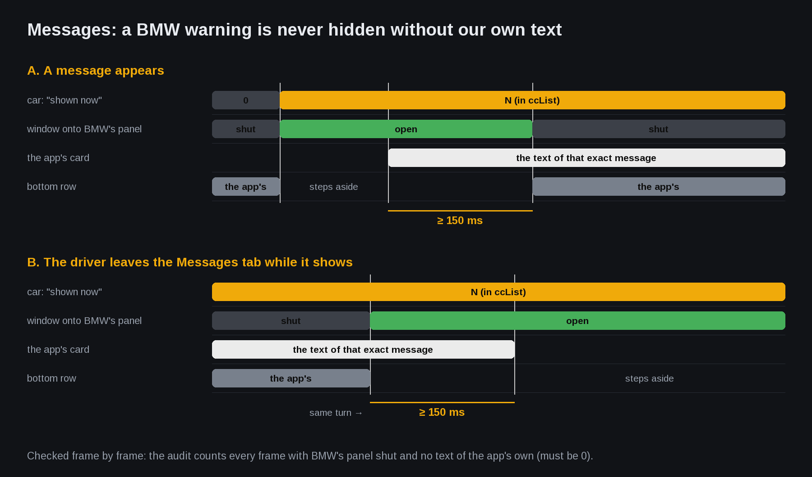
*How BMW's panel is shut and reopened. Without the app's own text for that exact message it isn't shut for a single frame.*

The point here isn't the code but **tests that fail when the feature is broken**. An audit on the real engine checks *every frame* the engine sent: it compares the pixels with an independent render and counts frames where BMW's panel is shut without the app's text. Six deliberately broken engines (the row doesn't step aside, the window never opens, a stale card stays, a card for the wrong message, the 150 ms waits removed, the row on the wrong connection) each fail that test. The machine's model ran 35 scenarios in three service modes (everything at once, one operation at a time, connections in any order): about 100,000 audited frames with no violation, and each of eight broken machines fails. Until the car confirmed that the "shown now" number matches a list entry, Twin Dial didn't shut BMW's panel at all.

## 10. Performance: why one app is light and the other heavy

The first audit started with an observation on the car: the needle seemed to stutter a little. Two causes were found. The needle value was sampled by a 50 ms timer with no interpolation, so on a 60 Hz cluster only every third frame moved. And the centre-screen page, while open, is rasterised in software, which on the car's CPU is estimated at about 70 ms a frame of blocked event loop. In 0.7.14 the needles got their own 33 ms timer and show a value interpolated one sample period back, and socket writes are corked into batches.

Then came the question of why Twin Dial is so light and f30_cluster so heavy. Both apps were put on the same protocol recorder and every byte was counted:

| | f30_cluster (Comfort) | Twin Dial |
|---|---|---|
| Pixels to the first complete frame | 5.8 MB (2.9 s at 2000 KB/s) | 2.3 MB (1.14 s) |
| Drive-mode change | a rebuild: back to Comfort is 5.68 MB | 6 KB (just the mode label) |
| Pixel memory, settled | 11.41 MiB | 4.73 MiB |
| Identical pixels re-sent over the script | 19.8 MB | 4.1–4.8 MB |
| Steady driving | 4.2–4.4 KB/s | 4.5–5.3 KB/s |

In f30_cluster the three themes are three layouts. Every drive-mode change rebuilds everything, and the two RGBA8 dial textures (1.8 MB each on the wire) are dropped when leaving Comfort and uploaded again on return. Twin Dial has one layout: mode, night and redline change in place as uniforms, and its R8 faces take a quarter of the bytes per texel. Both share a "triple build" at start: the car's first time zone and first `ccList` each trigger another full rebuild.

There are several ways to lighten f30_cluster. cluster-render 0.5.12 on the car already accepts ETC2-compressed textures and charges them to memory once, not twice. The "safe" package (R8 only) halves a Comfort build, from 5.98 to 2.98 MB. The "best trade" (ETC2 plus textures that stay resident) brings it to 2.23 MB and no longer re-sends a texture on a switch. The prototypes sit behind a setting and are off by default: whether this KOMBI draws `etc2rgb` is still a hypothesis.

## 11. How the team of AI agents worked

- **The lead agent** writes briefs, splits work into packages, merges branches and pushes only when asked to. There were some twenty briefs: for baking, the bottom strip, three Twin Dial rounds, the car session.
- **Package agents** work in parallel, each in its own git worktree and branch, with its own bench port. At the peak, on 18 November, three mockup packages, seven Twin Dial build packages and four car-session preparation packages ran at the same time, plus one more.
- **Marked hunks.** The seven build packages edited the same files. The rule: new code goes into new files, and every edit of a shared file is a small block marked with the package's name. Merge conflicts could only be resolved inside those blocks, and every integration edit became a separate commit called "Integrate: …".
- **Verified and hypothesis.** Every package report separates what was measured (with the command that reproduces it) from what needs the car. The agents have no browser: renders go straight through moderngl, and processes start through a wrapper that ends on its own.
- **Tests that must fail.** A test is worth something only if a deliberately broken feature fails it. So next to the tests came broken engines, doctored pictures and a fake `ssh` that the checks must catch.

What went wrong, briefly and honestly:

- **The bench lies.** fp16, the unbound sampler, shader size: each time, the bench was fine.
- **An agent's finding is a hypothesis until the car confirms it.** Once an audit agent found a "problem" on the bench, and a fix nobody had asked for slipped into a push. On the car that spot was fine, and the fix had to be reverted. Since then "bump and push" means exactly that.
- **Wrong assumptions in reports.** The bottom-strip packages disproved some numbers in the earlier G20 spec. A wider message "release" rule covered BMW's panel in one scenario, so it was narrowed. Twin Dial 0.1.0's empty trip page wasn't the car being silent but a consequence of config. The audit before the car session found 13 contradictions between reports.
- **"Feet" that weren't there.** A mockup drew a detail found in no reference. Now every number in the specs cites a reference and a measuring method.
- **Shared resources.** The budget test wrote into a work folder shared by every worktree, so two agents running it at once would collide. One agent noticed and ran it against a private copy.

There's no "the AI did it all" magic here: the rules, the checks on the car and the decisions stayed outside the agents, and the agents took on a volume that would not otherwise have fitted into nine days.

## 12. Evolution, and what's next

| Version | Date | What changed |
|---|---|---|
| f30 0.4.1 | 11 Nov | first version in git history: three 6WB themes in shaders, bench and emulator |
| 0.5.0–0.6.3 | 11 Nov | Comfort fitted to the G20; signs, over-speed band, tubular rings |
| 0.7.0 | 11 Nov | first baked 6WB scene, range and consumption arcs |
| 0.7.3–0.7.5 | 12 Nov | the sampler lesson, freeing textures before a rebuild, fp16 |
| 0.7.9–0.7.10 | 14 Nov | message window, map window around the dials |
| 0.7.11–0.7.13 | 14 Nov | BMW's native menu on the centre screen; the KOMBI resets, and shaders are split by look |
| 0.7.14 | 15 Nov | smooth needles |
| 0.7.18 | 16 Nov | the bottom strip on a baked R8 mask, Ukrainian in the fonts |
| 0.7.19–0.7.20 | 17 Nov | messages from `ccList`, then by the "shown now" signal |
| Twin Dial 0.1.0 | 17 Nov | the second cluster: two dials, centre pages, its own message plate |
| signal_probe 0.1.0–0.1.1 | 18 Nov | the probe with 160 fields, then the "Signs" set with events |
| Twin Dial 0.1.1 | 18 Nov | live tabs, messages in the centre, limit and cruise from the real sources; released |
| f30 0.7.21 | 18 Nov | "shown now" and the limit sign from the car's real sources; released |
| signal_probe 0.2.0 | 19 Nov | the "cruise and distance" and "camera objects" sets for a drive |

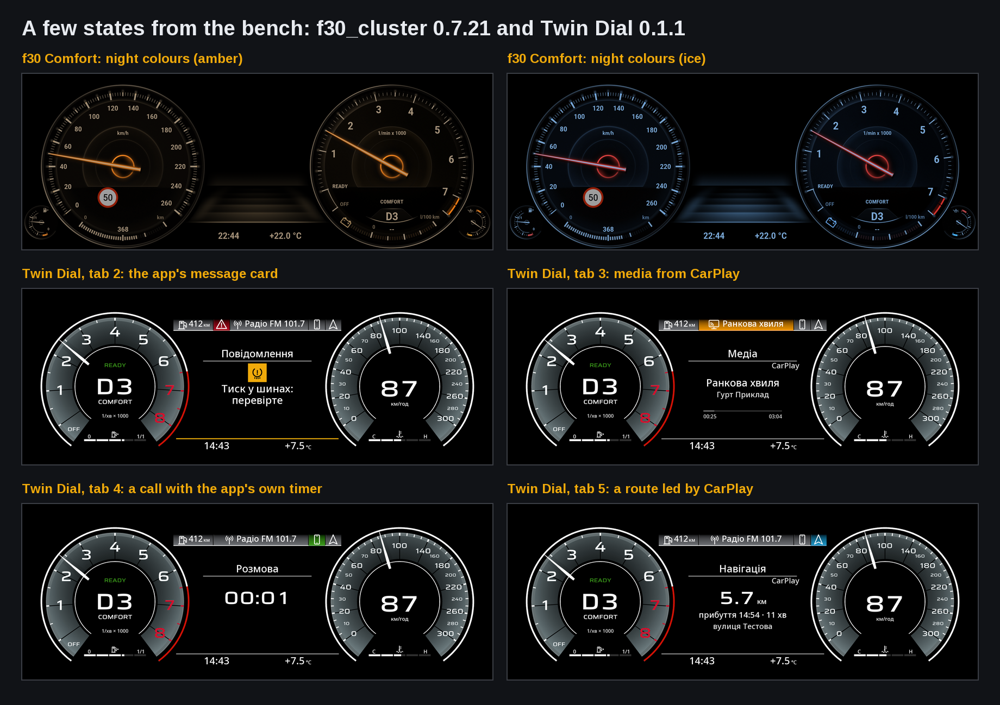
*A few states of the released versions from the bench. Top: two of f30_cluster's night looks. Below: Twin Dial's tabs with a message card, media from CarPlay, a call, and a route led by CarPlay (all texts invented). Twin Dial's night look isn't shown separately: it only dims the white, and no colour changes.*

What's next. Twin Dial 0.1.1 and f30_cluster 0.7.21 are already released with the fixes from the car session: "shown now" from `statusDisplayedCCMessage`, the limit from the sign-recognition event, the CarPlay media and route pages. A diagnostic experiment on the car has already hidden the black box; what remains is to establish which one, and to move it into the normal build. Queued: the remaining blocks of the car session, lighter textures for f30_cluster, and a separate centre-screen app that records a trip and draws its graph, which so far exists as a spec and a bench prototype. BMW's lamps at the top and a bottom row that's entirely the app's own are deliberately deferred.

The next drive is being prepared already. signal_probe 0.2.0 adds two sets. "Круїз і дистанція" (cruise and distance: 37 new entries on 16 interfaces, 11 of them events, plus seven existing fields, 44 in all) listens to the vehicle ahead (gap and speed in X and Y, type, width), the distance control's object list with longitudinal and lateral distance, speed and acceleration, the collision-warning request, and the car's own speed, accelerations, yaw rate and road gradient. "Об'єкти камери" (camera objects: 21 events on 7 interfaces) listens to the front camera's object lists and the fused list. The first set writes 5–10 KB of log a second and the second 20 KB or more, while the app's log rotates at 256 KB, so it will be read live. These sets have not been listened to on a drive yet: so far, parked, only one field about the vehicle ahead answered, and whether the other providers come up is unknown.

The main conclusion is simple: on someone else's cluster the hard part isn't drawing a pretty needle, it's **knowing exactly what is being covered and what the car is really saying**, and proving it with a test that fails.

---

*The images in this article are bench renders, the project's diagrams and pictures made from the apps' own baked files, except two sheets of photos of the real G20 panel: those are cropped to the cluster, with the map, the street name and the town name blurred. There is no BMW artwork and no third-party reference image here. Brand names are used only to describe the style.*
