# Два щитки для однієї «трійки»: приладова панель BMW G20, перемальована командою ШІ-агентів

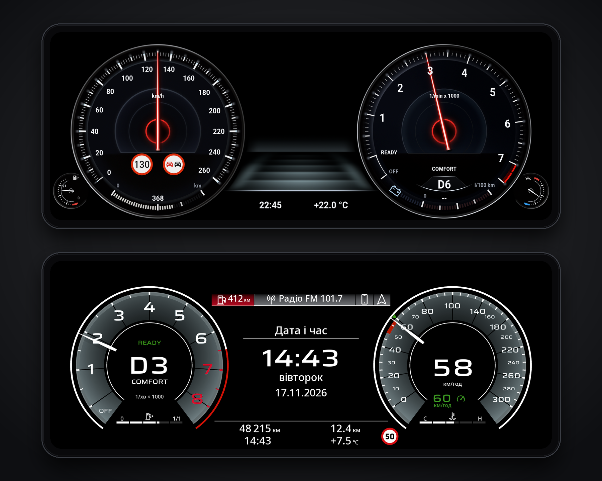
*Обидва щитки, як їх малює бенч проєкту: f30_cluster (вигляд аналогового щитка F30, режим Comfort) і Twin Dial (два круглі циферблати в дусі «віртуального кокпіту» Audi). Рамка намальована.*

**Коротко.** BMW 3 серії в кузові G20 має цифрову панель приладів 1920 × 720. Задача проєкту: повернути на неї два «аналогові» циферблати старого F30, а потім зробити ще один щиток із нуля. Головний пристрій iDrive 7 (MGU) в авто рутований, а спільнота вже має інструменти, які дають малювати на щитку.

Роботу виконала команда ШІ-агентів на базі Claude (один ведучий агент і паралельні агенти-виконавці пакетів) під керівництвом людини. Людина ставила цілі й правила, ухвалювала рішення, фотографувала панель і натискала кнопки в авто. Агенти вимірювали, малювали, писали код, тести й звіти. Далі в тексті йдеться лише про те, що й як зроблено.

За дев'ять днів історії git (11–19 листопада) з'явилося два застосунки для щитка і один для прослуховування авто:

- **f30_cluster**: вигляд щитка F30 з режимами Comfort, Sport і Eco Pro;
- **Twin Dial**: окремий щиток із нуля в стилі віртуального кокпіту Audi;
- **signal_probe**: застосунок, який нічого не малює, а лише слухає сигнали авто.

У цифрах це понад 650 комітів, близько 150 мерджів, майже 190 гілок і два десятки брифів. На піку паралельно працювало до 15 агентів, а за весь проєкт — понад 60 (оцінка; на диску й досі лежать 62 робочі копії агентів, git worktree). Каталог сигналів авто має 689 інтерфейсів, а робочих даних (рендерів, ректифікованих кадрів, логів) набралося близько 3,7 ГБ у 12 тисячах файлів. Обидва щитки вже працювали на авто, а не лише на стенді.

> **Важливо.** Це хобі-проєкт на рутованому головному пристрої. Авто не прошивається й не «кодується», і в нього нічого не записується: застосунки лише читають сигнали. Попередження BMW ніколи не ховаються, і нижче пояснено, як саме це забезпечено. Інструкцій із рутування тут немає. Повторювати на своєму авто будь-що, що в нього пише, не варто.

## 1. Задача і платформа

F30 з опцією 6WB (мультифункціональний дисплей приладів) теж мав екран, але малював на ньому два великі «аналогові» циферблати з хромованими обідками й червоними стрілками. G20 має замість нього пласку цифрову панель.

Технічно все влаштовано так. Головний пристрій MGU запускає сторонні застосунки OAP (на Node 8). Спільнота зробила для них MGU App Kit, а **cluster-render** уміє передавати шари на щиток: застосунок відкриває Unix-сокет і описує шари (ефекти з GLSL-шейдерами, картинки, аркуші тексту), а cluster-render складає з них сцену RAMSES. Саму сцену малює **KOMBI**, окремий блок комбінації приладів.

Звідси перший важливий висновок: **щиток BMW не замінюється, власні шари кладуться поверх його сцени.** BMW і далі малює своє, а частину своїх елементів (лампу ременя, стоянкове гальмо, літеру передачі) малює *поверх* шарів застосунку. Через увесь проєкт тому проходить одне правило: **попередження BMW не можна сховати, якщо в тому самому кадрі на екрані немає власного тексту саме для цього повідомлення.**

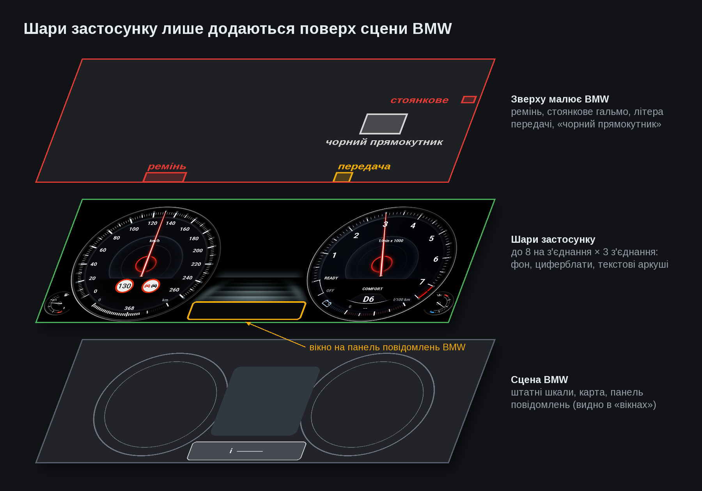
*Як складається картинка: сцена BMW, над нею шари застосунку (з «вікном» на панель повідомлень BMW), а над ними те, що BMW малює поверх. Схема проєкту; сцену BMW показано сірими заглушками.*

## 2. Обмеження платформи, вивчені на авто

Спершу все жило на **бенчі**, браузерному стенді, який імітує cluster-render і авто. На бенчі все працювало. На авто частина речей не працювала, і за кожною такою розбіжністю стоїть кілька кіл «встановлено, сфотографовано, з'ясовано».

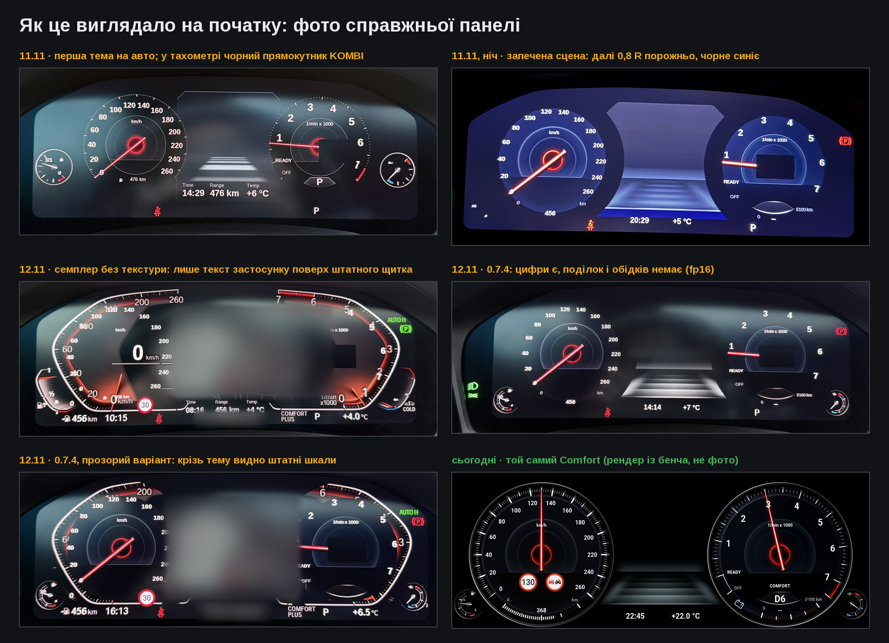
*Так це виглядало на початку. П'ять фото справжньої панелі з 11–12 листопада, обрізані до щитка; карту й назву вулиці в рядку BMW розмито. Останній кадр — сьогоднішній рендер із бенча для порівняння.*

**Пам'ять пікселів рахується двічі.** cluster-render має 16 MiB на картинки й текстури і рахує кожне зображення двічі: w·h·8 байт для RGBA, w·h·2 для однобайтового R8. Одна текстура циферблата 670 × 670 займає 3,4 MiB. Перемикання макетів падало з помилкою «пам'ять пікселів сервісу заповнена»: старі текстури ще жили, коли вже завантажувалися нові. Виправлення: спершу звільнити непотрібне, потім створювати нове. Окремо діє ліміт шарів: до восьми на одне з'єднання з cluster-render.

**Семплер без текстури, і шар зникає мовчки.** На третьому фото намалювався лише текст застосунку, а під ним видно штатний щиток із власними цифрами. Рендерер RAMSES просто не малює ефект, у шейдері якого оголошено `sampler2D` без прив'язаної текстури, і помилки не повертає. Спершу підозра впала на ліміт у 32 uniform-и, потім на розмір ассетів. Тепер кожен незайнятий семплер отримує прозору текстуру 1 × 1, а бенч пропускає такий шар так само, як авто.

**`mediump` на авто — це fp16.** На другому й четвертому фото є цифри, але немає поділок, обідків і кінчиків стрілок: великі циферблати (R 335 px) не малювали нічого далі приблизно 0,8 R. Причина в тому, що `length(p)` від зміщення в пікселях підносить координати до квадрата, а у fp16 (максимум 65 504) це переповнюється десь після 256 px. Браузер рахує `mediump` у fp32, тож бенч цього не показував. Виправлення у 0.7.5 займає два рядки:

```glsl
#ifdef GL_FRAGMENT_PRECISION_HIGH
precision highp float;     // mediump is fp16 on the car's GPU (x*x+y*y overflows past ~256 px)
#else
precision mediump float;
#endif
...
float d = length(p / R) * R;   // not length(p)
```

**KOMBI перезавантажується від завеликого шейдера.** У версії 0.7.11 з'явилися нічні вигляди, і щиток почав гаснути. За логами з авто KOMBI зникав приблизно через 2,3 с після кожного показу сцени: 13 разів майже за шість хвилин, а тунель до KOMBI щоразу рвався й піднімався заново. Структура шарів і пам'ять були такі самі, як у 0.7.10, змінилися лише шейдери. Шейдер циферблата на 25,4 тис. символів працював, на 26,7 тис. уже перезавантажував щиток. У 0.7.13 кожен шар отримує лише код свого вигляду, і шейдер Comfort важить 12,4 тис. символів. Додався й власний запобіжник: після двох перезавантажень KOMBI застосунок сам вимикає тему. На авто це перевірено того ж вечора: перезавантаження зникли.

**Нульовий гетер означає «гетера немає».** Оновлення 0.7.16 чотири рази не встановилося з лаконічним `UPDATE_FAILED`. У каталозі сигналів шість полів мали `"getter": {"id": 0}`, а генератор конфігурації на MGU перевіряє id на істинність, тож нуль для нього означає відсутність гетера. Прапорець «читати» (`r`) на такому полі валить усю інсталяцію. Прапорець `r` прибрано, підписку (`s`) залишено, і 0.7.17 встановилася. Відтоді перевірка сигналів вимагає ненульових id.

### Як це працює: шейдер для слабкого GPU

Причина проста: KOMBI компілює кожен отриманий шейдер цілком, з усіма гілками, а запас у нього невеликий. Тому шейдер, який іде на авто, готується ще в JS.

Вихідний текст шейдера циферблатів WBDIAL з коментарями має близько 30 тис. символів і містить п'ять виглядів: Comfort, Sport, Eco Pro, малий бічний прилад і циферблат ефективності. Функція `compact()` у `shared/shaders.js` перед відправкою робить три речі: розв'язує всі блоки `#if STYLE` і `#if NIGHT` для потрібного вигляду (лише цифри й оператори, обчислені в JS), вирізає коментарі й порожні рядки і, якщо вигляду нічні кольори не потрібні, розгортає кожен виклик `nightLook(x)` у просте `x`. Ядро таке:

```js
const cond = (e) => {
    const x = e.replace(/\bSTYLE\b/g, '(' + n + ')').replace(/\bNIGHT\b/g, '(' + nk + ')');
    if (!/^[\d\s()<>=!|&-]+$/.test(x)) throw new Error('shaders.compact: cannot evaluate #if ' + e);
    return !!Function('return (' + x + ');')();       // only digits and operators reach here
};
...
const c = line.replace(/\/\/.*$/, '').replace(/\s+$/, '');
if (c.trim()) out.push(c);
```

Результат у цифрах (виміряно на поточному коді): усі п'ять виглядів після стискання займають 18,2 тис. символів, Comfort з нічним виглядом 13,3 тис., Sport і Eco Pro (без нічних кольорів) 6,4–6,6 тис. Шейдер циферблата Twin Dial `tdial` має 5,8 тис. символів за бюджету 8 тис., і цей бюджет перевіряє тест.

Ще кілька правил виросли з тих самих уроків:

- **Uniform-и спаковано у `vec4`.** cluster-render тримає до 32 uniform-ів на шар, а деякі GPU мають менше векторів. Тому WBDIAL отримує, наприклад, `u_geo` (ширина й висота шару, ширина обідка, дзеркальність) і `u_scale` (початок, розмах, число великих і малих поділок), а `#define` повертає їм зручні імена.
- **Кожен семплер має текстуру.** Пусті семплери отримують прозору текстуру 1 × 1 (`_bindBlanks` у `hud.js`).
- **R8 на авто і на бенчі читається по-різному.** Авто віддає однобайтову текстуру як (r, 0, 0, 1), а сторінка бенча через 2D-канву як (r', r', r', r) з округленим r'. Одна функція читає точно на обох, навіть з білінійною фільтрацією: `float r8a(vec4 s) { return s.a < 0.999 ? s.a : s.r; }`.
- **Жодної довжини в пікселях.** Усі відстані рахуються на масштабованих векторах (`length(p / R) * R`, `length(q / 64.0) * 64.0`) або на обрізаних (`length(clamp(q, 0.0, 64.0))`), а статичний тест Twin Dial перевіряє, що в шейдерах немає `length()` від ненормованого зміщення.

## 3. Геометрія і площа: що з 1920 × 720 справді доступне

Панель має 1920 × 720 пікселів, але водій бачить не всі. Верхні кути ховає козирок. Його виміряно так: на панель виведено сітку, її сфотографовано з місця водія і вписано гомографію по 108 вузлах сітки (залишкова похибка 3,5 px). Межа козирка тепер записана ламаною: «перший видимий y» для кожних 100 px по x. Перші цифри дісталися від іншої машини, X3 M40i, у якої козирок у кутах значно глибший, тому для G20 усе переміряно.

Далі йде список того, що належить BMW. Агенти склали каталог штатних елементів G20 Comfort (38 елементів) і для кожного з'ясовували за фото, чи BMW малює його **над** шарами застосунку, **під** ними, чи він **зникає** з кастомною темою, чи це поки **невідомо**. Над шарами завжди лежать лампа ременя, червона (P) стоянкового гальма, літера передачі в нижньому рядку і чорний прямокутник, про який ітиметься нижче. Для критичних ламп, які на фото не вдалося побачити ні над шарами, ні під ними, складено «безпечний план» з дірками у фоні саме над ними.

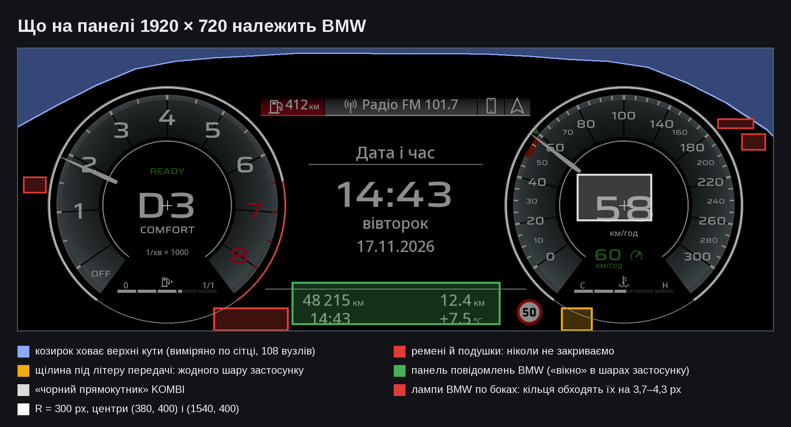
*Що на панелі належить BMW: козирок, ремені й подушки, щілина під літеру передачі, панель повідомлень BMW, «чорний прямокутник» і бічні лампи. Підкладка: рендер Twin Dial 0.1.1 з бенча.*

### Як це працює: ректифікація фото

Усі виміри на авто починаються з одного: перевести фото панелі в пікселі самої панелі. Для цього застосовано гомографію (перспективне перетворення площини), але однієї гомографії виявилося замало.

На фото сітки залишок після найкращої гомографії має чистий кубічний профіль по x, близько ±3,5 px: це радіальна дисторсія об'єктива телефона. Тому модель `tools/overlay/rectify.py` — гомографія плюс один радіальний член навколо центру фото:

```
u = c + (q − c) · (1 + k₁ · |q − c|² / s²),    u = H · (точка панелі)
```

тут q — піксель фото, c — центр фото, s — половина його діагоналі. Для кожного k₁ на сітці значень гомографію знайдено методом найменших квадратів, а з усіх k₁ узято той, що дає найменшу середньоквадратичну похибку в пікселях панелі. Вузли сітки шукаються нормованою кореляцією (NCC) на каналі «зелений мінус червоний», щоб жовті підписи сітки випали. Спершу RANSAC із широким порогом відкидає хибні точки, потім три раунди уточнення з порогом 3 px.

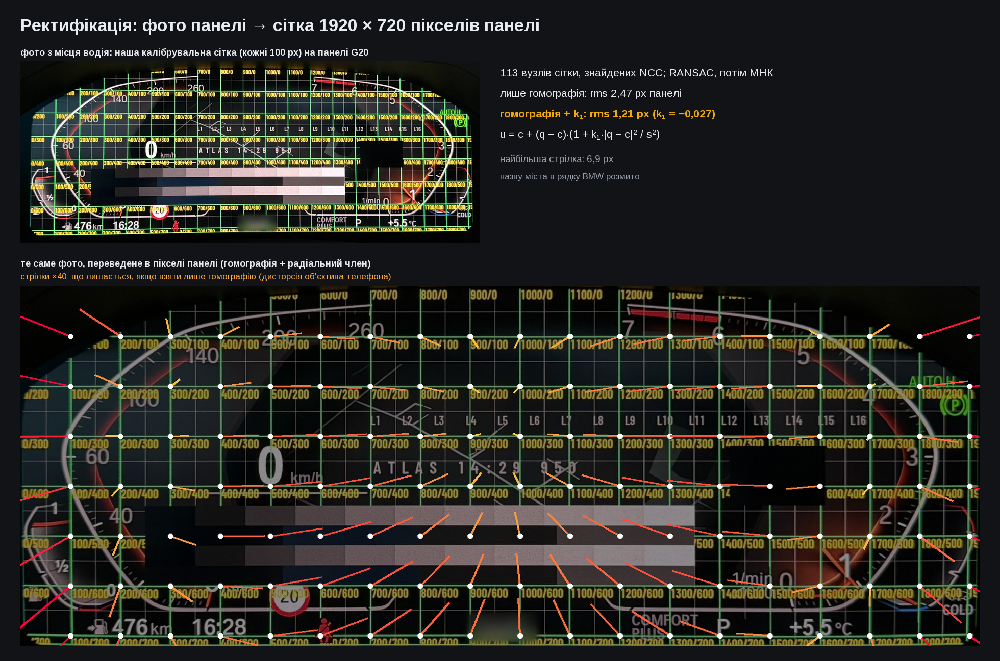
*Угорі: фото калібрувальної сітки на панелі G20 з місця водія. Унизу: воно ж у пікселях панелі; стрілки (×40) показують, що лишилося б від самої гомографії без радіального члена. Назву міста в рядку BMW розмито.*

Що це дає в цифрах. На фото сітки знайдено 113 вузлів. Сама гомографія лишає похибку 2,47 px (середньоквадратичну), гомографія з k₁ = −0,027 лише 1,21 px. На фото першої теми на авто, де опорними точками служили 30 статичних написів самої теми (знайдених NCC за рендером тієї самої збірки з бенча), похибка падає з 1,61 до 0,16 px.

Фото без сітки прив'язуються ланцюжком. Денне фото штатної теми зіставлено з уже ректифікованим фото сітки через SIFT: зображення спершу вирівнюються локальною еквалізацією CLAHE (3,0, плитки 8 × 8), далі 12 000 ознак SIFT, тест Лоу з порогом 0,8 і збіги лише в межах 40 px від попередньої оцінки. Нічне фото прив'язано до денного так само. Перша, найпростіша версія інструмента (6000 ознак, поріг Лоу 0,78, RANSAC із порогом 6 px) так само зводила рендер бенча з фото першої теми на авто. Фото, де один піксель фото більший за 4 пікселі панелі, для геометрії не беруться, лише для візуальних перевірок.

### Як це працює: пошук посадки і перевірка накладань

Для Twin Dial окремий агент перебирав радіус і положення циферблатів скриптом. Умови були такі: обидва циферблати симетричні відносно x 960, уся дуга обідка щонайменше на 4 px нижче лінії козирка, диск циферблата щонайменше на 3 px від кожного елемента BMW. Перемагав найбільший радіус, а за рівних радіусів відстань між центрами, найближча до референсу. Вийшло **R = 300 px** з центрами в (380, 400) і (1540, 400). Положення зафіксували дві лампи: auto-hold справа (запас 3,7 px) і ABS зліва (4,3 px). Щоб пропорції не гуляли між різними референсами, усе вимірювано в **одиницях циферблата**: довжини як частку R, кути в градусах за годинниковою стрілкою від 12. Одну річ із референсів зберегти не вдалося: циферблати на 9 % менші й сидять на 30 px нижче, бо інакше лампи BMW опинилися б усередині кілець.

Цифри на шкалі мають правило зазору: «чорнило» кожної цифри тримається щонайменше на 4 px від сусідньої цифри, поділки й стрілки в положенні спокою. Це перевіряється під час запікання: межі гліфів беруться з малюнка, збільшеного втричі, і для кожної пари рахується найменша відстань між контурами. На спідометрі найменший зазор між цифрами 7,6 px, а цифра «120», якби її додали, мала б зазор 0,65 px, тому її в наборі немає. Для макетів написано «реєстратор чорнила»: він запускає генератор картинок без змін і записує рамку кожного тексту й кожної іконки. На 210 кадрах перевірялися заборонені зони (жодного не чорного пікселя в групі ременів, у щілині передачі й у дірках семи бічних ламп), комірки вкладок, зазори в рядку і відкрите вікно повідомлень. Сама перевірка має тест із 25 навмисно зіпсованих картинок, на кожній з яких вона мусить упасти. Одну справжню помилку вона теж знайшла: одиниця «бар» на технічній сторінці вилазила за край центрального вікна на 2,7 px.

### Чорний прямокутник

З кастомною темою KOMBI іноді малює суцільний чорний прямокутник посеред правого циферблата (у G20 приблизно [1420, 320, 1611, 440], його видно на ранніх фото й навіть на фото сітки вище) і більше його не прибирає. Цій загадці присвячено три дослідницькі раунди:

- Перемикання макета не перепризначає слот панелі. На бенч-моделі cluster-render пауза без жодного шару тривала 3–19 мс, а слот відпускається лише після 3000 мс.
- У каталозі на 689 інтерфейсів жоден сигнал не каже «прямокутник показано». Зате прямокутник накриває **саме те місце**, де штатний G20 малює велику літеру передачі. Схоже (гіпотеза), що це підкладка літери, яка «повертається» на своє штатне місце.
- Порівняння двох застосунків за записом кожного повідомлення до cluster-render показало: f30_cluster у кожній темі й стані кладе прямокутники шарів поверх літери передачі в нижньому рядку, а Twin Dial ніколи не кладе жодного шару в зону x 1380–1460, y 660–720. Кожен шар cluster-render — це чотирикутник RAMSES у сцені, яку малює сам KOMBI, тож KOMBI отримує ці прямокутники як геометрію, а не лише як пікселі.

Для перевірки на авто в f30_cluster з'явилося меню «Діагностика» з трьома вимкненими за замовчуванням експериментами: вирізати кожен прямокутник шару навколо щілини передачі (ефектний шар, що її торкається, розбивається на чотири, а три віджети переїжджають на четверте з'єднання, щоб на кожному лишалося не більше восьми шарів), покласти над щілиною окремий шар (прозорий, чорний або сірий) і перебудовувати макет на кожну зміну режиму їзди. На бенчі перший варіант не змінює картинку поза щілиною більш ніж на 0,03 одиниці коду.

19 листопада діагностичний експеримент на авто прибрав чорний прямокутник. [МЕХАНІЗМ: уточнити]

## 4. Як аналоговий щиток розкладено на шари

Перші теми були чистим GLSL: циферблати, поділки, сяйво, усе процедурне. Виглядало пристойно, але не як F30: на тих самих фото процедурний циферблат мав SSIM лише 0,23–0,32. Тому наступним кроком стало **запікання**: розкласти щиток 6WB на окремі елементи, кожен виміряти й намалювати власним кодом, а статичне зберегти як текстури.

### Від фото до системи координат циферблата

Підхід такий: кожне фото 6WB перевести не в «пікселі панелі» (у чужого щитка їх немає), а в **систему координат циферблата**. Для цього кожен циферблат на кожному фото вписано за його власним обідком:

1. З ручної початкової точки пускаються промені, і на кожному промені шукається яскравий гребінь обідка з субпіксельною точністю.
2. По точках гребеня RANSAC вписує коло, потім еліпс (перспектива) з інлаєрами за відстанню до еліпса.
3. **Зовнішній край обідка на половині максимуму** відповідає R теми; сам гребінь лягає на ~0,99 R.
4. Нахил камери береться з лінії через центри обох циферблатів. Для одиночних циферблатів його дає край нижньої «підлоги» диска, а для макрознімка поділок радіус береться з кроку малих поділок (3,2°), а нахил з поділки 6000 об/хв.

Похибка вписування на найкращому фото — 0,64 і 0,59 px для великих циферблатів і 0,14–0,21 px для малих. Кожне фото ще й нормується за експозицією: чорне — 5-й перцентиль яскравості одразу за обідками (1,0–1,08 R), біле — середнє найяскравіших 0,5 % усередині 0,95 R, яке переводиться в 235; канали вирівнюються до нейтрального білого з обмеженням підсилення 0,8–1,25. Для кожного кадру зберігається маска бітами: поза фото, відблиск, водяний знак, коридор стрілки, живий текст.

На цьому кроці з'ясувалася перша неочевидна річ. Обідки на фото найяскравіші не там, де «ключове світло зліва вгорі», а внизу, у бік центрального вікна, і два циферблати одного фото дзеркальні один одному. Це вказувало на відбиття, а не на намальований відблиск, тож напрям світла довелося міряти окремо (розділ 5).

### Інвентар: десять кластерів і стек шарів

Щиток розбито на десять **кластерів**: C1 спідометр, C2 тахометр, C3 і C4 малі прилади пального й оливи, C5 центральне вікно, C6 нижній рядок і дуги, C7 знаки й піктограми, C8 частини режимів Sport і Eco Pro, C9 корпус і скло (лише документація), C10 фон. Кластери поділено між вісьмома пакетами агентів, а дев'ятий звів усе разом. Усередині кластера йдуть **шари** знизу вгору з дробовими z, щоб нові шари вставлялися без перенумерації. Для спідометра стек такий:

| z | Шар | Вид | Клас |
|---|---|---|---|
| 1 | обличчя: темно-синій градієнт, заливка диска й «підлоги» | albedo | запікається @0,5x |
| 2 | тінь від обідка всередину (ambient occlusion) | shadow | запікається @0,5x |
| 2,5 | тінь під лінією «горизонту» | shadow | запікається @0,5x |
| 3 | жолоб під поділками | albedo | запікається @0,5x |
| 3,1 | освітлений внутрішній край жолоба | highlight | процедурне |
| 5 | поділки-клини з холодною облямівкою на кінцях | albedo | процедурне |
| 6, 7 | край внутрішнього диска, внутрішнє кільце (дуги, відкриті внизу) | albedo | процедурне |
| 8 | кромка «підлоги» | albedo | процедурне |
| 8,5 | сяйво: плями за поділками, ореол поділок і кілець | glow | запікається @0,5x |
| 9 | затемнення навколо осі | shadow | запікається @0,5x |
| 11 | обідок із відблиском | highlight | процедурне |
| — | стрілка, її тінь, вісь, смуга перевищення | — | динамічне |

Тахометр має ще червону зону, дугу до OFF, «лоток» передачі, світлі плями за поділками й червоне кільце осі.

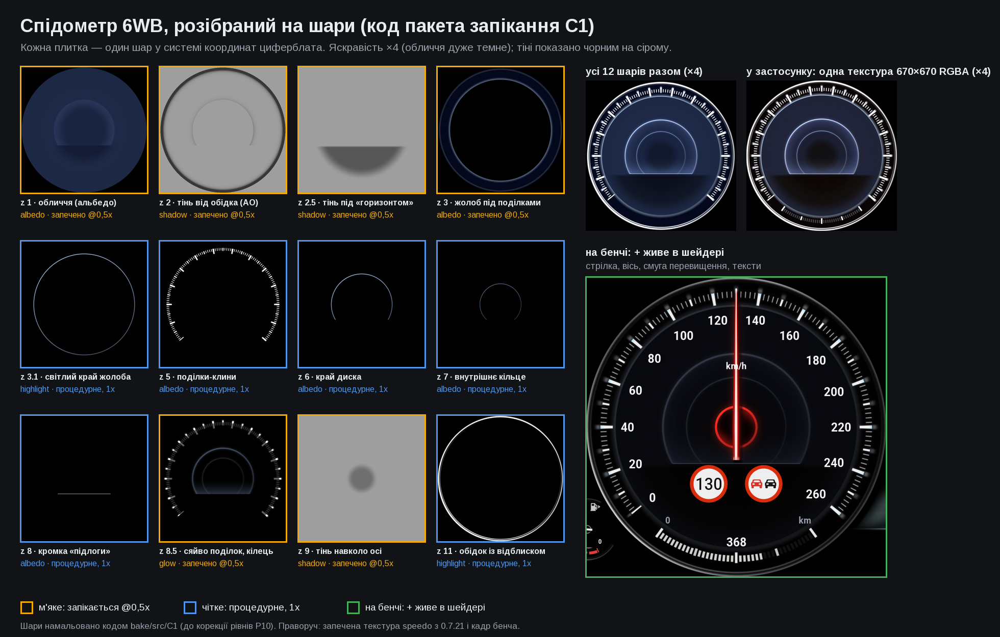
*Кожна плитка — один шар спідометра, як його малює код `bake/src/C1/draw.py` (яскравість ×4; тіні показано чорним на сірому). Праворуч: усі шари разом, запечена текстура з випущеної 0.7.21 і кадр бенча з живими частинами.*

Ніде не копіюється жоден піксель фото. Кожен шар — формула в одиницях R: наприклад, поділка — трапеція від r_in до r_out з напівшириною, що лінійно зростає від w_in до w_out, а її покриття рахується аналітично на сітці 4 × 4 підпікселів і усереднюється. Параметри підібрано вимірами: великі поділки 0,820–0,902 R з напівшириною 0,0085 → 0,0112 R, обідок на 0,9915 R із σ 0,0058 R, край диска на 0,487 R (тема мала 0,51), внутрішнє кільце на 0,330 R (тема 0,36), лінія «підлоги» на 0,245 R під центром. Диск і кільце — дуги, відкриті внизу: вони обриваються на лінії «підлоги», а не замикаються, як у першій темі.

### Що запікати, а що лишати живим

Межа проходить не там, де зручно, а там, де її ставлять обмеження платформи:

- **М'яке й низькочастотне** (градієнти, тіні, сяйво) запікається в половинному розмірі (@0,5x): при білінійному збільшенні воно нічого не втрачає, а пам'яті бере вчетверо менше.
- **Чітке** (поділки, кільця, обідок) в пакетах було процедурним, з точними параметрами в R, щоб його можна було перемалювати при іншому R.
- **Динамічне** не запікається ніколи: стрілка з тінню, стан осі, смуга перевищення, видимість знаків, тексти (шрифти живі й локалізовані) і, звісно, усе, що малює BMW.
- Дозволене змішування лише «звичайне» (alpha over), без множення й додавання, тож тінь, відблиск і сяйво зберігаються як окремі шари з альфою над альбедо. Це дає змогу «переосвітити» сцену без перепікання основи.

Бюджети, у які це мало влізти: не більше 8 MiB запеченого на один режим (пам'ять рахується як w·h·8), до восьми шарів на з'єднання і 32 загалом. Звідси пропозиція інтеграційного пакета: не робити з кожного шару окремий шар cluster-render, а зробити запечені файли **ассетами** (текстурами), які семплюють уже наявні ефектні шари. Ассети рахуються як пам'ять пікселів, а не як шари, і порядок z зберігається всередині одного шейдера. Запечене для Comfort вкладалося в 4,31 MiB.

### Як запечене потрапляє в застосунок

Остаточна інтеграція пішла ще далі. Скрипт `tools/bake_scene.py` складає **увесь статичний стек** кожного великого циферблата (обличчя, тіні, жолоб, поділки, червону зону, дугу OFF, диски, кільця, «підлогу», сяйво, лоток, кільце осі, обідок і нижню дугу з піктограмою) у z-порядку в одну RGBA-текстуру 670 × 670 з прямою (не попередньо помноженою) альфою. Процедурні шари для цього рендеряться в 1x тим самим кодом пакета. Половинні шари перед накладанням збільшуються білінійно в попередньо помноженій альфі, як це зробить GPU.

У шейдері WBDIAL режим «запечено все статичне» (`u_hasBase > 2.5`) робить лише одне вибирання з текстури, а живим лишається тільки те, що рухається або залежить від даних: смуга перевищення, заповнення нижніх дуг, вісь, тінь стрілки і сама стрілка. Цей поділ і пояснює, чому межа між «запеченим» і «живим» лежить саме тут:

- **Розмір шейдера.** Кожен статичний елемент у шейдері — це код, який KOMBI компілює повністю. Після перезавантажень у 0.7.11 кожен рядок шейдера мав значення, а текстура коштує нуль символів.
- **Пам'ять.** Дві текстури циферблатів по 3,42 MiB — найбільша стаття. Разом зі шрифтами, вікном і масками стабільний стан Comfort займає 11,41 MiB з 16.
- **Шари.** Увесь Comfort — 21 шар на трьох з'єднаннях; окремий шар під кожен елемент 6WB не вліз би у вісім на з'єднання.
- **Анімація.** Усе, що змінюється частіше за перемикання теми, лишається в шейдері: перепікання текстури коштувало б нового завантаження в кілька мегабайтів.

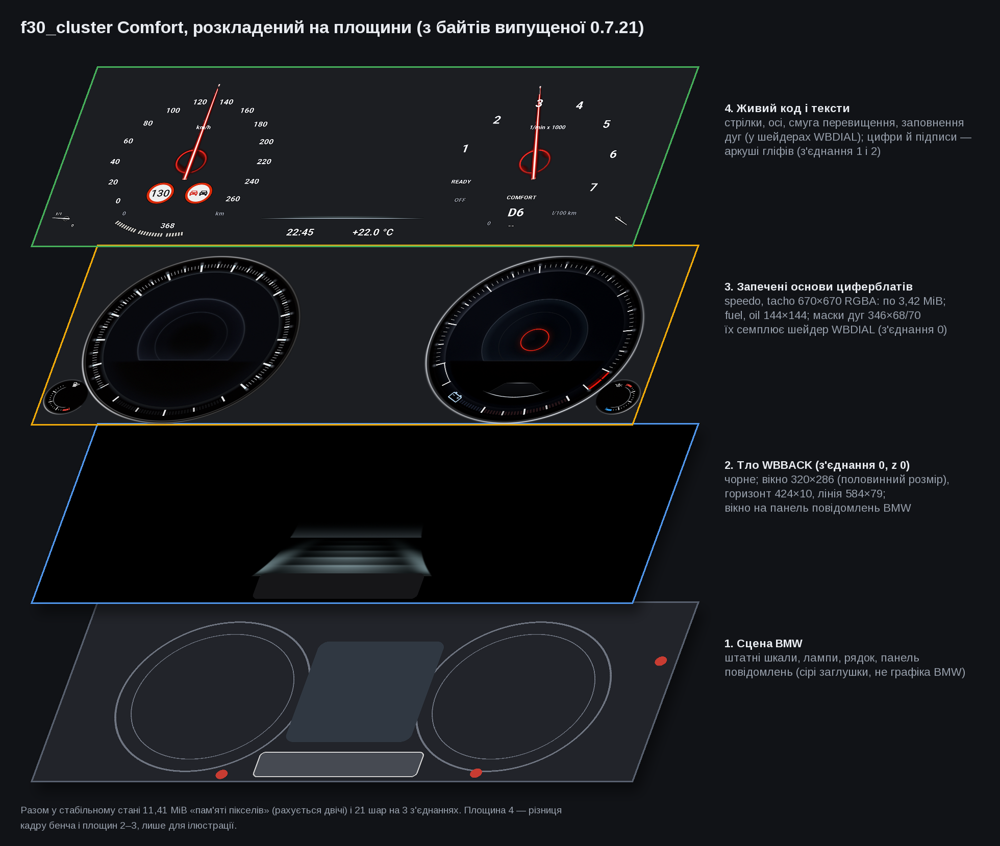
*f30_cluster Comfort з байтів випущеної 0.7.21: сцена BMW (сірі заглушки), тло WBBACK з запеченими вікном, горизонтом і лінією, запечені основи циферблатів, і те, що додають живий код і аркуші тексту (виділено різницею кадру бенча й запечених площин).*

### Контроль якості

Кожен шар і кожен стек порівнювався з ректифікованим фото тим самим інструментом `bake/src/qc.py`: SSIM за яскравістю з гаусовим вікном, середня колірна різниця ΔE2000, похибка положення країв (симетрична відстань між краями Canny у пікселях панелі) і перевірка на смуги квантування. Цілі брифу були суворі: SSIM ≥ 0,85 і ΔE ≤ 6 для м'яких шарів, край ≤ 1 px для чітких. Чесний результат: окремі м'які шари цих цілей досягали (заливка «підлоги» 0,92, лунка осі 0,92), а складений стек на найкращих фото дав SSIM 0,61–0,66 і ΔE 4,8–5,3. Проти попереднього процедурного циферблата (0,23–0,32) це великий крок, але не «піксель у піксель». Похибка країв стеку (3,8–4,9 px) обмежена розмиттям, цифрами й стрілкою на самих фото, а не помилками малюнка.

Дорогою траплялися кумедні знахідки:

- **Вікно вийшло вчетверо яскравішим, ніж треба.** Його рівні взяли з фото, на якому розсіяне світло підняло все зображення. Пропонувався коефіцієнт 0,24, але фото давали розкид від 0,08 до 0,39, тож остаточне рішення лишилося за оцінкою на око (а потім рівні виправив пакет P10, нижче).
- **Фото 02 не фото.** Аналіз шрифтів показав, що «найчистіший» референс — синтетична картинка: «Fasten seatbelt» подвоєно, «EfficientDynamics» нечитабельний, на місці OFF стоїть «OPO». Пропорції в ній теж інші (диск 0,568 R замість 0,487), тож для вимірів її не брали.

### Рівні: чорне не чорне

Окремий пакет P10 розібрався з рівнями, і тут з'ясувалися дві речі.

Перша: стара нормалізація віднімала чорне в кодах sRGB, а не в лінійному світлі, і на двох фото за «чорне» бралося не РК-поле, а пластик корпусу. Корекція робиться в лінійному світлі: код повертається до власного коду фото, а потім

```
L  = (lin(raw) − lin(F)) / (lin(W) − lin(F))
c' = srgb(L · lin(235))
```

де F — чорне РК-поле разом із локальним розсіяним світлом цієї ділянки, а W — біле. Корекцію застосовано до альбедо, сяйва, відблисків і злитих шарів; тіні й маски не змінюються.

Друга: **чорний колір G20 не чорний.** Нічне фото теми на авто, переведене в пікселі панелі, підігнано до рендера з бенча моделлю для кожного каналу окремо, у лінійному світлі:

```
photo_lin = F + g · panel_lin^γ
```

Чорне панелі вийшло на рівні 0,12 % білого в червоному, 0,09 % у зеленому і 0,56 % у синьому, тобто помітно синє (приблизно 1000 : 1 проти 180 : 1). На другому з ранніх фото, перетриманому нічним режимом телефона на ~2,8 EV, це видно неозброєним оком. Модель точна приблизно до ±12 кодів: одне фото не розділяє гамму панелі й гамму камери. Ці самі три числа потім стали константою в Twin Dial: плоскі кольори там передаються вже з вирахуваним чорним панелі, `L' = (L − F) / (1 − F)`.

## 5. Тіні, світло, сяйво і ніч

Тінь на щитку — це не фізика, а кілька формул, підібраних до фото. Нижче зібрано кожне місце, де в проєкті рахується чи запікається світло й тінь, і як саме.

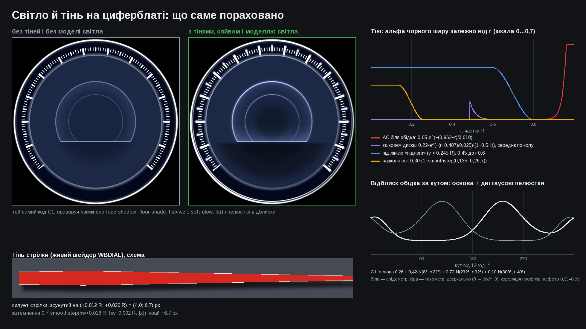
*Ліворуч той самий код без тіней і без моделі світла, праворуч усе ввімкнено. Праворуч угорі: альфа тіньових шарів за радіусом; нижче: яскравість відблиску обідка за кутом; унизу: схема тіні стрілки в живому шейдері.*

### Звідки світло: відблиск обідка

Спершу треба було з'ясувати, звідки на 6WB падає світло. Для цього по кожному куту обідка вимірювалися дві речі: яскравість гребеня і зсув найяскравішої точки поперек трубки обідка. З обох рядів бралася перша гармоніка: її фаза дає напрям, амплітуда — силу.

Потім профіль гребеня спідометра корелювався з профілем тахометра двічі: як є («те саме світло») і дзеркально, θ → 360° − θ. На фото 04 кореляція вийшла 0,22 проти **0,93**, на 06 — 0,20 проти **0,99**, на 03 — 0,80 проти 0,91. Висновок: відблиск дзеркальний між циферблатами, тож це частина намальованого дизайну, а не відбиття в склі. Звідси одна дзеркально-симетрична модель на обидва циферблати: основа плюс дві гаусові «пелюстки» за кутом. Пакет спідометра виміряв їх так: основа 0,26, вузька пелюстка на 8° (σ 22°, підсилення 0,42), широка на 232° (σ 32°, 0,72) і слабка третя на 300°. Для тахометра — те саме дзеркально. Зведення двох пакетів запропонувало ще й зсунути пелюстки до 22° і 219°, а «ключ» для країв жолоба поставити вертикально (90°): вертикальний напрям дзеркально-симетричний за побудовою і дорівнює середньому з фото. У коді пакета спідометра лишилися виміряні 8° і 232°.

Для освітлених країв (жолоб, край диска, кільце) використовується простий множник з боку «ключа»:

```python
def lit(g):
    a = math.radians(P.LIGHT["key_dir_deg"])
    lx, ly = math.cos(a), -math.sin(a)            # y down
    rr = np.maximum(g.r, 1e-6)
    return 0.5 + 0.5 * (g.u / rr * lx + g.v / rr * ly)
```

Тут `key_dir_deg` = 115° (математичний відлік), і колір краю множиться на `(1 − 0,35) + 2 · 0,35 · lit`, тобто міняється в межах ±35 %.

### Тіні, які намальовано, а не пораховано

Жодна тінь на запечених циферблатах не рахується трасуванням чи розмиттям силуету. Кожна — **намальований градієнт з альфою**, підібраний за профілем фото, і це теж відповідь на питання «як рахували тіні»:

- **Тінь від обідка всередину** (ambient occlusion): `a = 0,65 · exp(−max(0,962 − r, 0) / 0,018)`, найтемніше на 0,944–0,960 R, як на макрознімку.
- **Тінь за краєм диска**: `0,22 · exp(−(r − 0,487) / 0,025)`, сильніша з неосвітленого боку (множник `1 − 0,5 · lit`), лише над лінією «підлоги».
- **Тінь під «горизонтом»**: на фото обличчя нижче лінії «підлоги» темніше аж до ~0,7 R, хоча чіткий край є лише всередині ~0,45 R. Тому з'явився окремий шар z 2,5: альфа 0,45, наростає за 0,035 R від лінії і згасає між 0,6 і 0,8 R. Докази слабкі (видно на одному фото з трьох), і це записано в маніфесті.
- **Лунка осі**: `0,30 · (1 − smoothstep(0,135; 0,26; r))`, теж зі слабкими доказами.
- **Жолоб під поділками**: не тінь, а заливка, що переходить від світла, яке стікає з освітленого краю, до майже чорного дна, з темною стінкою обідка на 0,964–0,984 R.

Під час запікання всі тіні й альбедо зливаються в одну основу «@0,5x», а тіні множаться в неї.

### Сяйво

Сяйво теж має кілька джерел, і всі вони виміряні на макрознімку поділок:

- **світла пляма за кінцем великої поділки**: гаусіан на 0,918 R, σ 0,012 R уздовж і 0,016 R поперек, альфа 0,42 для великих і 0,30 для середніх (на фото: максимум 108 на 0,916 R, 66 на 0,932 R, 26 на 0,944 R);
- **ореол навколо кожної поділки**: `0,10 · exp(−d / 0,006)`, удвічі слабший для малих;
- **ореоли краю диска й кільця**, сильніші з освітленого боку;
- **світіння від кромки «підлоги»**, що наростає до неї як степінь 1,8;
- **холодна облямівка** на зовнішніх 30 % великих поділок (колір (120, 215, 255), домішка 0,40). У звіті вона позначена як імовірна хроматична аберація об'єктива на фото, і питання, чи лишати її, відкрите.

Усі складники зводяться в один шар сяйва з прямою альфою: `alpha = 1 − Π(1 − aᵢ)`, колір — зважене за альфою середнє.

Живе сяйво є лише в шейдері: червоний ореол стрілки, що повторює її звуження (`0,22 · exp(−max(|x| − hw, 0) / (0,016 R))`), і ореол кільця осі (`0,30 · exp(−|d − r_hub| / (0,020 R))`).

Ще одна задача зі сяйвом виникла в симуляції штатного щитка G20 на бенчі (вона потрібна, щоб бачити, що з BMW проступає крізь прозорі варіанти теми). Підсилення штатного сяйва стрілок підібрано методом найменших квадратів: `фото − основа = g · (сяйво₁ − основа)` по зоні стрілки з маскою решти елементів, звідки `g = Σ G·Y / Σ G²`. Два фото дали 0,47–0,73 для різних циферблатів, і в симуляції стоїть 0,6.

### Тінь стрілки: єдина «жива» тінь

Стрілка рухається, тож її тінь запекти неможливо, і вона рахується в шейдері WBDIAL на кожен піксель. Підхід: той самий силует стрілки, зсунутий вправо й униз, з м'яким краєм, множить колір під собою:

```glsl
vec2 ps = p - vec2(0.012 * R, -0.020 * R);
vec2 qs = vec2(dot(ps, vec2(nd.y, -nd.x)), dot(ps, nd));
if (qs.y > T && qs.y < L) {
    float hws = qs.y < 0.0 ? mix(W0, WT, qs.y / T) : mix(W0, W1, qs.y / L);
    col *= 1.0 - 0.7 * smoothstep(hws + 0.018 * R, hws - 0.002 * R, abs(qs.x));
}
```

Вісь y тут спрямована вгору, тож силует зсунуто вправо й униз. При R = 335 це зсув на (4,0; 6,7) px і край тіні шириною близько 6,7 px. Сама стрілка теж «трубка»: червоні краї, темний шов з освітленого боку, світле ядро на ~0,4 ширини (як на макрознімку), тепла накладка на хвості й білий кінчик.

Червона смуга перевищення швидкості лежить у порожньому кільці між віссю і цифрами, виміряному на референсі: твердий внутрішній край 0,521 R, найяскравіше там, згасання назовні до нуля на 0,663 R. Її альфа — дві складові: лінійне згасання 0,72 і вузька смужка 0,30 біля 0,530 R.

### Вікно між циферблатами

Центральне вікно Comfort не має жорсткої рамки. Шейдер тла робить м'які краї за кривою «вуалі» штатної карти G20 (`veil(t) = 1 − (1 − t)²`), із шириною згасання 150 px зверху, 40 px з боків, 56 px знизу і тінню від обідків циферблатів на 60 px (`smoothstep(0, 60, відстань від обідка)`). Кути округлено, бо смуги згасання сходяться по колу (довжина вектора, чиї компоненти не більші за 1, не перевищує 1,42 і безпечна для fp16), а не множенням, яке лишило б квадратні кути. Правило: тінь лише затемнює, порожнє місце лишається (0, 0, 0).

fp16 мав значення і тут: стара кругла діра під знак BMW рахувала `length(lp − centre)` у пікселях, що для fp16 небезпечно. Тепер усі відстані вікон беруться на векторах, поділених на 64, а потім помножених назад.

### Ніч

У f30_cluster ніч — це **одне колірне перетворення наприкінці шейдера**, тож запечені текстури перефарбовуються на GPU живцем, без другого комплекту текстур (який не вліз би в 16 MiB). Колір розкладається на сіру частину w = min(r, g, b) і залишок, і кожна частина має свій «образ»:

```glsl
vec3 nightLook(vec3 c) {
    float w = min(c.r, min(c.g, c.b));
    vec4 v = vec4(c - vec3(w), w);
    return vec3(dot(u_nk0, v), dot(u_nk1, v), dot(u_nk2, v));
}
```

Вдень матриця одинична. Вигляд «бурштин», наприклад, переводить біле в (0,66; 0,59; 0,50), а червоне стрілки в (1,0; 0,50; 0,06). Ті самі рядки застосовуються в JS до кольорів тексту, щоб цифра і її поділка збігалися. Дорожні знаки лише приглушуються (знак обмеження лишається червоно-білим). Вигляди оцінено лише на бенчі, на авто вночі ще ні. Для Sport і Eco Pro нічних кольорів немає взагалі, і їхні шейдери збираються без цього коду.

### Twin Dial: лінійне світло

Twin Dial рахує світло в **лінійному** просторі. Ніч там — множник на кожен матеріал у лінійному світлі (біле 0,80, обідок 0,70, поділки 0,75, смуга шкали 0,60 усередині, 0,55 ззовні й 0,50 на освітлених кінцях, смуга поділок 0,55, червоне 0,85). Нічного референсу немає, тож усі ці множники — гіпотези.

Тінь стрілки Twin Dial простіша, ніж у f30: смуга шкали під стрілкою темніє до 0,85 на 0,05 R з кожного боку, лише на самій смузі (не на смузі поділок) і ніколи на «чорнилі». Тіні цифр (обведення 0,008 R і падаюча тінь зі зсувом (+0,010; +0,012) R і розмиттям σ 0,008 R, обидві в лінійному світлі) виміряно, запрограмовано й показано на макетах. Рішення ухвалено за макетами: цифри без тіні. Обидві моделі лишилися в коді, і повернути будь-яку можна одним словом.

Червона дуга на обідку тахометра має згладжений край уздовж кута. Різниця кутів переводиться в пікселі множенням на кількість пікселів в одному градусі на цьому радіусі:

```glsl
float pxd = rd * 0.0174533;                                   // px per degree at this radius
float arc = step(0.975, rho) * clamp((th - u_red.x) * pxd + 0.5, 0.0, 1.0) * step(th, u_red.w);
```

А червона поділка чи цифра «вмикає» свій колір раніше, з `smoothstep(0,50; 0,70; g)` замість `smoothstep(0,70; 0,85; g)`, тож навколо червоного не лишається сірого ореолу.

## 6. Шрифти

Шрифти обирали вимірюванням, а не на око.

**f30_cluster.** Спершу стояв Arimo. Потім агент виміряв цифри справжнього 6WB і помітив, що в Arimo «1» має засічку внизу, а в 6WB її немає: ширина «1» до висоти цифри 0,655 проти 0,410, тобто на 60 % ширша. Але просте «вирівняти висоту й порівняти ширину» на фото не працює: яскравий РК-екран на фото «розпливається», кожен гліф товстішає на приблизно сталу величину d. Тому модель підгонки враховує це розпливання:

```
виміряна_ширина(i) = s · W(i) + d,     виміряна_висота(i) = s · H(i) + d
```

з s і d за методом найменших квадратів і d ≥ 0. Дві додаткові спостережувані прив'язують d: товщина штриха (розпливається як гліф) і **внутрішній просвіт** «0», «4», «6», який від розпливання *зменшується*, тож входить з коефіцієнтом −1. Саме просвіт розв'язав виродженість «тонкий шрифт плюс велике розпливання»: виміряний просвіт «0» у 6WB (5,60 px) відкинув кандидата, який до цього йшов нарівні з переможцем. Перевірка методу: «6» на двох різних фото з різницею масштабу вчетверо дає відношення ширини до висоти 0,6394 і 0,6390, тобто збіг до 0,1 %.

Серед 22 вільних шрифтів у різних вагах і ширинах Roboto з шириною 87,5 посів перше, перше й третє місця у трьох прогонах (на цифрах тахометра 1,85 % висоти цифри проти 6,87 % в Arimo, який посів 17-те місце). Цифри 6WB ще й табличні: крок між сусідніми цифрами 10,26 ± 0,39 px незалежно від цифр.

**Twin Dial.** Агент зняв «відбиток» цифр із референсів: нуль там заповнює 0,904 своєї рамки, тоді як еліпс заповнює 0,785, тобто цифри «квадратні». З 38 сімейств (75 файлів шрифтів), ранжованих за відхиленням рамок символів, для цифр переміг Saira (4,23 % проти 7,13 % у наступного), а для тексту Noto Sans (3,14 %). Нуль Saira навіть на максимальній ширині приблизно на 7 % вужчий за референсний, тому цифри запікаються з горизонтальним розтягом 1,06.

**Як шрифт потрапляє на авто.** Авто ніколи не растеризує шрифти. `tools/bake_fonts.py` на комп'ютері розробника малює кожен потрібний гліф і записує атлас: один байт покриття на піксель, base64 у JSON, плюс метрики (усі клітинки однакової висоти, зсув для виносних елементів, спільна ширина для цифр, щоб число не «стрибало»). JSON тому, що пакет застосунку тримає лише JSON, а авто тоді не потребує декодера PNG. На авто `hud_text.js` лише копіює ці байти в аркуші, а шейдер тексту бере `.r` однобайтової текстури.

**Кирилиця.** Щиток в авто працює українською, і якщо в шрифті бракує літери, елемент повертається до BMW (заміна гліфом-квадратиком не вважається «власним текстом на екрані»). Тому шрифти, якими може йти текст авто, мають повний український алфавіт в обох регістрах, апострофи, «ялинки», лапки, тире, №, а після рішення «повний текст, завжди» ще й російські та білоруські літери і латинські діакритики європейських назв вулиць. Апостроф U+02BC, якого в Roboto немає, малюється гліфом U+2019 тієї самої форми. Атлас Saira в Twin Dial, навпаки, під час запікання відмовляється приймати кирилицю, бо малює лише цифри й латинські підписи. Шістнадцять атласів Twin Dial другого раунду займають 3,03 MiB. Піктограми намальовано власні за формами ISO 2575. Авто вміє віддати свої іконки повідомлень (7 PNG), але це графіка BMW: вона не зберігається, не логується й не потрапляє в репозиторій.

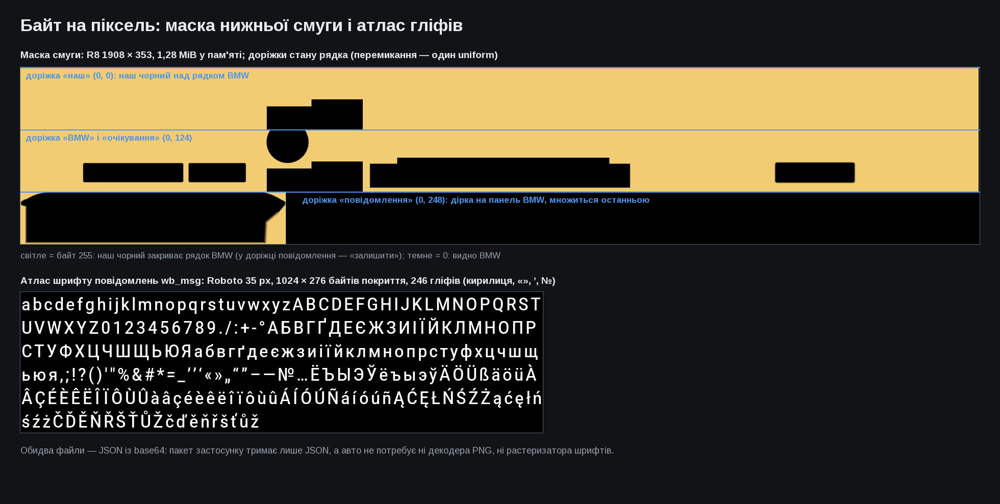
*Два однобайтові ассети f30_cluster, як вони лежать у застосунку: маска нижньої смуги з доріжками для кожного стану рядка і атлас шрифту повідомлень (Roboto 35 px, 246 гліфів із кирилицею).*

## 7. Маски нижньої смуги

Нижній рядок панелі належить то BMW, то застосунку: у ньому лампи ременів, літера передачі, панель повідомлень, і залежно від стану рядка застосунок то закриває штатне чорним, то відкриває. Спершу це були десятки прямокутників і кіл у шейдері. Пакет M замінив їх **однією маскою R8** 1908 × 353.

Ключове питання — як зберігати форму. Перевірено три способи на восьми синтетичних формах (8 × 8 підпікселів як еталон, вибірка так само, як `texture2D`):

| Форма | Повна маска R8: макс. похибка | Поле відстаней у ½ розміру: макс. похибка |
|---|---|---|
| прямокутник із дробовим краєм | 0,002 | 0,41 |
| кругла дірка r 41,5 | 0,002 | 0,067 |
| панель з дугою й скошеними кінцями | 0,002 | 0,56 |
| коридор 2 px між двома дірками | 0,001 | 0,48 (і зсув краю −0,20 px) |

Поле відстаней добре на довгих прямих краях, але ламається саме в кутах і вузьких коридорах, а там і треба, щоб чорне щільно облягало штатні елементи. Повна маска відтворює кожну форму з точністю до кроку 8 біт, а R8 коштує чверть від RGBA, тож повний розмір виявився доступним. Кругла дірка радіусом 42,5 px з м'яким краєм 2 px відновлюється із запечених байтів як 42,499 (залишок підгонки кола 0,004 px).

Кожен стан рядка («наш», «BMW», «очікування», «повідомлення») має в атласі свою доріжку, і перемикання коштує один uniform без жодного завантаження. Зчитування прив'язане до центру текселя: `floor(p − box) + 0,5`. Без цього в fp16 60 зі 1920 стовпців потрапили б не в той тексель (до 0,94 текселя мимо). Маска з сьогоднішніх прямокутників відтворює попередню картинку в межах 0,60/255 у всіх семи станах бенча. Twin Dial так само запікає своє «вікно» на панель повідомлень BMW: контур штатної панелі, розширений на 3 px, у текстурі 536 × 112.

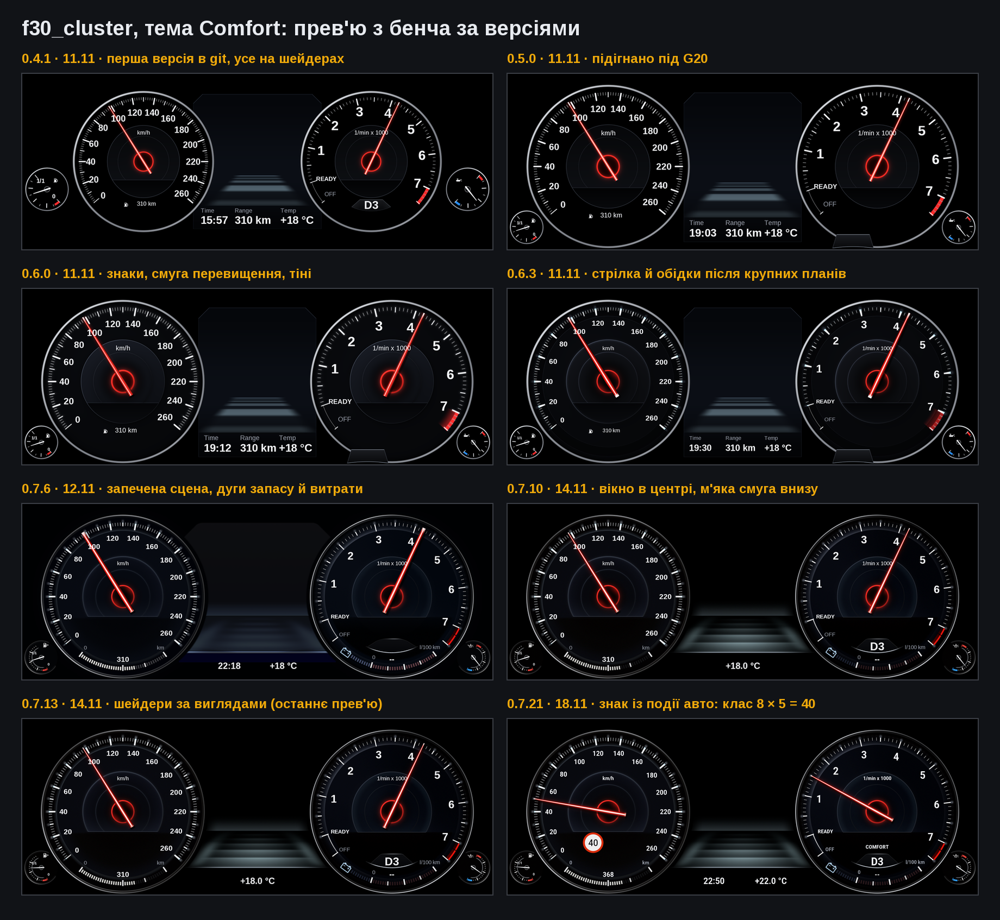
*Еволюція f30_cluster за власними прев'ю застосунку (знімки з бенча) від першої версії в історії git. Прев'ю востаннє перезнімали у 0.7.13; останній кадр — із галереї станів випущеної 0.7.21.*

## 8. Слухаємо авто

Це найбільша частина проєкту, і ззовні її найменше видно.

### Каталог: 689 інтерфейсів

Головний пристрій має каталог сигналів, файл `someip-interfaces.json`. У ньому **689 інтерфейсів SOME/IP і 5100 членів: 2319 полів, 2116 методів і 665 подій**, описаних 7411 типами даних. 640 полів мають сеттер, і щитки та зонд не торкаються жодного з них.

Спершу здається, що достатньо знайти потрібну назву. Проте те, що поле є в каталозі, ще не означає, що авто його надсилає. Каталог дає структуру й ідентифікатори, але не каже, чи живий постачальник, які в поля множники і що означає 65535.

Показова історія з повідомленнями check-control. Першим кандидатом був `KombiInterface_2.newCCMessage`, бо назва підходила ідеально. У лозі 0.7.18 за 25 хвилин це поле не прийшло жодного разу, хоча двері відчинялися. Пізніше в іншому лозі воно таки з'явилося кілька разів, але покладатися на нього не можна. Живим виявився `ccList`: у спокої він містить запис з id 0, а відчинені двері дають запис id 15 білого кольору. Проте `ccList` містить і збережені повідомлення, а не лише те, що на екрані зараз. Поле, яке за назвою мало відповідати на питання «що показано зараз», `statusActiveCCMessage`, на авто весь час показувало 65535. Справжнім виявилося третє, `Vehicle2.statusDisplayedCCMessage`: двері відчинено, у списку з'являється 15, і за 30–60 мс поле теж каже 15. Воно ще й показало повідомлення BMW, яких у `ccList` немає взагалі (номери 285, 926, 927, 184).

Після кількох таких історій стало ясно, що вгадувати далі не можна. Потрібен був окремий інструмент.

### signal_probe: застосунок, який нічого не малює

`signal_probe` — окремий застосунок OAP. Він не має жодного шару на щитку й нічого не рендерить, а лише підписується на сигнали й пише лог. Влаштовано його так:

- **Набори з галочками.** У версії 0.1.0 це 160 полів на 62 інтерфейсах, розбиті на 11 наборів: повідомлення, бортовий комп'ютер і пробіг, кузов і напруга, медіа, телефон, вид і кнопки, навігація, допоміжні системи, технічне, «чорна коробка», ще не підключене. Кожен набір вмикається своєю галочкою в меню на центральному екрані. При першому запуску всі вимкнені, і поки набір вимкнено, застосунок ні на що не підписаний. Це свідоме рішення: авто ще ніколи не слухали на стільки сигналів одразу, тому вмикається один-два набори за раз.
- **Кнопка «Позначка N».** Натискання ставить у лог рядок «тут почався крок». За цими позначками ведучий агент потім знаходить потрібні секунди серед тисяч рядків.
- **Приватність.** У лог потрапляють лише числа, назви enum-ів і довжини текстів. Назва треку логується як «17 символів», а про абонента відомо лише, є він у контактах чи ні. Це перевіряють тести з «канарками»: у кожне текстове поле підставляється мітка, і жодна з них не має дійти до рядка логу.
- **Обмеження обсягу.** Кожне поле має мінімальний інтервал між рядками й стелю на їх кількість, а загальний запобіжник тримає не більше 40 рядків на секунду. Для кнопок на кермі інтервал нульовий: тест подає 60 змін за 60 мс і чекає 60 рядків.
- **Підсумки.** Через 30 секунд, 2 хвилини й 10 хвилин після ввімкнення набору застосунок пише, які поля заговорили, які мовчать і чиї постачальники не піднялися. Мовчазне поле він один раз питає через гетер, і це теж лише читання.

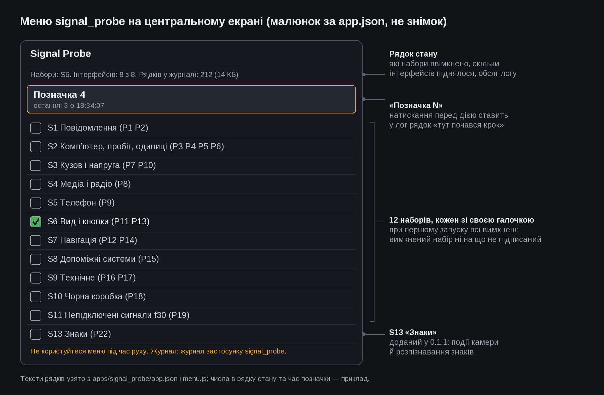
*Меню signal_probe на центральному екрані. Це малюнок за описом меню в застосунку, а не знімок екрана; числа в рядку стану взято для прикладу.*

Навколо зонда виросла ціла інфраструктура. **Реєстр** на 91 пункт перелічує все, на що має відповісти авто: що читається з логів уже встановлених застосунків, що із зонда, що вимагає фото чи експерименту. **Збирач логів** працює лише на читання: він виконує тільки команди з білого списку (`cat`, `ls`, `stat`, `tail`, `date`, `journalctl` для одного сервісу), відмовляється від будь-якої іншої команди й будь-якого метасимволу оболонки, а тест перевіряє це на підставному `ssh`. **Парсер** перетворює логи на таблиці рішень із кожного дослідницького звіту і пише відповіді по пунктах реєстру. Після збору перевірка приватності не випускає в похідні файли VIN, телефони, координати й адреси. Окремий скрипт пропонує точні зміни в `app.json` як дифи з доказами поруч, але сам їх ніколи не застосовує.

### Сесія в авто

Для сесії підготовлено документ українською на десять блоків: «стоїмо із запалюванням», «двигун», «медіа», «телефон», дві короткі поїздки з пасажиром. У ньому є правила безпеки («меню зонда ніколи під час руху», «у дорозі з меню працює лише пасажир») і таблиця позначок.

Перша сесія тривала близько години (оцінка, у файлах не перевірено): ноутбук в авто підключено по SSH, у салоні натискалися кнопки й відчинялися двері, а ведучий агент між натисканнями читав свіжі рядки логу. У першому зібраному лозі зонда за вісім хвилин у чотирьох наборах заговорили 44 поля з 53. Мовчазні зонд назвав поіменно разом із постачальниками, які не піднялися. Після першого збору реєстр мав 28 пунктів із відповіддю, 14 часткових і 13 без відповіді; решта 36 потребують фото або ручної перевірки.

Найкращий момент дня був такий. Обидва щитки не показували обмеження швидкості, хоча штатна панель показувала знак 30. Поки авто стояло з цим знаком на панелі, агент менш ніж за годину зібрав версію зонда 0.1.1 з дванадцятим набором «Знаки»: десять нових джерел, вісім із них події, а не поля. Разом вийшло 170 джерел на 66 інтерфейсах. Коротка поїздка з цим набором і показала, звідки щиток бере знак.

### Що знайдено

- **Кнопка TRIP на важелі** (бортовий комп'ютер) — це біт **0x40** поля `operationColumnStalks` в інтерфейсі `de.bmw.body.Light`. Сімнадцять натискань дали сімнадцять чистих пар «0 → 0x40 → 0». Тепер ця кнопка перемикає вкладки Twin Dial. Застосунок її лише *бачить*: BMW під шарами так само гортає свої сторінки.

  ```json
  "tabKey": {
    "iface": "de.bmw.body.Light", "field": "IndicatorSteeringColumn",
    "path": ["operationColumnStalks"], "mask": 64, "invalid": [255]
  }
  ```

  Автоматичний парсер обережно відмовився назвати біт, бо той ворушився і в сусідньому кроці. Ведучий агент підтвердив його вручну, звіривши лог із нотатками, зробленими під час сесії.
- **«Показано зараз»** читається з `statusDisplayedCCMessage`, а не з мертвого `statusActiveCCMessage` з його вічним 65535.
- **Обмеження швидкості.** Обидва щитки були побудовані на полі `TrafficSignDisplayControl`, але його постачальник на цьому авто не з'являється ніколи. Знак приходить як **подія** `TrafficSignRecognition` приблизно двічі на секунду: `presentClassLimitSpeed` × 5 = км/год. Клас 8 збігся зі знаком 40, клас 6 зі знаком 30, і це підтвердила окрема подія передньої камери, яка віддає прочитане значення прямо в км/год. Клас 29 у каталозі описаний як запит на звуковий сигнал, тож без окремої перевірки на щитку з'явився б знак «145».
- **Круїз-контроль** знайшовся в даних для HUD: задана швидкість у км/год і символ функції (круїз чи обмежувач), навіть коли сам HUD вимкнено.
- **Бортовий комп'ютер.** Множники для середньої швидкості, витрати й відстані звірено зі сторінкою поїздки самого авто. Відстань виявилася з множником 1, а не 0,1, як передбачалося.
- **Маршрут CarPlay.** Коли навігація йде через CarPlay, авто віддає відстань до цілі, час у дорозі й час прибуття, але стрілок маневрів і смуг немає. Відстань приходить у метрах незалежно від того, яку одиницю написано поруч: 5700 і «KM» означає 5,7 км, бо 57 км за 11 хвилин дороги не буває.

Правила для коду прості й жорсткі: `r` лише з ненульовим гетером, `s` лише для підписки, події тільки названі, **жодного сеттера й жодного методу з побічними ефектами**.

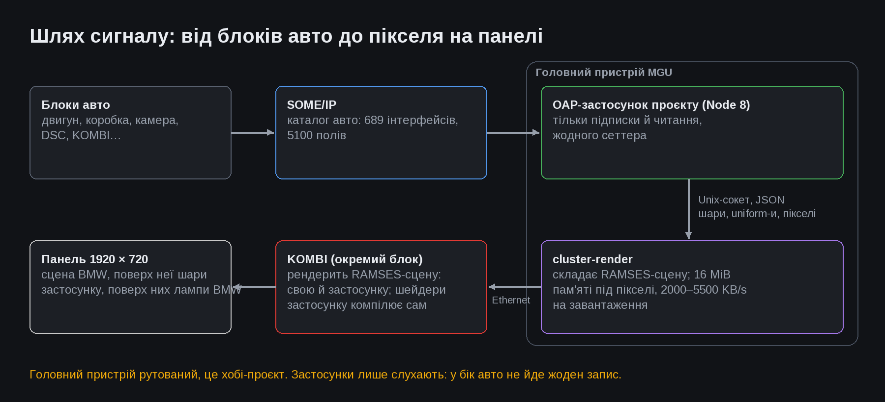
*Шлях сигналу: блоки авто → SOME/IP → застосунок на MGU → cluster-render → KOMBI → панель. У зворотний бік, до авто, нічого не йде.*

## 9. Twin Dial: другий щиток із нуля

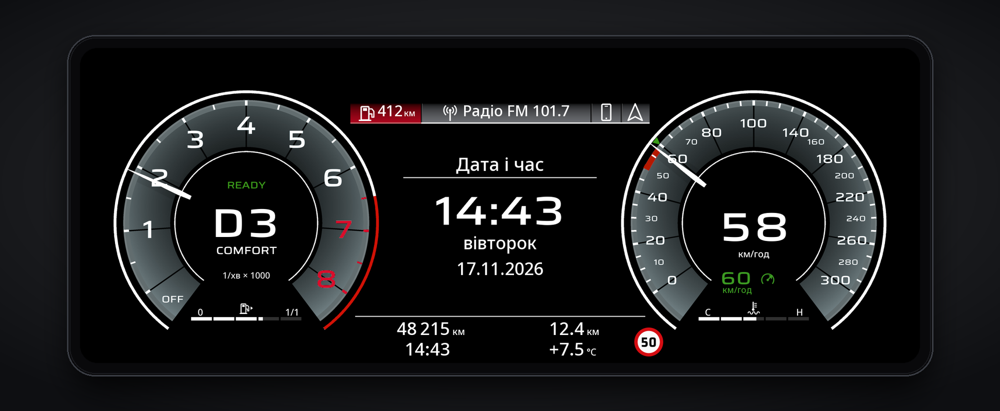
*Twin Dial 0.1.1 на бенчі: обмеження 50, стрілка на 58, смуга шкали червона від 50 до стрілки, знак унизу, круїз на 60 зеленим у спідометрі.*

Після f30_cluster наступною задачею став інший вигляд: два круглі циферблати в дусі віртуального кокпіту Audi пізнішого покоління, з пласкою сірою шкалою, тонким білим обідком і червоною зоною. Це окремий застосунок, а не тема f30_cluster, і він повністю власний, без «прозорого» варіанта, крізь який видно штатне.

**Раунд 1 був лише вимірюванням.** Сім агентів працювали паралельно, кожен у своєму git worktree: референси, циферблати, рамка, шрифти й піктограми, колір, сигнали, посадка на панель G20. Агент референсів ректифікував п'ять зображень до фронтального вигляду з R = 400 px; найкраще з них вписалося з похибкою 0,35 px. Пошук в інтернеті більше придатних фронтальних знімків не дав, а частина публічних джерел просто відповідала HTTP 429. Рішення: нових референсів поки не шукати. З семи звітів ведучий агент зібрав специфікацію.

Далі з'явився **рендерер макетів**, який малює саму специфікацію. Рішення ухвалювалися за макетами: розмах шкали ±125°, біла стрілка, червона зона, повідомлення малюються самим застосунком, у центрі бортовий комп'ютер. Оцінка макетів була однозначно позитивна, і з того моменту вони стали візуальним еталоном. Звідти ж прийшов один урок: перший макет мав сірі «ніжки» під шкалою, яких на жодному референсі немає. Агент їх вигадав, і їх прибрано окремим комітом.

**Раунд 2 (0.1.0)** зібрав застосунок: шрифти, 25 піктограм, запечені обличчя циферблатів, рушій, бенч-симуляцію, галерею станів. **Раунд 3 (0.1.1)** додав живі вкладки, кожну зі своїм кольором: бортовий комп'ютер, повідомлення, медіа з CarPlay, телефон і навігацію. Додалися знак обмеження з маркером на шкалі й червоною смугою від обмеження, а круїз оселився в нижньому отворі спідометра. Над цим працювали вісім дослідницьких пакетів, два раунди макетів і сім пакетів збірки, які потім злилися в одну інтеграційну гілку.

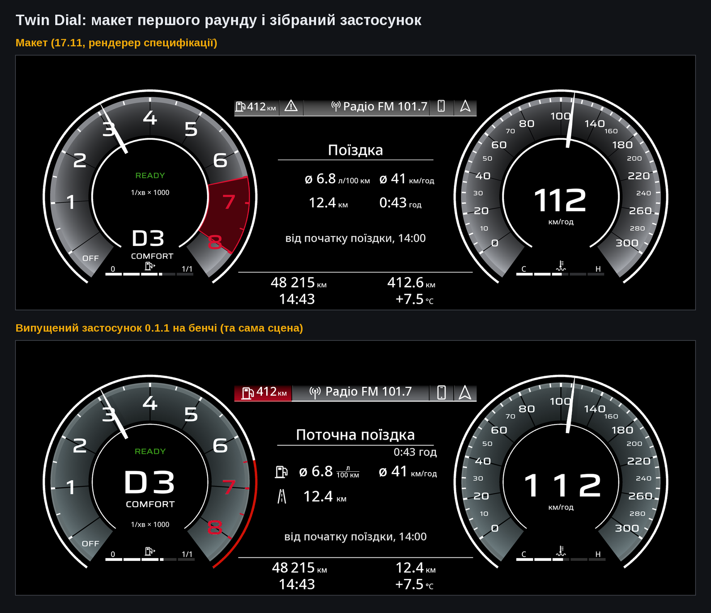
*Угорі: макет першого раунду (рендерер специфікації). Унизу: випущена версія 0.1.1 на бенчі в тій самій сцені. За третій раунд червоний клин став дугою на обідку, передача переїхала в центр тахометра, а вкладки отримали власні кольори.*

### Як це працює: матеріал у байті

У f30_cluster кожен циферблат — RGBA-текстура на 3,42 MiB. У Twin Dial обличчя кожного циферблата — **одна текстура R8** 616 × 560, тобто один байт на піксель: 0,66 MiB у пам'яті, учетверо менше на тексель. Байт — це нейтральний код sRGB пікселя (зелений канал картинки), а **матеріал і колір визначає шейдер** за двома речами: радіусом пікселя ρ = r/R і самим значенням байта.

Підхід такий. Під час запікання (`tools/twin-dial/bake_face.py`) обличчя малюється втричі більшим і зменшується фільтром LANCZOS. Смуга шкали отримує яскравість за законом, підігнаним до референсу,

```
Y = 0,0188 · e^(4,60 · (ρ − 0,60)) · e^(0,59 · (1 − cos θ))      (лінійне світло)
```

смуга поділок — сталий код 109, її світла лінія — 124, великі лінії поперек смуги — 6, рамки сегментів пального — 47, сірий підпис — 227, усе «чорнило» (поділки, цифри, обідок, внутрішній обідок, OFF) — 255. Шейдер декодує так:

1. g = байт/255, L — його лінійне світло.
2. Матеріал за радіусом: смуга шкали ρ 0,5795–0,9375, смуга поділок 0,893–0,9375, її лінія 0,924–0,934, обідок ρ ≥ 0,975 (завжди «чорнило»). Межі — `smoothstep` шириною кілька тисячних R.
3. «Чорнило» за байтом: `ink = max(smoothstep(0,70; 0,85; g), обідок, червоне · smoothstep(0,50; 0,70; g))`.
4. Колір: `rgb = L · mix(тонування фону, колір чорнила, ink)`. Тонування смуги — 0,76 : 1 : 1,064 у лінійному світлі (холодне), у смуги поділок — власне, з її кольору (98, 109, 111).
5. Червоне від червоної зони, маркери обмеження й круїзу, заповнення смуг пального і стрілка з тінню — з uniform-ів, без жодної зміни текстури.

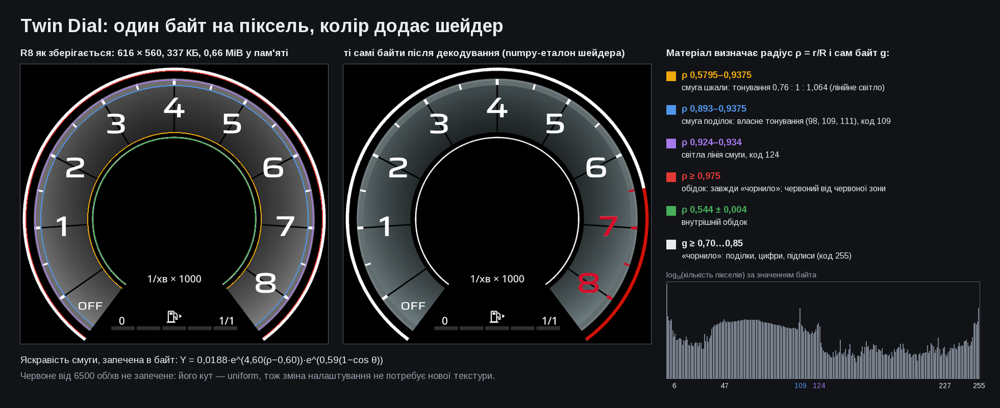
*Ліворуч — R8-обличчя тахометра, як воно зберігається (кольорові дуги — межі матеріалів). Посередині — ті самі байти після декодування numpy-еталоном шейдера з червоною зоною від 6500 об/хв. Праворуч — правила матеріалів і гістограма значень байта.*

Звідси дві властивості. Перша: червона зона, нічні множники, рівень яскравості смуги (налаштування `bandGain`) і обмеження змінюються як uniform-и на місці, без перебудови макета й без завантаження. Друга: декодування можна перевірити поза авто. `face_shade.py` — це той самий алгоритм на numpy, а `test_shader.py` запускає справжній GLSL-шейдер на GPU комп'ютера (через moderngl, без браузера) і порівнює: поза зоною стрілки різниця 0,000 коду. Запікання відтворюване до байта: кожен закомічений файл перегенеровується точно таким самим, а маніфест зберігає sha256 кожної текстури й кожного шрифту. Порівняння з макетом за однакового розтягу шрифту дає середню різницю 0,3–0,4 коду на канал.

### Повідомлення та «машина безпеки»

Найскладніша частина Twin Dial — повідомлення check-control у центрі. Штатна панель повідомлень BMW закривається власною карткою, тож треба гарантувати, що попередження не зникне з екрана ні на кадр. Під штатною панеллю є «вікно» точно її форми, і воно відкрите, доки застосунок не може намалювати текст: поле ще не прочитане, запису для номера немає, бракує гліфа, малювання кинуло виняток. Послідовність така:

1. Повідомлення з'являється, і вікно **відкривається** прямо в обробнику сигналу, не чекаючи наступного такту.
2. Вікно закривається лише тоді, коли картка з текстом **саме цього** повідомлення пробула на екрані щонайменше **150 мс**.
3. Якщо водій іде з вкладки «Повідомлення», вікно відкривається в тому самому ході, а текст лишається ще щонайменше 150 мс. Вікно і картка живуть на різних з'єднаннях, порядку між якими ніхто не гарантує.

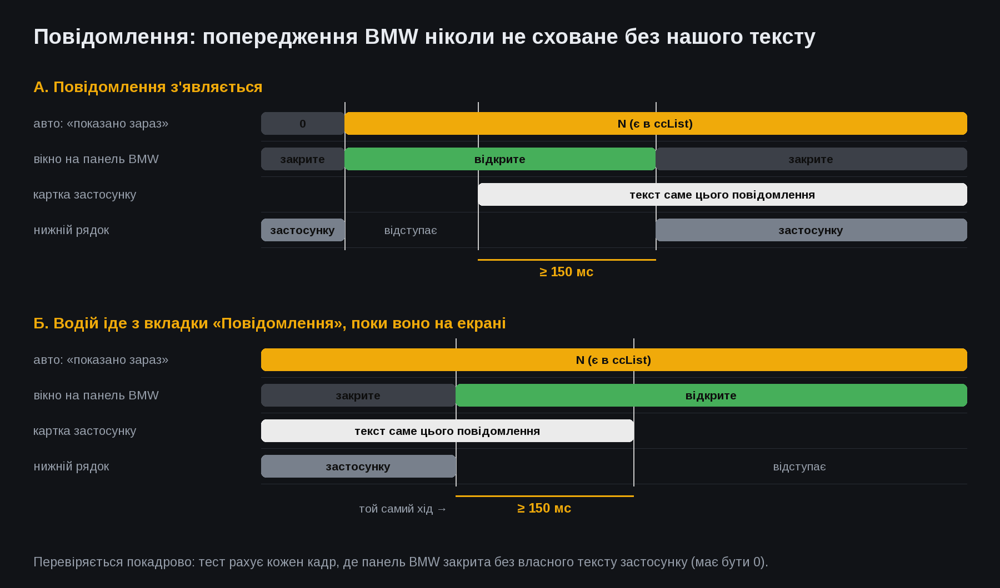
*Як закривається і відкривається панель BMW. Без власного тексту саме для цього повідомлення вона не закрита жодного кадру.*

Головне тут не код, а **тести, які падають, коли функцію зламано**. Аудит на справжньому рушії перевіряє *кожен кадр*, який рушій надіслав: порівнює пікселі з незалежним рендером і рахує кадри, де панель BMW закрита без власного тексту. Шість навмисно зламаних рушіїв (рядок не відступає, вікно не відкривається, лишається стара картка, картка для чужого повідомлення, прибрано очікування 150 мс, рядок не на тому з'єднанні) кожен валить цей тест. Модель машини пройшла 35 сценаріїв у трьох режимах сервісу (усе одразу, по одній операції, з'єднання в будь-якому порядку): близько 100 000 перевірених кадрів без жодного порушення, і кожна з восьми зламаних машин тест провалює. Поки авто не підтвердило, що номер «показано зараз» збігається із записом у списку, Twin Dial взагалі не закривав панель BMW.

## 10. Продуктивність: чому один застосунок легкий, а інший важкий

Перший аудит почався зі спостереження на авто: стрілка ніби злегка підвисає. Знайшлося дві причини. Значення стрілки бралося таймером раз на 50 мс без інтерполяції, тож на 60-герцовому щитку рухався лише кожен третій кадр. Крім того, сторінка центрального екрана, поки відкрита, растеризується програмно, і за оцінкою на процесорі авто це близько 70 мс на кадр, які блокують цикл подій. У 0.7.14 стрілки отримали власний таймер на 33 мс і показують значення, інтерпольоване на один період семплів назад, а записи в сокет збираються в пачки.

Потім виникло питання, чому Twin Dial такий легкий, а f30_cluster важкий. Обидва застосунки поставлено на той самий записувач протоколу й пораховано кожен байт:

| | f30_cluster (Comfort) | Twin Dial |
|---|---|---|
| Пікселів до першого повного кадру | 5,8 МБ (2,9 с при 2000 KB/s) | 2,3 МБ (1,14 с) |
| Зміна режиму їзди | перебудова: повернення в Comfort 5,68 МБ | 6 КБ (лише напис режиму) |
| Пам'ять пікселів у стабільному стані | 11,41 MiB | 4,73 MiB |
| Ті самі пікселі, надіслані повторно за сценарій | 19,8 МБ | 4,1–4,8 МБ |
| Стабільна їзда | 4,2–4,4 KB/s | 4,5–5,3 KB/s |

У f30_cluster три теми — це три макети. Кожна зміна режиму їзди перебудовує все, а дві RGBA8-текстури циферблатів (по 1,8 МБ на дроті) при виході з Comfort викидаються і при поверненні вантажаться знову. Twin Dial має один макет: режим, ніч і червона зона змінюються як uniform-и на місці, а його обличчя в R8 займають учетверо менше байтів на тексель. Спільною для обох виявилася «потрійна збірка» на старті: перший часовий пояс і перший `ccList` від авто запускають ще дві повні перебудови.

Варіантів полегшення знайшлося кілька. cluster-render 0.5.12 на авто вже приймає стиснені текстури ETC2 і рахує їх у пам'яті один раз, а не двічі. «Безпечний» пакет (лише R8) удвічі зменшує збірку Comfort, з 5,98 до 2,98 МБ. «Найкращий компроміс» (ETC2 плюс текстури, що лишаються в пам'яті) зводить її до 2,23 МБ і більше не пересилає текстуру при перемиканні. Прототипи лежать за налаштуванням і за замовчуванням вимкнені: чи малює цей KOMBI `etc2rgb`, поки гіпотеза.

## 11. Як працювала команда ШІ-агентів

- **Ведучий агент** пише брифи, ділить роботу на пакети, зливає гілки й пушить лише на прямий запит. Брифів набралося два десятки: на запікання, на нижню смугу, на Twin Dial у трьох раундах, на сесію в авто.
- **Агенти пакетів** працюють паралельно, кожен у своєму git worktree і на своїй гілці, з власним портом бенча. На піку, 18 листопада, одночасно йшли три пакети макетів, сім пакетів збірки Twin Dial і чотири пакети підготовки до сесії в авто, плюс ще один пакет.
- **Позначені шматки коду.** Сім пакетів збірки правили ті самі файли. Правило було таке: новий код іде в нові файли, а кожна правка спільного файлу — маленький блок із позначкою пакета. Конфлікти при злитті дозволялося розв'язувати лише в цих блоках, а кожна правка інтеграції ставала окремим комітом «Integrate: …».
- **Перевірене й гіпотеза.** Звіт кожного пакета розділяє те, що виміряно (з командою, якою це відтворити), і те, що потребує авто. Браузера в агентів немає: рендери робляться напряму через moderngl, а процеси запускаються через обгортку, яка завершується сама.
- **Тести, які мають падати.** Тест чогось вартий лише тоді, коли навмисно зламана функція його валить. Тому поряд із тестами з'являлися зламані рушії, зіпсовані картинки й підставний `ssh`, на яких перевірки мусять спрацювати.

Що йшло не так, коротко й чесно:

- **Бенч бреше.** fp16, семплер без текстури, розмір шейдера: щоразу на бенчі все було добре.
- **Висновок агента — гіпотеза, доки авто не підтвердить.** Одного разу агент-аудитор знайшов на бенчі «проблему», і в пуш потрапило виправлення, якого не просили. На авто там усе було добре, і виправлення довелося відкотити. Відтоді «оновити версію й запушити» означає рівно це.
- **Помилкові припущення у звітах.** Пакети нижньої смуги спростували частину чисел попередньої специфікації G20. Ширше правило «звільнення» повідомлень в одному сценарії закривало панель BMW, тож його звужено. Порожня сторінка поїздки в Twin Dial 0.1.0 була не мовчанням авто, а наслідком конфігурації. Аудит перед сесією знайшов 13 суперечностей між звітами.
- **«Ніжки», яких не було.** Макет намалював деталь, якої немає на жодному референсі. Тепер у специфікаціях кожне число має посилання на референс і метод вимірювання.
- **Спільні ресурси.** Тест бюджету писав у робочу папку, спільну для всіх worktree, тож два агенти, запущені одночасно, заважали б один одному. Один з агентів помітив це й запускав тест із приватною копією папки.

Магії «ШІ все зробив сам» тут немає: правила, перевірка на авто й рішення лишалися поза агентами, а агенти брали на себе обсяг, який за дев'ять днів інакше не вмістився б.

## 12. Еволюція і що далі

| Версія | Дата | Що змінилося |
|---|---|---|
| f30 0.4.1 | 11.11 | перша версія в історії git: три теми 6WB на шейдерах, бенч і емулятор |
| 0.5.0–0.6.3 | 11.11 | Comfort, підігнаний під G20; знаки, смуга перевищення, трубчасті обідки |
| 0.7.0 | 11.11 | перша запечена сцена 6WB, дуги запасу ходу й витрати |
| 0.7.3–0.7.5 | 12.11 | урок семплерів, звільнення текстур перед перебудовою, fp16 |
| 0.7.9–0.7.10 | 14.11 | вікно повідомлень, вікно карти навколо циферблатів |
| 0.7.11–0.7.13 | 14.11 | нативне меню BMW на центральному екрані; KOMBI перезавантажується, і шейдери розрізано за виглядами |
| 0.7.14 | 15.11 | плавні стрілки |
| 0.7.18 | 16.11 | нижня смуга на запеченій масці R8, українська в шрифтах |
| 0.7.19–0.7.20 | 17.11 | повідомлення з `ccList`, потім за сигналом «показано зараз» |
| Twin Dial 0.1.0 | 17.11 | другий щиток: два циферблати, центральні сторінки, власна плашка повідомлень |
| signal_probe 0.1.0–0.1.1 | 18.11 | зонд на 160 полів, потім набір «Знаки» з подіями |
| Twin Dial 0.1.1 | 18.11 | живі вкладки, повідомлення в центрі, обмеження й круїз з реальних джерел; випущено |
| f30 0.7.21 | 18.11 | «показано зараз» і знак обмеження з реальних джерел авто; випущено |
| signal_probe 0.2.0 | 19.11 | набори «Круїз і дистанція» та «Об'єкти камери» для поїздки |

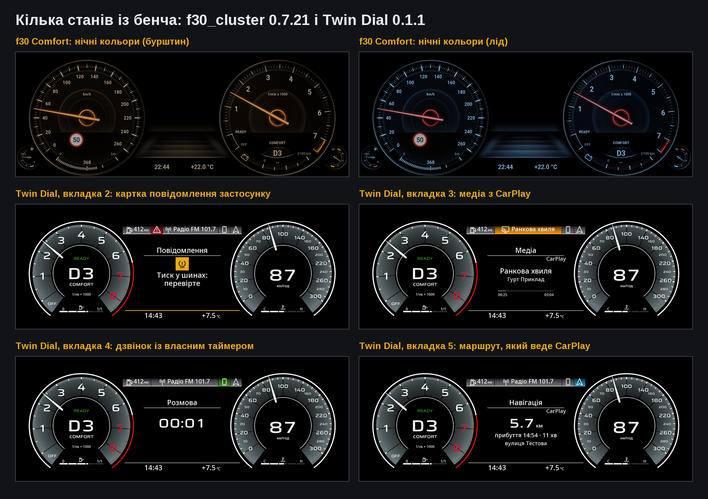
*Кілька станів випущених версій із бенча. Угорі: два нічні вигляди f30_cluster. Нижче: вкладки Twin Dial з карткою повідомлення, медіа з CarPlay, дзвінком і маршрутом, який веде CarPlay (усі тексти вигадані). Нічний вигляд Twin Dial окремо не показано: він лише приглушує біле, кольори не змінюються.*

Що далі. Twin Dial 0.1.1 і f30_cluster 0.7.21 уже випущені з виправленнями після сесії в авто: «показано зараз» із `statusDisplayedCCMessage`, обмеження з події розпізнавання знаків, сторінки медіа й маршруту CarPlay. Чорний прямокутник діагностичний експеримент на авто вже прибрав; лишилося з'ясувати, який саме, і перенести це в звичайну збірку. Чекають своєї черги решта блоків сесії в авто, легші текстури для f30_cluster і окремий застосунок для центрального екрана, який записує поїздку й малює графік; для нього поки є специфікація й прототип на бенчі. Лампи BMW угорі й повністю власний нижній рядок свідомо відкладені.

Наступна поїздка готується вже зараз. signal_probe 0.2.0 додає два набори. «Круїз і дистанція» (37 нових записів на 16 інтерфейсах, 11 із них події, плюс сім уже наявних полів, разом 44) слухає авто попереду (відстань і швидкість по X і Y, тип, ширина), список об'єктів системи дистанції з поздовжньою й поперечною відстанню, швидкістю й прискоренням, запит попередження про зіткнення, а також власні швидкість, прискорення, кутову швидкість і нахил дороги. «Об'єкти камери» (21 подія на 7 інтерфейсах) слухає списки об'єктів передньої камери й об'єднаний список. Перший набір пише 5–10 КБ логу на секунду, другий 20 КБ і більше, а лог застосунку обертається на 256 КБ, тож його читатимуть наживо. На поїздці з ними авто ще не слухали: поки що, на стоянці, відповіло лише одне поле про авто попереду, і чи піднімуться решта постачальників, невідомо.

Головний висновок простий: на чужому щитку найважче не намалювати красиву стрілку, а **знати, що саме закривається і що авто насправді каже**, і довести це тестом, який падає.

---

*Зображення в статті — рендери бенча, схеми проєкту й зображення з власних запечених файлів застосунків, крім двох аркушів фото справжньої панелі G20: вони обрізані до щитка, а карту, назву вулиці й назву міста на них розмито. Графіки BMW і чужих референсів тут немає. Назви брендів використано лише для опису стилю.*
